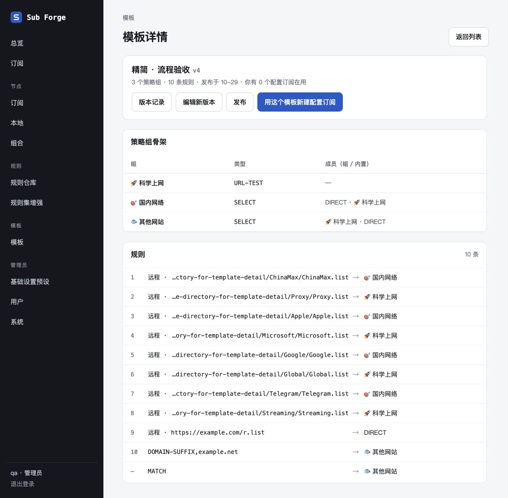
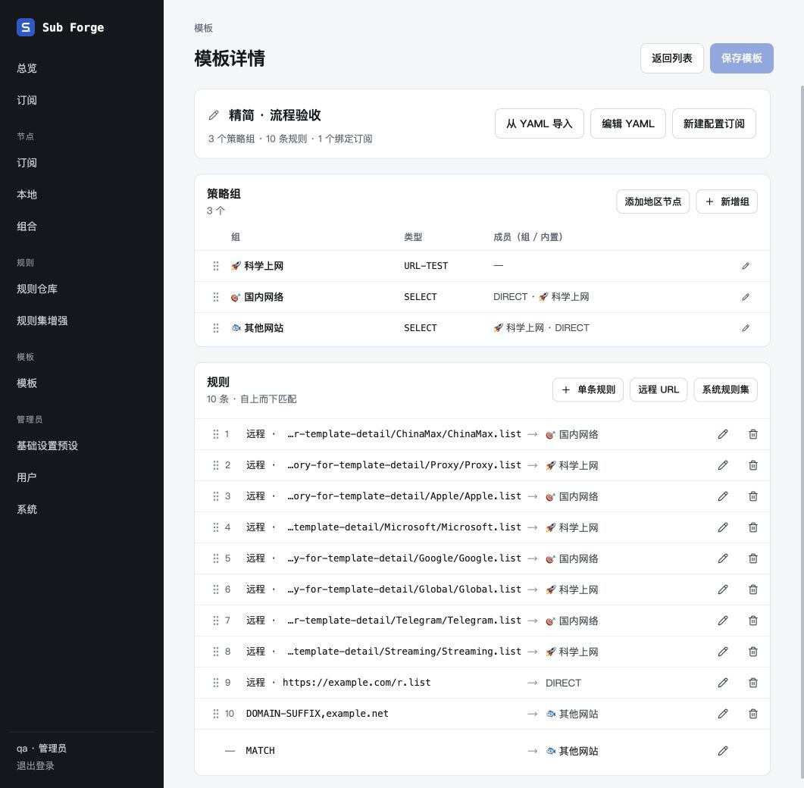
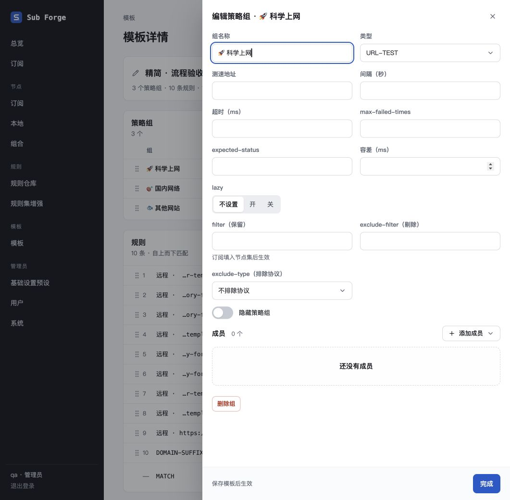
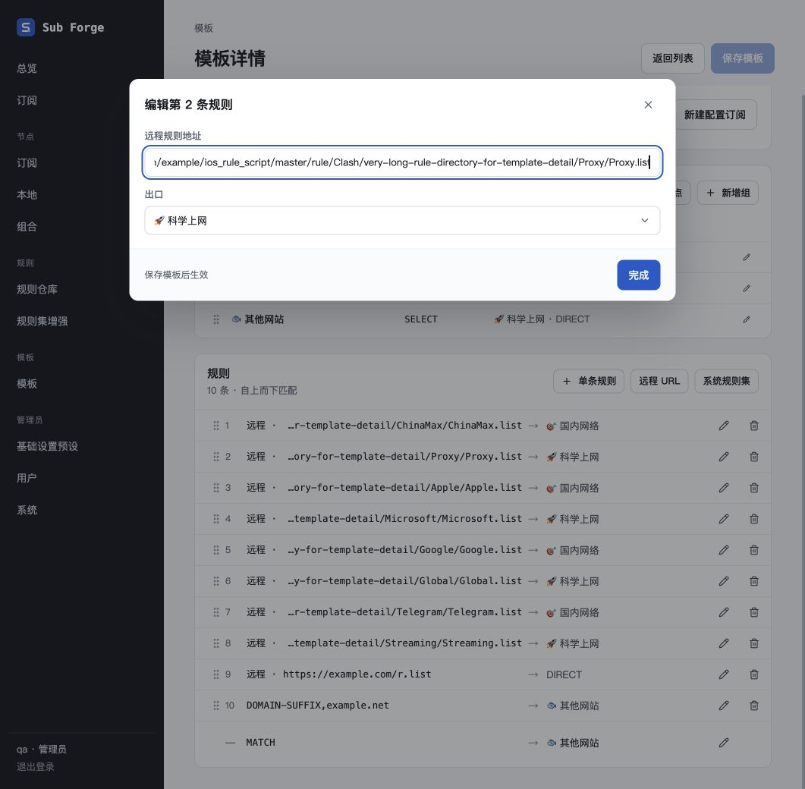
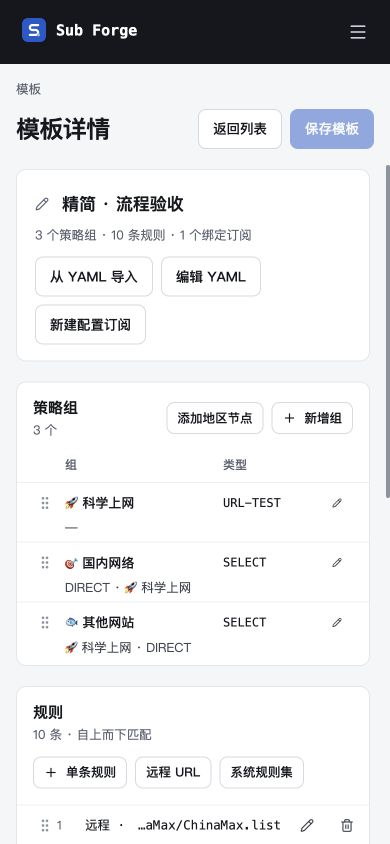
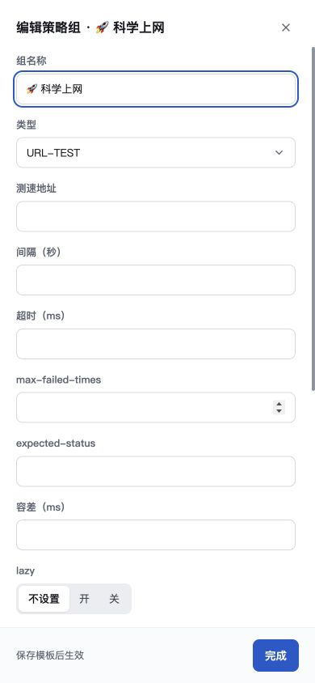
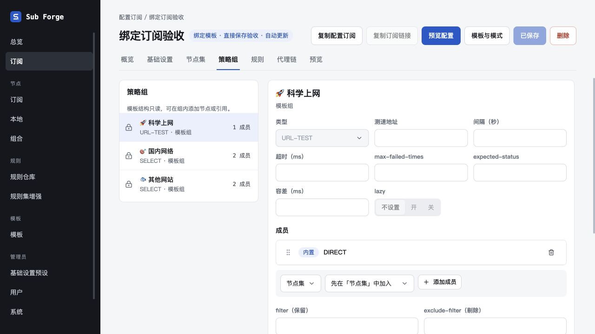

# 模板详情与编辑合并验收

日期：2026-10-29。代码分支：`codex/template-unified-editor`。

## 目标与边界

以用户选定的模板详情排版为基础，将查看、新建和编辑统一为单页。策略组在侧边抽屉编辑，规则与 MATCH 在弹窗编辑；顶部统一保存，取消模板历史、对比和发布流程。绑定订阅继续跟随模板，保存前保留影响检查。按后续用户要求，模板与订阅的并发拦截及内部修订号也已移除；订阅产物的历史资源与 last-good 回退继续保留。

## 视觉对照

参考为上一轮已验收的详情页，截图与本次桌面截图均为 **1061 × 1040**，同一浅色主题、默认滚动位置，使用相同的模板名称、3 个策略组、10 条规则及 MATCH；额外增加 1 个绑定订阅用于验证同步，因此绑定计数有意不同。新页面没有版本号、发布时间、历史和发布按钮，增加就地编辑及保存按钮，均为本次需求规定的变化。

| 参考详情页 | 合并后页面 |
| --- | --- |
|  |  |

| 检查项 | 结果 |
| --- | --- |
| 字体 | 延续现有系统字体，标题、辅助文字和等宽规则层级清晰；长名称在表格内截断，编辑时可完整读取。 |
| 布局 | 保持摘要、策略组、规则三块卡片；压缩行距，桌面能同时看到 10 条规则与 MATCH。窄屏列自动换行，390 px 视口的页面宽度也是 390 px。 |
| 颜色 | 沿用页面浅灰背景、白色卡片、细边框与蓝色主按钮；未保存与错误状态可辨认。 |
| 图像与图标 | 沿用既有 Lucide 图标和组名称中的 emoji，无新增位图资产；编辑、删除及拖拽操作各有可访问名称。 |
| 文案 | 移除面向用户的模板版本和发布概念；抽屉、弹窗明确“保存模板后生效”，YAML 明确“应用后仍需保存模板”。 |

桌面抽屉与规则弹窗：

窄屏测试使用 **390 × 844**，检查单列字段、内容滚动与固定底部操作：

## 浏览器交互

验收使用内存数据库、虚构账号与固定上游响应；没有读取或修改生产数据库。最终使用专用 `template-editor.localhost:18473`，避免其他本地应用的同名 Cookie 干扰。

- 列表点击进入统一详情；旧 `/templates/detail-demo/edit` 自动重定向到详情。
- 策略组改名在抽屉与列表即时回显，保存并刷新后保持；键盘 Space / ArrowDown / Space 可排序，反向操作能恢复顺序。
- 编辑远程 URL 时无效输入保留并显示原因，修复后可保存；长地址显示末尾，短地址完整显示。
- 新增 RAW 单条规则、修改 MATCH 出口，保存后生效；规则默认全部显示。
- 返回列表时未保存拦截有效，“保存并离开”能保存并导航，“放弃修改”不改变服务端内容。
- 删除绑定订阅仍在引用的组会得到 409 冲突，页面列出具体订阅和原因，草稿保留；无法强制覆盖。
- 新建模板直接使用同一布局。YAML 语法错误保留输入并禁用应用；合法 YAML 应用到草稿后可保存，成功进入新模板详情。
- YAML 未修改时可直接取消；修改后取消要求选择继续编辑或放弃；空导入弹窗不提前显示错误。
- MATCH 下拉选择可用；Tab 从弹窗末尾循环到关闭按钮，Escape 关闭当前弹窗。
- 手机宽度下页面无横向溢出；抽屉占满宽度、主体独立滚动、完成按钮固定可见。
- 最终桌面与窄屏操作后的浏览器 error 日志为空。

## 自动验证

- `pnpm typecheck`：core、server、web 全部通过。
- `pnpm --filter @sub-forge/web build`：通过；保留既有大包体积提示，无构建错误。
- 前端测试：30 个文件，288 通过、2 跳过；删除的 6 项只覆盖已移除的历史对比功能。
- 后端全量测试：401 通过、5 跳过，1 项原有 Git 缓存测试触发默认 5 秒超时；该文件以 `--testTimeout=20000` 单独复核，6 项全部通过。合计有效结果为 402 通过、5 跳过。
- 新增后端回归覆盖：直接创建 / 保存权限、旧草稿直接覆盖、每模板仅保留当前内容、历史接口不可用、绑定订阅同步与冲突保护、v18 升级先展开旧锁定引用再清历史、归属 / 时间 / token / 原始备份保留、重启幂等。
- `git diff --check`：通过。

未发现遗留 P0–P2 问题。验收结束停止临时服务并恢复浏览器视口，不保留后台进程。

## 后续调整：移除并发拦截

用户要求移除内部并发检查。已清理模板保存、订阅保存和绑定模式转换中的版本比较、检查期间快照比较、错误提示及前后端标记。新模板不再生成递增版本号，旧数据升级至 v20 清除并发字段。样式与截图对应的交互布局保持一致。

新增或调整接口回归：旧草稿和无版本请求成功保存；两笔模板请求同时进行时最后完成的保存生效；模板检查期间订阅保存不中断；绑定模式转换不要求版本；旧种子和 v19 数据清理字段，保留绑定、原配置、归属、时间、令牌、备份和最后成功输出。渲染缓存仍按内容变化刷新。

本次验证：core 248 通过、39 跳过；web 288 通过、2 跳过；server 全量及修正旧断言后的定向复核合计 404 通过、5 跳过。后端 Git 文件系统测试统一采用 20 秒超时。类型检查与前端构建通过。

浏览器复核（1280 × 720）：直接保存模板后，进入新建订阅及已有绑定订阅，模板名称与策略组正常读取；共享查询缓存格式一致，error 日志为空。验收使用内存库，结束后关闭临时服务。

final result: passed
