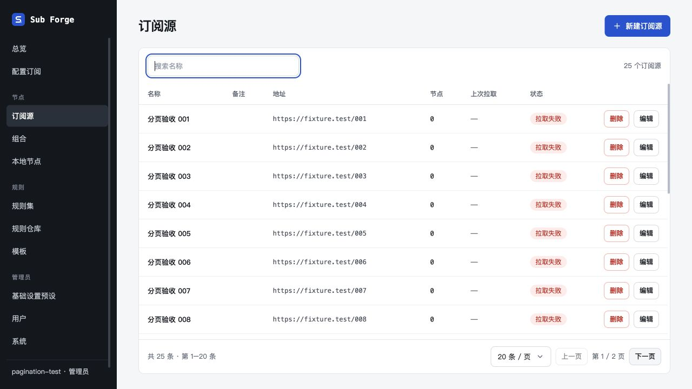
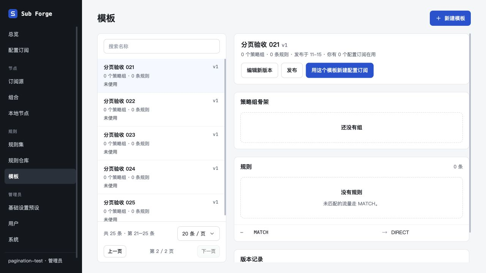
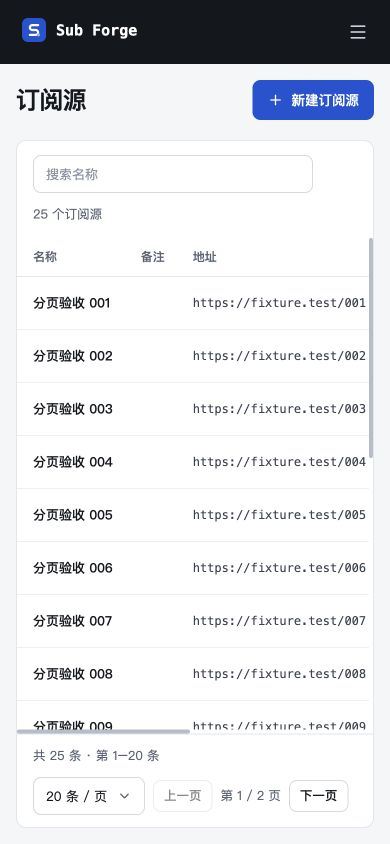
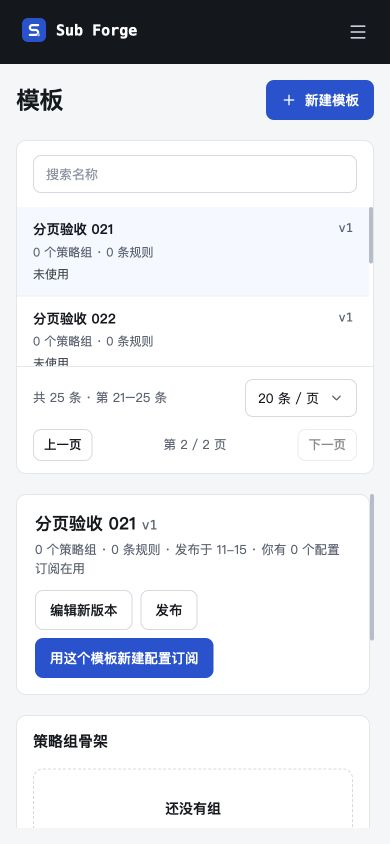

# 列表分页验收（2026-10-29）

## 范围与环境

订阅源、配置订阅、组合、本地节点、规则集、模板；基础设置预设因复用通用组件同步支持。独立 worktree `codex/list-pagination`，从 `440330e` 开始。浏览器仅使用 Codex 内置浏览器，未安装或调用 Playwright。测试服务使用内存数据库、虚构管理员及每类 25 条记录，上游为固定测试响应，未连接生产数据；订阅源截图中的拉取失败来自不含节点的测试响应。

## 自动化

- 全仓类型检查通过；前端生产构建通过（仍有单个构建块超过 500 kB 的提示）。
- 服务端：32 个文件通过、2 个文件跳过；319 项通过、5 项跳过。
- 前端：26 个文件通过；255 项通过、2 项跳过。
- 内核：12 个文件通过、3 个文件跳过；185 项通过、23 项跳过。
- 新增分页接口回归覆盖六种文档、模板最新版本去重、稳定顺序、跨页搜索、大小写及空白处理、特殊字符、无名模板、空结果、越界回退、删除回退、用户隔离、共享预设、参数校验、未登录和旧全量接口兼容。
- 跳过项均来自原测试配置，不计为通过；测试通过合计 759 项、跳过 30 项。

## 内置浏览器

- 六个指定列表逐一验证默认每页 20 条，25 条数据时下一页为第 21–25 条，页码 2 / 2，下一页禁用。
- 订阅源从第 2 页搜索 `001`，展示第 1 页的一条匹配记录；搜索无结果显示共 0 条、第 1 / 1 页，清空后恢复列表。
- 订阅源通过组件库下拉选择 10 条 / 页，范围变为第 1–10 条，总页数为 3。
- 模板翻页自动展示该页第一个模板，选择第二个模板保留第 2 页；刷新保持所选模板和页码，浏览器返回恢复第一页。
- 1280×720 桌面和 390×844 窄屏检查：列表填满剩余高度，表格内部滚动，搜索与分页器始终可见；模板双栏分别滚动，窄屏变为上下分栏。390×844 模板页面测得文档宽高为 390×844，未撑大整个页面。
- 删除末页后回退由接口自动化覆盖；本次未在浏览器操作删除、新建/编辑保存或模拟请求失败。

## 截图

## 外部画布

访问设计画布仍显示「Sign in to view this page」，未修改外部画板；交互与控件规范已追加到 [待同步清单](13-design-canvas-sync.md)。领域模型和种子格式无变更，不需要数据库迁移。

验收结束后已关闭临时服务，服务进程正常退出；未保留后台服务。

## 合并主干回归（2026-10-29）

集成 `main@d2bd01d` 的模板规则引用和布局改动，保留双方文档，解决前后端模板文件导入冲突。合并后全仓类型检查、前端构建及测试通过：内核 185 项、前端 257 项、服务端 326 项，合计 768 项通过，30 项按原配置跳过。构建仍有大包体积提示。本轮未新增浏览器测试或启动后台服务，浏览器证据沿用上次分页验收。

## 右上角总数精简（2026-10-29）

通用分页列表移除右上角总数，仅保留加载时的状态提示；底部分页器继续显示总数和当前范围。覆盖订阅源、配置订阅、组合、本地节点、规则集及基础设置预设；模板本身没有重复计数。上方历史截图中的右上角总数已不再显示。本次为文案展示调整，未重新运行浏览器验收；通过前端类型检查，并检查所有分页页面的计数位置。后端分页接口、数据模型及种子格式不变。
