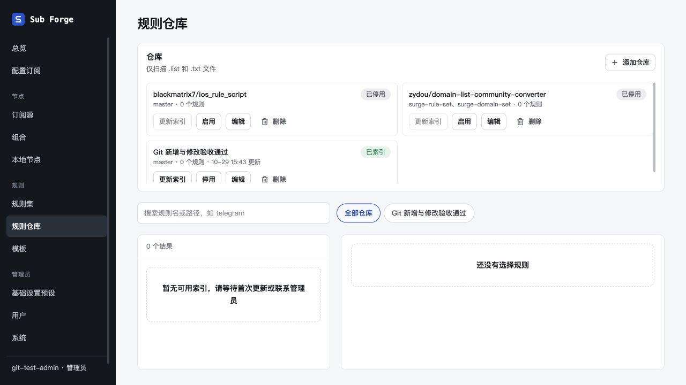
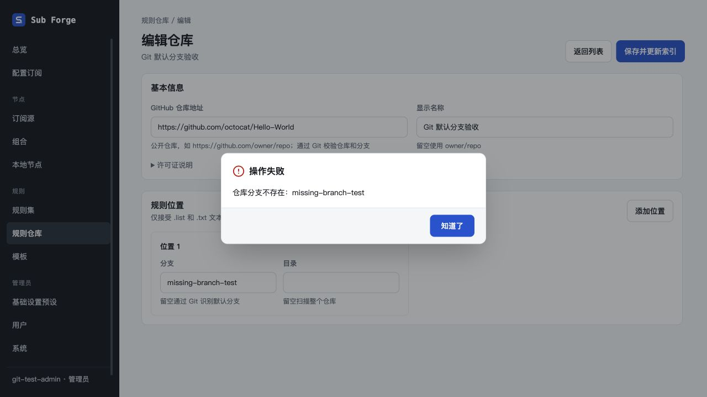
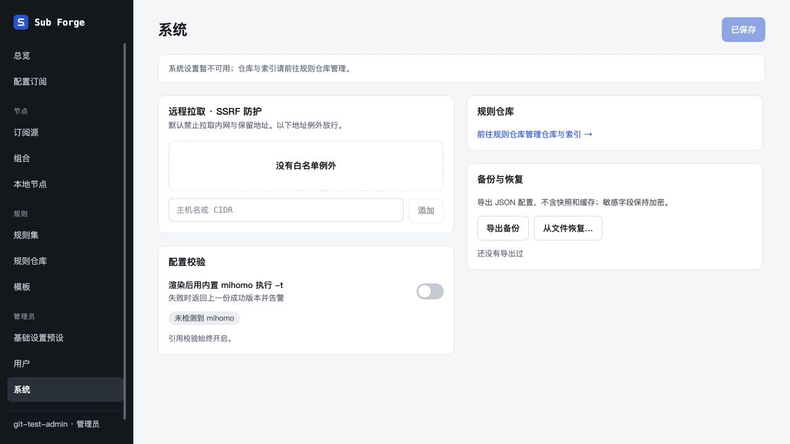

# 16 · 仓库全部使用 Git 验收

日期：2026-10-29。独立工作树 `codex/git-only-repositories`。本次移除 GitHub Token 的界面、管理接口、上游参数和存储读写；SQLite v14 清理旧凭据。新增和修改仓库均通过匿名 Git 获取默认分支并验证分支存在，索引继续使用现有 Git 缓存。

## 自动化验证

| 项目 | 结果 | 范围 |
| --- | --- | --- |
| 全仓类型检查 | passed | core、server、web；新增手动验收脚本后补跑 server |
| core 单元测试 | passed | 185 通过，23 跳过 |
| server 单元测试 | passed | 331 通过，5 跳过 |
| web 单元测试 | passed | 257 通过，2 跳过 |
| 前端构建 | passed | 既有大于 500 kB 的打包提示，不影响构建 |
| 旧 Token 接口与迁移 | passed | 管理员旧接口全部 404；v11/v12/v13 升级、重启幂等、保留文档归属、订阅令牌和未知其他凭据 |
| 真实本地 Git | passed | 远程 HEAD、切换默认分支、斜杠分支、缺失 HEAD、空仓库、访问失败；停止时回收 inspect/sync 的子进程组 |
| 新增与修改服务 | passed | Git 失败、空分支、默认/显式分支、无效更新不落库、许可证保留/手工值，无 HTTP 上游请求 |

全量 `pnpm test` 共 773 项通过、30 项跳过。跳过项未记为通过；本轮不运行需要外部 Mihomo/Docker 条件的额外验收。未安装或调用 Playwright。

## 内置浏览器验收

运行 `pnpm --filter @sub-forge/web build` 后，启动 `pnpm --filter @sub-forge/server exec tsx test/manual-git-repository-server.ts`。服务仅监听 127.0.0.1:18744，采用内存数据库、临时 Git 缓存及虚构测试账号。禁用全部 HTTP 上游请求，保留真实公开 HTTPS Git。使用 Codex 内置浏览器访问 `http://git-only.localhost:18744`。

| 场景 | 结果 | 证据 |
| --- | --- | --- |
| 仓库首页无 Token 配置入口 | passed | 首页仅有添加、编辑、启停、刷新和删除管理操作 |
| 公开仓库新增，分支留空 | passed | `octocat/Hello-World` 通过 Git 识别 `master`，最终显示「已索引」 |
| 修改为不存在分支 | passed | 弹窗「仓库分支不存在：missing-branch-test」，继续停留编辑页 |
| 修改名称并清空分支 | passed | 保存成功，重新识别 `master`，返回列表显示新名称与「已索引」 |
| 系统页无 Token 配置入口 | passed | 「规则仓库」卡片仅管理跳转链接 |
| GitHub API 零调用 | passed | 服务退出日志「验收期间 HTTP 上游请求次数：0」；生产源码无 `api.github.com` 和 Token 读取/写入引用 |
| 外部设计画布同步 | not_run | 画布要求登录；变更清单已记入 docs/13 |

测试仓库没有匹配的规则文本，因此 0 个规则是预期结果；此次真实远程浏览器验收不覆盖规则正文导入，相关逻辑由原有回归和真实本地 Git 测试覆盖。服务已正常退出（exit 0），临时缓存清理，临时页面关闭。

## 行为边界

- 仅支持可匿名访问的公开 GitHub 仓库，所有保存操作需要 Git 网络可用；不支持私有仓库凭据。
- Git 不提供平台 SPDX 分类，不自动猜测许可证；同仓库保留已有说明，新仓库默认提示参阅上游，可手工填写。
- v14 清理当前数据库旧凭据，不修改用户的离线备份。用户订阅令牌不属于本次删除范围。
- 没有新增领域模型字段，离线示例种子不包含 GitHub 服务凭据，因此无需修改种子。
