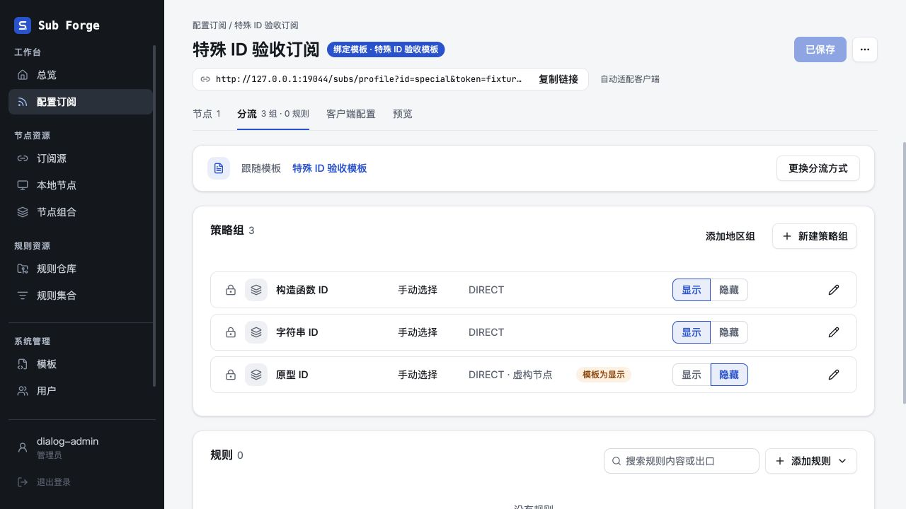
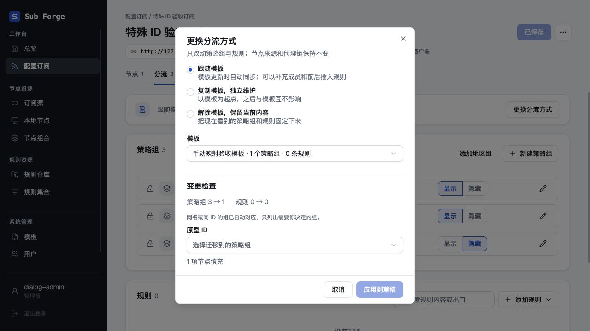
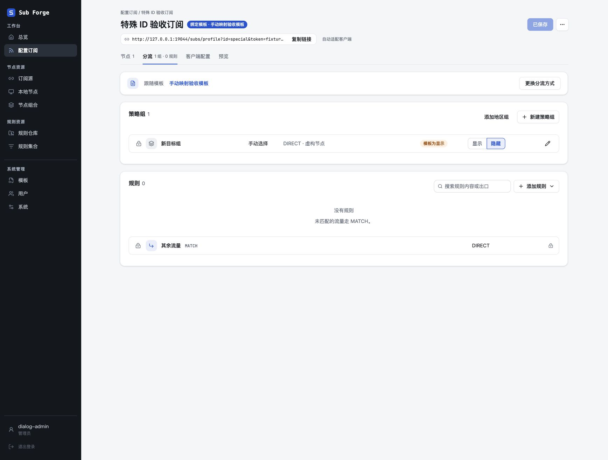

# 问题修复与设计精简复核

日期：2026-11-02。基线：`main@f660bf5`。

工作树：`.Codex/worktrees/review-fix-simplify-20261102`，分支：`codex/review-fix-simplify-20261102`。本轮在独立工作树修复和提交，未合并、未推送、未部署。现有前端布局、样式及操作流程保持不变。

## 已完成的修复和精简

| 提交 | 问题及处理 |
| --- | --- |
| `6577ccc` | `constructor`、`toString`、`__proto__` 等合法组 ID 会命中普通对象的继承属性，造成分流解析、预览、保存或迁移异常。读取追加成员统一使用只检查自身属性的领域函数；隐藏覆盖和映射同样只认自身属性；写入特殊键时避免触发原型 setter。 |
| `91c4a86` | 保存路由在 `validateDoc` 已返回规范化文档后又执行一次规则规范化，现删除该重复遍历。Store 对直接调用及旧数据的边界处理保留。 |
| `83ec733` | 前端把真实组 ID `__drop` 和“移除此组的节点填充”共用一个值，可能误删待迁移成员并漏报成员引用。内部映射改为与接口一致的 `string / null`，仅在选择控件边界给真实组值加前缀；中文文案和交互不变。 |

修复前先运行回归测试：对象原型问题在核心测试中出现 4 项失败；`__drop` 作为真实映射目标时，成员引用要求缺失，新增测试失败。修改后全部通过。没有通过禁止这些 ID 或改写已有 ID 绕过问题。

## 设计判断与后续顺序

现有 core 纯逻辑、server 存储和 I/O、web 页面草稿的分工合理。主要负担集中在少数重复处理、历史迁移分支与多次请求，没有证据支持整体重写或再增加通用工作流框架。

以下为本轮静态审查结论，除上表外尚未实施。

| 顺序 | 位置与现状 | 建议 | 必须保留的约束 |
| --- | --- | --- | --- |
| 1 | `packages/web/src/pages/profile/TemplateCard.tsx` 的复制模板流程先请求绑定，再请求独立化；服务端两次加载并校验草稿和模板。 | 给转换接口增加明确的“从模板复制为独立配置”操作，一次请求生成最终草稿，复用现有纯转换逻辑。 | 三种界面选项不变；转换仍不持久化，用户保存才写入；原成员、引用、隐藏状态和权限校验不变。不要让前端直接复制查询缓存来绕过校验。 |
| 2 | `packages/server/src/store.ts` 同时包含当前 CRUD、跨版本升级、旧种子导入；`legacyTemplateMode` 隐式改变 `getTemplate` 和模板查询读取的表。 | 把历史模板读取与迁移步骤移入明确的迁移模块，用显式历史读取函数替代类级模式开关；当前模板读取只访问 `templates`。先拆边界，再考虑局部合并步骤。 | 旧库升级、锁定版本展开、旧种子导入、原始备份、事务回滚和幂等重启必须保留；不需要新增迁移框架、仓储继承层或插件系统。 |
| 3 | `packages/server/src/resources.ts` 的刷新任务在每个资源开始前重复收集全部依赖，并在渲染前后重新收集。 | 若实测资源规模使其成为开销，可利用配置修订号，仅在配置变化时重新计算依赖集合。 | 每项归属检查、删除失效通知、异步返回后的身份检查继续保留。不能把这些一致性保护作为“重复代码”整体删除。 |
| 4 | `packages/web/src/pages/Templates.tsx` 既在渲染时计算本地问题，又在草稿变化后防抖做远端校验，保存时再做最终检查。 | 先复用本地计算结果，再把远端检查依赖缩到真正影响结构和引用的内容，避免只改管理名称也重复检查整个模板。 | 本地即时反馈与服务端最终校验职责不同，不可直接删掉一端；以请求次数和编辑响应的测量结果决定是否实施。 |

第 1 项是最直接的用户流程和网络请求简化；第 2 项是维护收益最大的结构调整。第 3、4 项尚未做性能基准，仅为可测量的优化候选，不宣称已发现线上性能瓶颈。

## 数据库及不应删除的机制

- 当前 Schema 为 v31。当前模板表只保留 `id / data / updated_at`；升级路径已删除 `template_versions` 和 `sub_tokens`。本轮没有发现需要再次变更 Schema 的确定无效业务字段，未对真实数据库执行迁移或清理。
- 旧版本结构只服务于旧库升级和旧种子转换，仍有测试和实际兼容入口；它们不是现用表重新设计失败的证据。
- `profile_migration_backups`、原始格式迁移备份和 `initializedFrom` 有恢复、追溯用途，应保留。删除这些字段会削弱用户明确要求的历史迁移能力。
- Store 的规范化和迁移保护覆盖直接写入、种子导入等绕过 API 的入口，不能因 API 已校验就删掉。
- 统一弹窗中的独立草稿、closing 阶段、一次 Promise 结算及晚响应保护对应明确需求，运行时本身较小，应继续共用，不能退回各页面维护多套 open/selected 状态。
- 上游快照、共享规则产物、`last_good` 最后成功渲染结果用途不同，不应为减少表或类而合并；权限和异步一致性检查也不能省略。

本次数据库判断基于 Schema、读写代码、全量测试和新建临时旧库升级测试，不代表再次完成所有现有数据的逐行审计，更不代表生产升级已执行。

## 自动验证

| 检查 | 结果 |
| --- | --- |
| `pnpm typecheck` | core、server、web 全部通过。最终仅修改 web 的 `__drop` 修复后，追加 web 类型检查通过。 |
| `pnpm test` | 原型 ID 修复和保存路由精简后：core 713、server 633、web 345 项通过。 |
| `pnpm --filter @sub-forge/web test` | 最终 `__drop` 修复后重新执行全部 web 测试：346 项通过，包含弹窗架构和控制器生命周期测试。 |
| 最终合计 | 1692 项通过，47 项条件跳过；新增 19 项回归。跳过项未计为通过。 |
| `pnpm --filter @sub-forge/web build` | 最终构建通过；CSS 产物仍为 `index-BT8iTH_E.css`，保留既有的大分块提示。 |
| `git diff --check` | 通过。 |

新回归覆盖创建、保存、预览、重绑、解除绑定、显式 false 隐藏覆盖、JSON 往返、v15 到 v31 升级、归属和更新时间保留、原始备份、重启幂等，以及真实 `__drop` 组的成员引用保留。

原始日志保留于工作树忽略目录 `.Codex/verification/`：`final-tests.log`、`final-web-tests.log`、`final-build.log`。没有安装或调用独立 Playwright 或 Chromium。

## 内置浏览器验收

使用 Codex 内置浏览器、`127.0.0.1:19044`、内存数据库和虚构账号、节点、令牌。真实应用接口和生产前端构建参与验收；未连接真实上游，也未运行实际代理客户端。

| 场景 | 观察结果 |
| --- | --- |
| 打开三个特殊 ID 的分流页与编辑弹窗 | 均正常显示，空追加成员仍保留模板 DIRECT。 |
| 添加成员后取消，再重开 | 新成员未进入页面草稿，仍为 1 项 DIRECT。 |
| 添加成员并保存弹窗、隐藏组、保存页面、刷新 | `__proto__` 组保留 DIRECT 和虚构节点，隐藏状态保留。 |
| Escape、关闭按钮 | 正常关闭特殊 ID 编辑弹窗，页面仍为已保存。 |
| 更换模板，未选映射 | 显示需要映射的“原型 ID”字段，应用按钮禁用；无成员和引用的其他组不产生多余字段。 |
| 手动映射到新组并保存、刷新 | 追加成员与隐藏状态保留；Mihomo 预览显示可以导入，错误和告警均为 0。 |
| 目标组 ID 为 `__drop` | 选择“新目标组”会保留成员和隐藏状态；保存刷新后仍存在。选择“移除填充”仍可提交，清空选择则恢复 placeholder 并禁用提交。 |

本轮未修改弹窗运行时。浏览器未重复执行完整的失败注入重试、嵌套弹窗、路由离开、StrictMode、无动画和逐帧退场矩阵；这些未执行项不计为通过。自动生命周期测试不能代替上述全部浏览器验收。

普通分流页和策略组弹窗使用相同虚构数据、1280 × 720 视口对照。CSS 产物摘要不变，目视未见布局、文案、间距变化。最终截图解码比较存在少量差异：页面 4777 / 921600 像素（0.52%），弹窗 1567 / 921600 像素（0.17%），因此不将最终版本记为像素完全一致。前后原图完整保留，截图本身为 JPEG，按实际格式命名。

| 视图 | 基线 | 最终构建 |
| --- | --- | --- |
| 普通分流页 | [修改前](before-routing.jpg) | [修改后](after-routing.jpg) |
| 普通策略组弹窗 | [修改前](before-modal.jpg) | [修改后](after-modal.jpg) |

临时服务及浏览器标签页均已结束，临时视口设置已恢复。没有停止其他开发服务。

