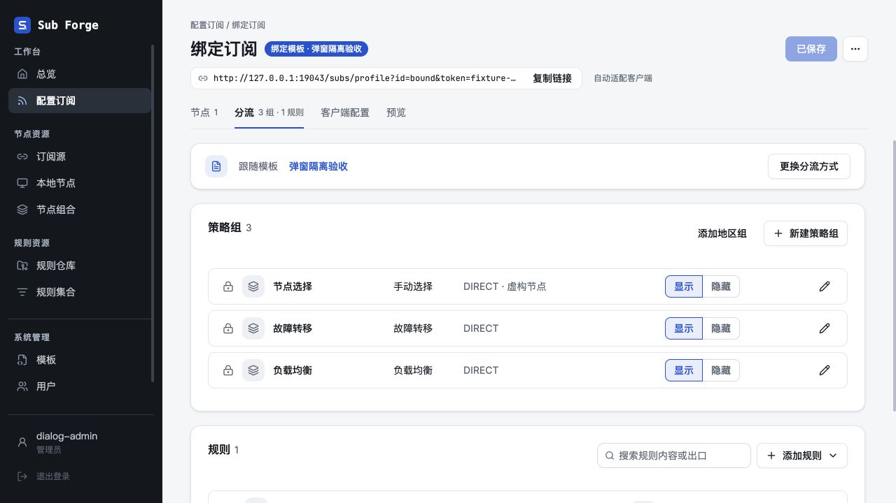
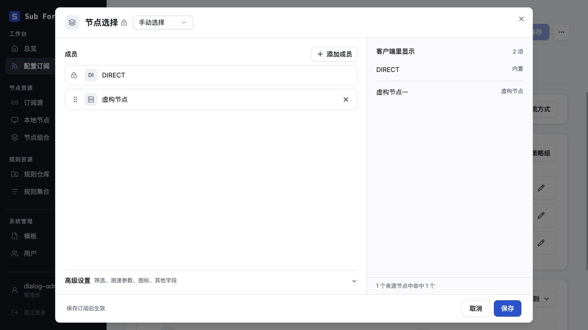
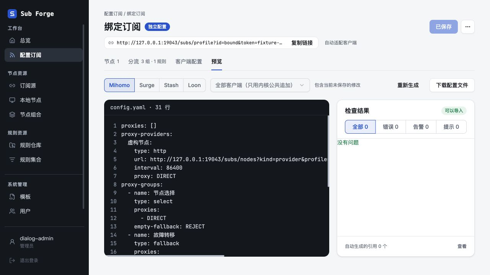
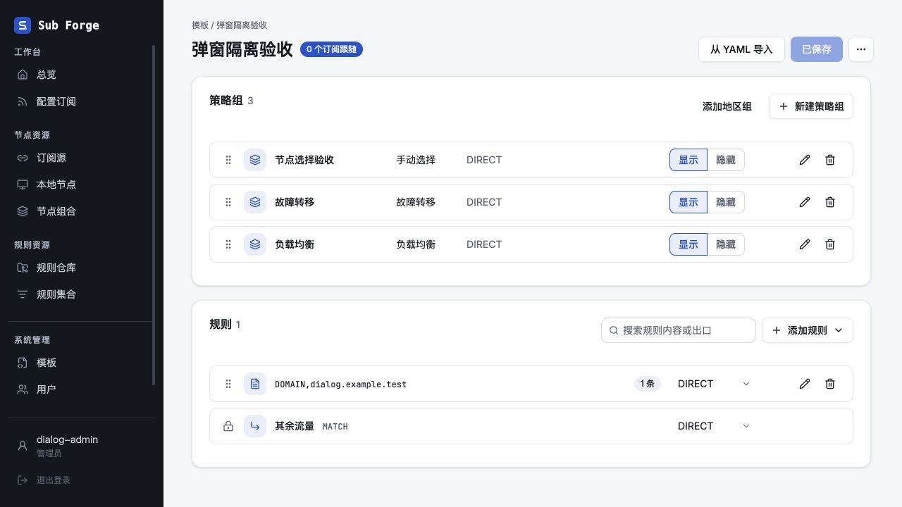

# 存储清理与当前模板迁移验收

日期：2026-11-02。

## 合并基线与范围

本会话此前的无用前端代码、后端空参数清理与 routing 统一工作，已同步最新本地主分支后合并到 `main@570e69c`。包括原提交 `87f7d38986a7b91746ae9b7cb1eb9f26a1503adc`：其验收文档经 rebase 后对应 `1416b46`，内容未丢失；`git cherry main codex/cleanup-unused-20261102` 的三个原提交均显示为已存在的等价补丁。

后续工作基于该合并点，在独立工作树 `.Codex/worktrees/routing-storage-cleanup-20261102`、分支 `codex/routing-storage-cleanup-20261102` 完成。本轮新分支仅提交，未合并、未推送、未部署，旧工作树保留。

## 完成内容

| 提交 | 变更 |
| --- | --- |
| `0674fa8` | 当前订阅 DTO 和持久化数据删除 overlay、refPolicy 等退役字段；移除前端恒等包装；清理远程来源 kind 和旧凭据表重建问题。 |
| `21f80cc` | 当前模板迁入 templates 单主键表；正常读写移除版本列、MAX 聚合与旧方法名；历史导入保留锁定版本解析。 |
| `a20290f` | 代理链诊断按绑定模板的实际分流内容刷新；资源调度直接收集模板规则依赖，不再构造旧格式订阅。 |

未调整页面结构、样式或弹窗运行时。代理链查询键修复用于避免模板内容变化后继续显示旧诊断，保留原有防抖、重试和展示交互。

SQLite v30 清理现用文档中的退役字段及 `sub_tokens`。v31 使用 `templates(id, data, updated_at)`，升级完成后不存在 `template_versions`。旧版本表只在数据库升级事务内或旧种子导入的临时表中出现，解析锁定引用后销毁。迁移失败整批回滚；原始配置备份、迁移说明、归属和更新时间保留。兼容输入类型与历史转换器继续保留，不能作为无用代码删除。

## 自动验证

在 `a20290f` 执行：

| 命令 | 结果 |
| --- | --- |
| `pnpm typecheck` | core、server、web 全部通过。 |
| `pnpm test` | core 704、web 340、server 627，共 1671 项通过，47 项条件跳过。 |
| `pnpm --filter @sub-forge/web build` | 通过；保留已有的大分块体积提示。 |
| `git diff --check` | 通过。 |

新增回归覆盖：旧库跨版本升级、新库结构与升级结果一致、重启幂等、备份及归属时间保留、API/Store 不回写旧字段、模板分页与更新时间、旧种子锁定版本展开、种子失败回滚及临时表销毁、模板规则依赖作用域与停用过滤。

代理链诊断使用真实 QueryClient/QueryObserver 和固定 HTTP 响应验证：无 version 的绑定模板成员变化会触发新请求并先隐藏旧结果；独立订阅不受模板变化影响，模板管理名称不触发诊断。此项为自动测试，未宣称通过浏览器复现完整缺陷。

另使用合并前一轮代码与本轮代码分别执行完整渲染和预览：绑定、独立、旧格式纯追加、旧格式覆盖四类输入，分别面向 Mihomo、Surge、Stash、Loon，共 `4 × 4 × 2 = 32` 组完整返回对象深比较全部一致。数据为虚构固定输入，未访问真实上游、未启动真实客户端内核。

原始日志和对照 JSON 保留在本工作树忽略目录 `.Codex/verification/`，包括 `final-typecheck.log`、`final-tests.log`、`final-build.log`、`render-before.json`、`render-after.json`。

## 开发数据库副本升级

只读打开现有开发数据库并建立一致性副本，分别使用上一轮代码与本轮代码升级后比较；没有用新 Store 打开原数据库。本次读取时原库为 v29，新副本升级到 v31，临时副本验证后清除。

结果见 [脱敏检查摘要](database-copy-audit.json)：

- 1 个订阅、2 个来源的业务数据相同，归属与更新时间相同。
- users、sessions、user_tokens、snapshots、last_good 的原始记录完全一致。
- 当前订阅退役字段和远程来源旧 kind 均为 0。
- sub_tokens、template_versions 均不存在；当前模板只有 id、data、updated_at 三列。
- 模板内容一致。凭据只在本地内存中用于解密对照，没有写入报告。

这是本地开发数据库副本验收，不代表生产数据库已升级或真实上游验收通过。

## 内置浏览器验收

使用 Codex 内置浏览器、127.0.0.1:19043、内存数据库及虚构节点/令牌。前端均使用生产构建；视觉基线为已合并前一轮分支的前端构建，之后换成本轮构建，使用相同初始数据和窗口。此视觉对照不用于证明后端基线一致性，后端一致性由上述独立对照验证。

| 场景 | 结果 |
| --- | --- |
| 订阅分流页与策略组弹窗前后对照 | 两对 PNG 分别字节完全一致。 |
| 删除追加成员后取消，再次打开 | 虚构成员仍存在，预览仍为 2 项；取消未污染外部数据。 |
| 删除成员并保存弹窗、保存页面、重载后重开 | 只保留 DIRECT，预览为 1 项；确认修改持久化。 |
| 解除模板并保留内容，保存后重载 | 独立配置保留 3 组、1 规则；Mihomo 预览无错误或告警。 |
| 模板策略组改名并保存，重载详情 | 显示“节点选择验收”与“已保存”，验证当前模板表读写。 |

截图 SHA-256：

| 对照 | 前后共同摘要 |
| --- | --- |
| before-routing.png / after-routing.png | `ecb2842818c6da7d6673b4eadfdb8c6beb3ee1ff8b0421529e7c33617e5c0108` |
| before-modal.png / after-modal.png | `8f4c9d2bb19f1650318ac2a8f450e01343f7864b59a8e1c6c90f388bb4313d3e` |

相同图片只提交一份，原始前后图片仍在本工作树 `.Codex/verification/`。本轮浏览器回归范围如上，未将未执行的额外浏览器场景记为通过。47 项条件跳过的测试未计入通过数。

临时浏览器标签页已关闭，临时服务已正常退出，19043 端口已释放；没有停止其他开发服务。

