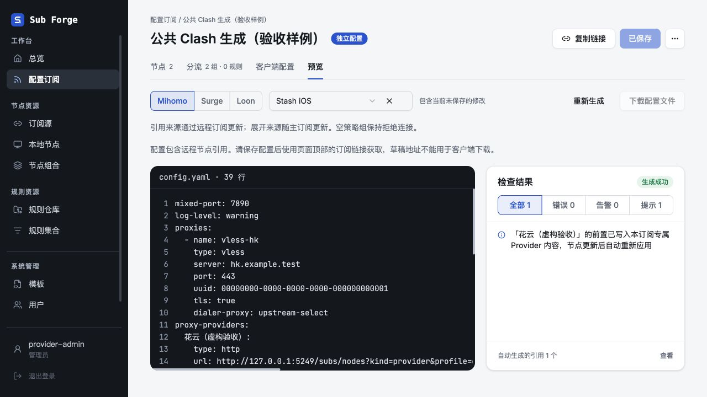

# 公共 Clash/Mihomo 生成验收

日期：2026-11-02。分支：`codex/stash-common-render`，基于 `main@d8b733e`，包含前一轮 provider 输出修复。

## 最终行为

Mihomo 和 Stash 的主订阅、草稿预览、独立节点接口统一进入 `renderClash`。没有独立的 Stash 解析器或代理链生成器；原 `renderStash` 仅为兼容入口。

- 节点来源仍遵循引用 / 展开设置。普通节点及 provider 声明共用公共结构。
- `dialer-proxy` 可引用普通策略组；精确远程节点前置使用公共隐藏组。两端前置名称、落地引用、依赖及循环校验保持一致。移除 Stash 专用的同集改写、跨 provider 拦截、网卡组合检查及相关提示。
- 不维护 Stash 节点协议、传输和扩展字段白名单。生成成功只说明已保留配置，不等于验证了客户端对所有透传字段的支持。
- 只保留 Hysteria 字段别名 / 单位、测速参数、空集合保护和规则方言差异。动态成员先按公共 Clash 表达构造，需要托管筛选保护时再展开，防止空组直连。扩展 `include-all*` 同样经过保护。
- 修复 Stash `block-quic: off` 被删除、结构化 `URL-REGEX` 被丢弃及 Stash Hysteria2 输入转 Mihomo 缺少字段归一化的问题。
- 基础配置继续继承 Mihomo 公共内容。旧 Stash 专用生成缓存不能作为失败回退。

## 自动检查

| 检查 | 结果 |
| --- | --- |
| `SURGE_BIN=/Applications/Surge.app/Contents/Applications/surge-cli pnpm -r test` | core 760、server 661、web 351 项通过，合计 1772 项通过、46 项按环境条件跳过 |
| `pnpm -r typecheck` | 通过 |
| `pnpm --filter @sub-forge/web build` | 通过，保留既有大包体积提示 |
| `git diff --check` | 通过 |

新增对照用例覆盖：普通策略组与隐藏组前置，各自搭配前置 / 落地引用或展开的四种组合；两个客户端实际节点字段、依赖记录及前置名称对照；循环检查；provider 声明共用；Hysteria2 YAML 导入后的双向输出与别名冲突；`block-quic: off`；扩展动态成员筛空；测速覆盖及零值。接口测试验证正式节点资源中的策略组前置和旧缓存拒绝回退。

## 内置浏览器

仅使用 Codex 内置浏览器，访问本地隔离服务。服务使用内存数据库、虚构节点与固定虚构上游，未读取真实生产配置或请求真实机场。

复现：构建 web 后，在 server 包目录运行 `pnpm exec tsx test/manual-clash-common-server.ts`。预置内联 `vless-hk` 和引用来源中的日本节点，二者均以 `upstream-select` 策略组为前置；该组包含精确远程节点隐藏引用及 DIRECT。

已验证：

1. 节点页显示两条有效代理链，各命中一个落地节点。
2. Mihomo 预览保留 `dialer-proxy: upstream-select`，provider 引用正常。
3. 在同一 Mihomo 分组选择 Stash iOS，仍保留同一 `dialer-proxy`；继承 `mixed-port: 7890` 并应用 Stash 的 `log-level: warning`。
4. Stash 显示零错误、零告警，仅有公共的 provider 前置写入提示；隐藏引用组保留，含远程节点的草稿下载禁用。

截图全部为虚构验收数据。未执行真实 Stash 客户端导入、代理转发或设备端动态切换；这些不计入通过项。本次未合并、推送或部署。临时服务已停止，并确认 5249 端口无监听、验收脚本无残留进程；用户原有服务未改动。
