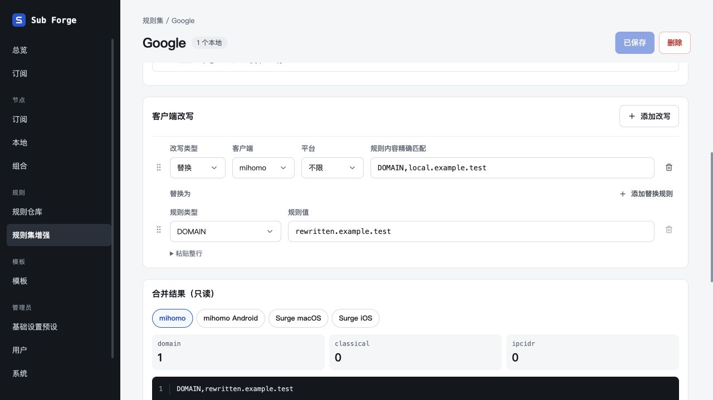
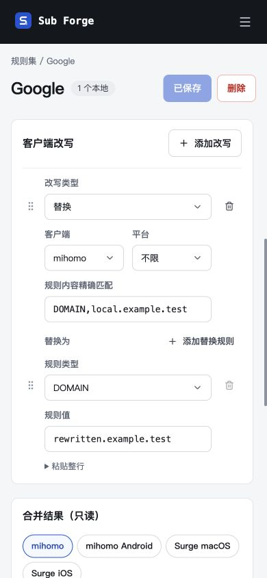

# 客户端改写 Select 与间距验收

日期：2026-10-29。

- 改写类型使用公共 Select，下拉选择替换、丢弃或追加。
- 宽屏将改写类型、客户端、平台、匹配内容排在同一行，标签与控件统一对齐；删除位于行尾，移除多余序号。
- 窄屏改写类型独占一行，客户端与平台并排，匹配内容另起一行；目标规则标题与输入左对齐。
- 主间距为 12 px，目标规则标题与表单间距为 8 px，收紧底部留白；不改变数据结构与执行语义。

## 已验证

- 前端类型检查与生产构建通过，保留原有大于 500 kB 的产物提示。
- 前端测试 268 项通过，2 项原有跳过。
- 内置浏览器在隔离内存数据库中验证 Select 三种类型切换、对应字段显隐、预览更新及保存重载；未访问生产数据。
- 桌面与 390 × 844 窄屏均完成截图检查，字段正常换行，控件未裁切。
- 已恢复视口、关闭测试页面并停止临时服务，5186 端口不再监听。
- 设计稿同步沿用现有待登录事项，本轮布局已登记到 docs/13-design-canvas-sync.md。

