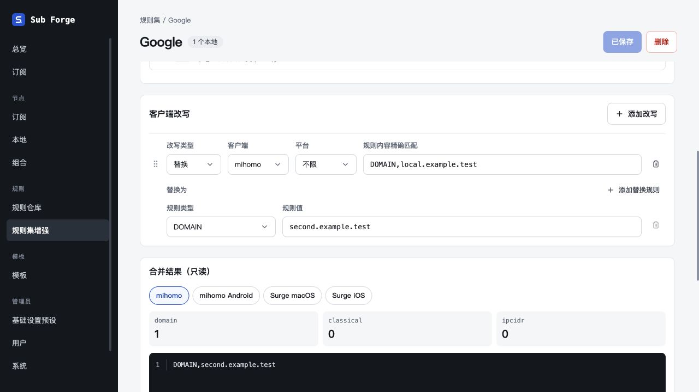

# 客户端改写单一排序入口验收

日期：2026-10-29。

- 客户端改写不再显示「粘贴整行」入口，直接填写规则类型和值。
- 仅保留整条改写的排序，移除内部替换 / 追加规则的排序手柄；目标规则仍支持增删，按添加顺序排列。
- 目标字段与上方条件保持左对齐；保存格式和后端执行逻辑不变。

## 验证

- 前端类型检查、生产构建通过；268 项前端测试通过，2 项原有跳过。构建保留原有大于 500 kB 的产物提示。
- 内置浏览器通过隔离内存数据库验证：新增改写时仅有一个排序手柄，无粘贴整行入口；添加两条替换规则、删除首条、保存重载后保留正确值，预览输出正确。
- 临时验收页面已关闭，服务已停止，5186 端口无监听。
- 设计画布沿用待登录同步事项，已更新仓库待同步清单。

