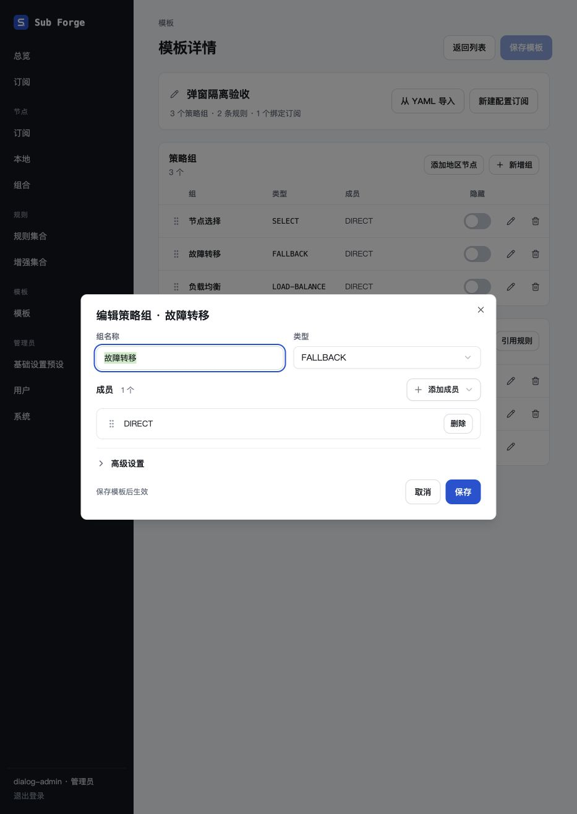
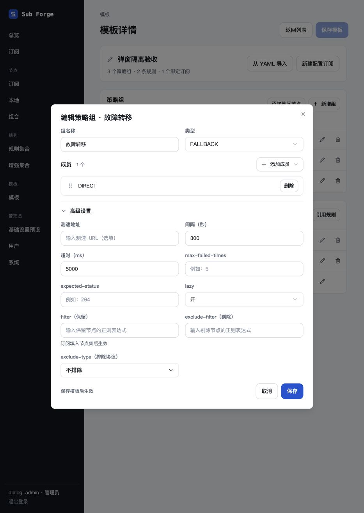

# 弹窗独立草稿验收（2026-10-30）

## 范围与环境

- 分支：`codex/group-dialog-settings`，基于 `b55362d`，在 `.Codex/worktrees/group-dialog-settings` 内修改。
- 全局检索 `Dialog`、`AlertDialog`、`Modal`、`Sheet`、`role="dialog"` 及通用弹窗调用点，核对草稿初始化、嵌套字段、保存、取消、异步结果和退场内容。
- 浏览器仅使用 Codex 内置 `@Browser`。未安装或调用独立 Playwright、Chromium 或用户日常浏览器。
- 使用 `packages/server/test/manual-dialog-draft-server.ts` 提供内存数据库、虚构管理员、模板、独立/绑定订阅、本地节点和规则集合；页面使用本次生产构建。未连接正式数据库，未修改真实订阅。
- 测试入口为 `http://dialog-draft.localhost:18643`，避免与其他本地服务共用主机 Cookie。测试账号及密码仅为脚本内公开的虚构夹具。

## 全局审计

| 入口 | 数据边界与修复 |
|---|---|
| 模板/订阅策略组 | 打开深拷贝；成员、筛选、测速、图标及扩展字段只更新弹窗；保存才替换目标组。新增组保存前不插入列表。 |
| 绑定订阅节点填充 | 独立复制当前组的 additions；成员添加、移除和排序保存后一次同步。 |
| 静态规则、前置规则、MATCH | 本地复制规则及出口；客户端覆盖和关联仓库操作只改草稿；保存合并当前项，取消不改外部。 |
| 引用规则、远程链接 | 先选择/解析到本地草稿，点击保存才添加引用。异步选择捕获所属会话，旧结果不能覆盖新会话。 |
| 模板关联 | 关联模板读取完成后创建快照；检查转换只产生待保存结果，空订阅也不自动应用。取消/重开重置选择、映射及转换结果。 |
| 代理链 | 复制链规则与嵌套节点引用；保存时再次复制到页面。关闭不清空退场表单。 |
| 模板 YAML、本地节点分组 YAML | 文本与开关分离，保存解析副本到页面；关闭保留文本。模板保留原有“放弃导入”确认流程。 |
| 重命名、节点集多选 | 名称/勾选为独立状态，节点引用及提交结果深拷贝，保存才调用外部回调。 |
| 新建订阅源、创建用户、共享、密码重置、新增订阅链接 | 表单独立且重开初始化；原有明确的创建/共享/重置按钮负责提交。保留关闭内容及密码重置标题。 |
| 通用新建、旧版额外规则弹窗 | 原有本地草稿及明确提交边界继续保留；额外规则嵌套选择与提交补充深拷贝。 |
| 规则预览、仓库文件预览、错误提示 | 保留所选内容/消息快照，关闭不先清空。仓库文件的创建操作仍仅在明确点击创建时执行。 |
| 删除、离开页面、恢复备份、重置链接确认 | 没有可编辑业务草稿，仅在明确确认时执行既有操作；未改其业务权限和接口。 |

统一规则已写入根目录 `AGENTS.md`，`CLAUDE.md` 引用该规则；需求、前端说明及设计覆盖文档同步更新。外部 Claude Design 画布本轮未编辑，已登记到 `docs/13-design-canvas-sync.md`。领域模型、正式示例种子和业务服务端接口无需迁移。

## 自动验证

- `pnpm typecheck`：core、server、web 全部通过。
- `pnpm --filter @sub-forge/web build`：通过，保留既有的大于 500 kB 构建分块提示。
- `pnpm --filter @sub-forge/web test`：34 个文件通过，301 项通过、2 项原有跳过。
- 新增 5 项状态转换回归：嵌套独立、外部刷新不覆盖与重开重置、切换对象、拒绝旧异步结果、连续更新与提交副本独立。
- `git diff --check`：通过。

## 内置浏览器实测

| 场景 | 结果 |
|---|---|
| 策略组首次打开、重开 | 只默认展示名称、类型、成员；高级设置均收起。展开后显示原 interval=300、timeout=5000、lazy=开。 |
| 策略组输入及取消 | 改名称、间隔时外部列表不变；取消后重开恢复原值。 |
| 策略组保存 | 改名称、移除成员后点击保存，列表才更新，并出现页面未保存状态。 |
| 新增策略组 | 弹窗内编辑期间列表仍为 3 组；Escape 关闭后仍为 3 组。 |
| 静态规则关闭/保存 | 编辑匹配内容及出口期间外部不变；右上角关闭后恢复；保存后才更新列表。 |
| 新增静态规则 | 保存前列表数量不变，取消不残留新规则。 |
| MATCH 遮罩关闭 | 改为 REJECT 后点击遮罩，重开仍为 DIRECT。 |
| 引用规则 | 未选择时保存禁用；选择虚构规则集后外部仍 1 条，保存后变 2 条；保存模板并刷新后仍为 2 条。 |
| 绑定订阅填充 | 添加节点期间外部仍无修改；取消重开为空；保存后外部摘要新增虚构节点并标记未保存。 |
| 独立订阅策略组 | 高级选项默认隐藏；改图标、间隔和成员期间外部仍无修改，取消后仍为已保存。 |
| 模板关联 | 检查变更后外部仍为独立配置且无修改；保存才变成绑定并标记未保存。取消并重开不保留模板选择或检查结果；最后构建再次验证该取消路径。 |
| 代理链 | 输入筛选再取消，外部无新增链，重开筛选为空；保存后才出现链规则和未保存状态。 |

截图来自最终构建：

## 验证边界

- 关闭期间不清空草稿由状态转换测试和实现检查覆盖；普通浏览器交互已完成。逐帧高度采样未执行成功：内置浏览器只读执行环境不提供 `requestAnimationFrame`，原始 CDP 调用被独立权限检查拒绝。用户授予文件/命令权限后重试仍被拒绝，未绕过限制或换用其他浏览器，不能据此宣称逐帧动画验收通过。
- 远程仓库解析及上游网络失败未做真实网络端到端验收；夹具禁止访问上游。旧会话结果隔离通过单元测试和回调归属审查覆盖。
- 用户管理、密码/令牌写入、所有删除/恢复确认、YAML 导入及全部通用新建入口本轮做源码审计，未逐一进行浏览器写入验收；未修改真实账户。
- 未执行移动端视口验收或真实生产环境验证。

## 重复验收

在工作树中先构建前端，再运行 `pnpm --filter @sub-forge/server exec tsx test/manual-dialog-draft-server.ts`，使用内置浏览器打开上述地址。测试数据退出即丢弃，结束后向本次服务发送 SIGTERM 并确认 18643 端口已释放。

本次验收服务已正常退出（退出码 0），已确认 18643 无监听，本次浏览器标签页已关闭；未停止其他开发服务。
