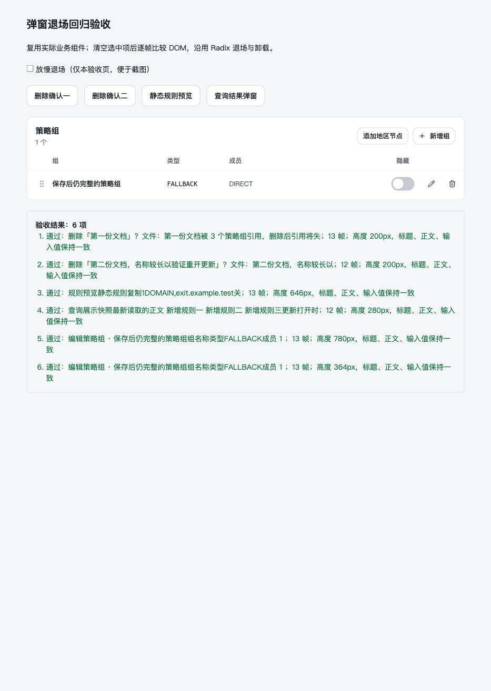
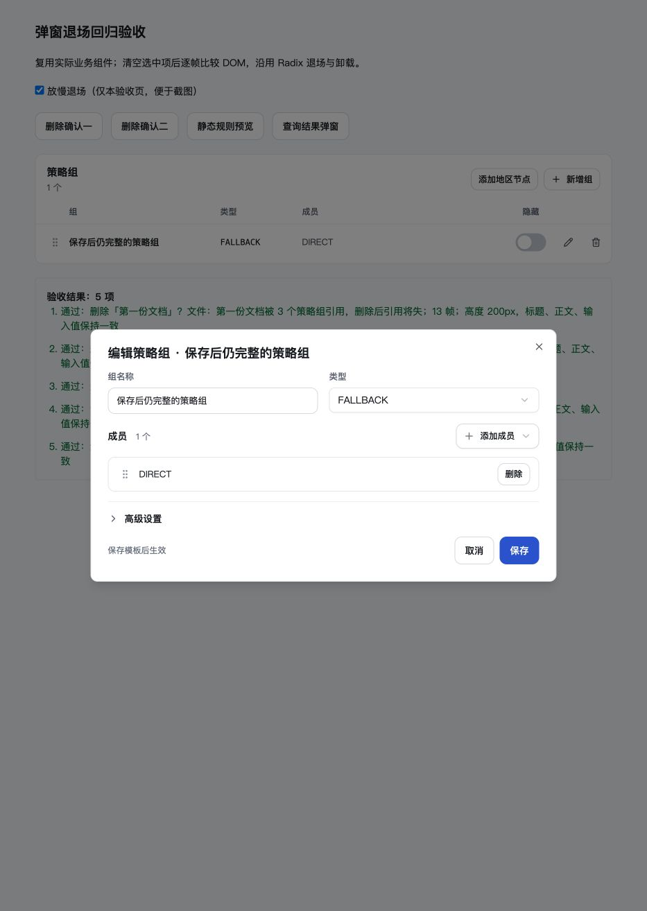

# 全局弹窗退场复查（2026-10-30）

本轮在 `codex/group-dialog-settings` 工作树继续修复，前序提交为 `8fe811e`。本记录独立于前序验收记录，未改写其历史结论。

## 发现与修复

上一轮的 `useDialogDraft` 已保护编辑草稿，但确认及预览弹窗仍有展示层遗漏：

| 入口 | 原因与本轮处理 |
|---|---|
| 通用删除确认 | 关闭清空被删对象后，标题退回空名称、引用说明消失；统一保留最后可见的标题、正文和状态，覆盖文档列表、详情、节点、策略组及订阅链接。移除按 `open` 卸载提示的写法。 |
| 链接重置 | `resetting` 清空使标题变为“未命名设备”；保留标题及提交状态。 |
| 备份恢复 | `restoreFile` 清空使文件名整行消失；保留文件名及提交状态，不复制文件对象。 |
| 离开确认 | 保存/放弃后页面草稿与校验改变，使说明或按钮变化；保留最后展示的说明、校验和提交状态。 |
| 远程规则选择、规则编辑的仓库匹配提示 | 关闭时查询参数清空，匹配卡片会同步消失；关闭后保留最后展示的查询结果。 |
| 规则源预览、仓库文件预览 | 关闭/禁用查询或索引更新可能把正文变为加载态/错误；保留查询展示及仓库名称。 |
| 策略组编辑 | 已有独立组草稿继续保留；补充保留退场校验说明，避免外部保存改变布局。 |

新增 `useDialogPresentation`：打开时使用当前展示，关闭时保留最后一次已提交渲染的展示。它不替代可编辑草稿，不参与提交，不缓存 DOM 或整个交互子树，也不增加动画计时器。容器继续由 Radix 完成退场后卸载。

全局复查了 `Dialog`、`AlertDialog`、`Modal` 和通用调用点。其他编辑/新建弹窗（组、规则、MATCH、节点填充、模板关联、代理链、YAML、重命名、节点集多选、用户及共享表单、订阅源和订阅链接）已有独立状态或仅在打开时初始化，关闭不再清空可见内容；错误提示也已保留消息快照。未发现按选中项条件卸载整个弹窗容器的调用点。

规范已补充到根目录 `AGENTS.md` 的“所有弹窗的退场生命周期”，`CLAUDE.md` 和前端 README 同步引用；需求、设计覆盖和外部画布待同步说明已更新。业务 API、模型、正式种子无变动。

## 自动验证

- `pnpm typecheck`：core、server、web 通过，前端类型检查包含新验收页源码。
- `pnpm --filter @sub-forge/web test`：34 文件通过，301 项通过、2 项原有跳过。
- `pnpm --filter @sub-forge/web build`：通过，保留原有大分块提示。
- `git diff --check`：通过。

## 浏览器逐帧验证

仅使用 Codex 内置浏览器，入口为 `http://127.0.0.1:18644/test/dialog-exit.html`。验收页复用实际 `DeleteDialog`、`TemplateGroupsEditor` 和 `RuleSourcePreview`，查询案例复用新的展示保留 Hook；不连接业务后端，不改真实数据。

验收页在关闭前记录标题、正文、输入值和 `offsetHeight`，收到实际组件的退场动画事件后，通过页面自身的逐帧采样持续比较至 Radix 卸载。高度使用布局值，排除预期缩放 transform。没有调用原始 CDP，没有安装或调用独立 Playwright/浏览器。

覆盖以下六个场景，原始结果见 `results.txt` 和 `results.png`：

1. 删除确认点击取消，关闭时清空选中对象及条件正文。
2. 删除确认重开另一对象，确认名称立即更新，Escape 关闭。
3. 静态规则预览点击右上角关闭，清空所选规则。
4. 查询弹窗打开时更新正文，关闭时清空查询结果，退场保留最新正文。
5. 策略组展开高级设置并修改名称，点击保存更新外部并清空选择。
6. 策略组重开后高级设置默认收起，通过遮罩关闭。

另保存了仅在验收页放慢退场后的截图 `group-closing.png`：读取时已确认 `data-state="closed"`，标题、类型、成员、表单与页脚仍在。正常速度的连续性以逐帧结果为准。

## 边界与复现

- 逐帧验收覆盖实际编辑、通用确认、只读预览和查询展示模式；备份恢复、密码/令牌写入、真实仓库网络请求未执行实际业务提交，其调用点经过源码复查。
- 生产动画和样式没有改动；放慢退场仅属于验收页的可选操作。
- 复现命令：`pnpm --filter @sub-forge/web exec vite --host 127.0.0.1 --port 18644 --strictPort`。在内置浏览器打开验收页后依次执行上述关闭路径，检查每条结果均为“通过”。
- 不要在采样过程中修改工作树文件：Vite 热更新可能重载验收页，清空尚未保存的结果。
- 最终六项均通过，各记录 12–13 帧；高度分别为 200、200、646、280、780、364 px，退场期间均保持不变。验收标签页已关闭，本次 Vite 服务已停止，确认 18644 无监听。
