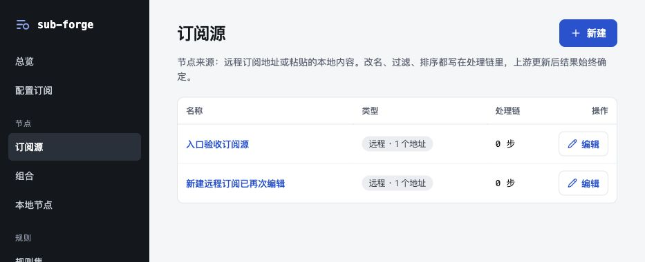

# 列表编辑入口验收（2026-10-29）

## 问题与修复

基线为 `main@0ad35de`。订阅源列表只有名称文字可以进入详情，文字样式近似普通文本；点击类型、处理链或行内空白没有反应，也没有明确的编辑按钮。内置浏览器已复现：点击类型区域页面不变，点击名称可以进入原有编辑页。

同类入口存在于通用列表的订阅源、组合、本地节点、规则集、规则包、配置订阅、基础设置预设，以及独立实现的模板列表、总览中的两张文档表格。

- 通用列表和总览新增“操作 / 编辑”，模板列表新增“操作 / 查看详情”；模板编辑仍由详情中的管理员“编辑新版本”入口进入。
- 名称使用明显的链接颜色，支持键盘焦点提示。
- 鼠标点击行内非交互区域也能进入详情；名称、操作链接保留原生链接行为，选择文字和点击嵌套控件不会触发行跳转。
- 用户管理已有明确操作按钮，本次只读检查未发现相同入口问题。

## 浏览器验收

仅使用 Codex 内置浏览器及其原生辅助功能接口。独立服务监听 `127.0.0.1:18870`，使用真实应用 API、内存数据库及虚构上游返回值；没有修改已有 `8080` 服务、用户数据库或真实订阅。浏览器载入工作树生产构建，构建更新后重新加载。

| 场景 | 结果 |
| --- | --- |
| 远程订阅源：新建 → 返回列表 → 编辑按钮 → 修改名称、地址 → 保存 → 刷新 | 通过 |
| 订阅源：点击类型区域进入对应编辑页 | 通过 |
| 普通用户本地订阅源：新建 → 返回列表 → 再次编辑 → 保存 → 刷新 | 通过 |
| 组合、本地节点、规则集、规则包、配置订阅、预设：列表编辑 → 改名保存 → 重新打开并刷新 | 六类均通过 |
| 模板：查看详情 → 管理员编辑新版本 → 发布 v2 → 刷新 | 通过 |
| 总览：配置订阅、订阅源的编辑入口 | 均通过 |
| 编辑链接键盘回车进入详情 | 通过 |
| 普通用户查看模板，无模板编辑及管理员菜单 | 通过 |
| 用户管理现有重置密码、禁用按钮 | 只读检查通过，未执行账户修改 |

[浏览器断言记录](browser-checks.json)

## 自动检查与边界

- `pnpm test`：295 项通过、22 项跳过。内核 54 通过 / 17 跳过，服务端 88 通过 / 3 跳过，前端 153 通过 / 2 跳过。跳过项为原有条件控制的 mihomo 外部内核测试和缺少协议样例的覆盖测试，没有记为通过。
- `pnpm typecheck`：全部通过。
- `pnpm --filter @sub-forge/web build`：通过。保留已有的单个构建产物超过 500 kB 提示。
- `git diff --check`：通过。
- 依赖以 `pnpm install --offline --frozen-lockfile` 安装，锁文件未变。锁文件中的 Playwright 名称仅为 Vitest 未安装的可选 peer 声明，本次未安装、启动或调用 Playwright、其他浏览器或浏览器运行时副本。
- 本次覆盖列表进入详情与再次编辑保存流程，未做全部业务功能或真实上游、mihomo 客户端验收。
- 临时浏览器标签已关闭，隔离服务收到 SIGTERM 后正常退出；工作树保留，等待用户决定合并。

## 合入 main 后的复验

用户授权合并后，在原修复工作树合入 `main@f0bedc8`，解决四个文件的冲突：`.gitignore` 保留 main 的 `.claude`、`.Codex` 忽略规则；通用列表、模板保留 main 的 `cx()` 写法；总览保留 main 的副标题及配置订阅、待处理布局，再加入编辑按钮和整行导航。

- `pnpm test`：298 项通过、22 项原有条件跳过（内核 54、服务端 88、前端 156 项通过）。
- `pnpm typecheck`、前端生产构建、暂存差异空白检查通过。
- 内置浏览器使用合并后的生产构建，复验订阅源整行点击、新建后再次编辑、保存刷新，模板详情及管理员编辑模式，总览两个编辑入口，全部通过。
- 独立内存数据库、虚构上游；未修改现有服务和真实订阅。临时标签关闭，验收进程正常退出。

[合并浏览器记录](merge-browser-checks.json) · [合并后的总览截图](merge-overview.png)
