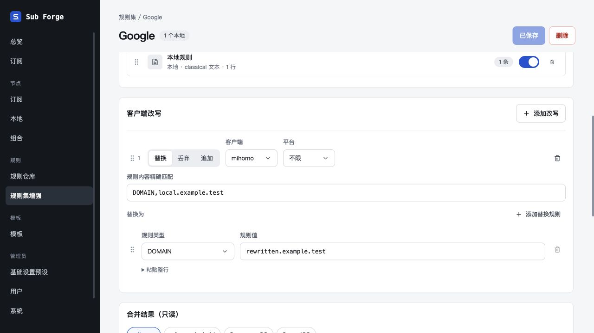
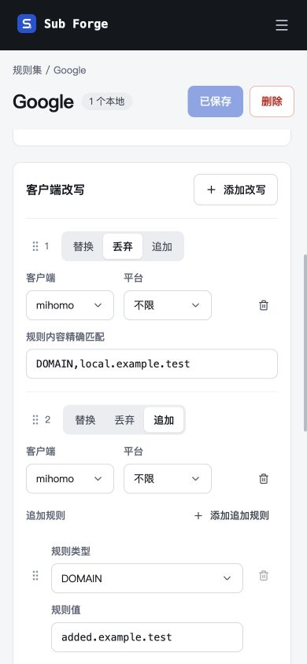

# 客户端改写扁平化验收

日期：2026-10-29。

- 仅保留区块外框，改写使用分隔线；目标规则不再嵌套卡片。
- 条件工具栏集中展示操作方式、客户端、平台、顺序与删除；宽屏类型和值并排，窄屏换行。
- 整行解析默认收起；进程匹配选项、IP no-resolve、增删及排序保留；每条改写仅显示一次校验提示。
- 数据模型、保存格式、后端校验、改写执行与预览接口不变，无迁移或种子变更。

## 验证结果

- 全仓类型检查通过；前端测试 268 项通过、2 项原有跳过；前端生产构建通过，保留原有产物大于 500 kB 的提示。
- Codex 内置浏览器使用 127.0.0.1:5186 隔离内存数据库与固定上游验收，未操作生产数据。
- 已验证替换更新预览、丢弃隐藏目标编辑且移除输出、追加隐藏匹配且新增输出、平台选择、多目标规则增删、键盘排序、保存重载保持顺序、移除全部改写恢复空态。
- 已验证整行解析 DOMAIN / PROCESS-NAME / IP-CIDR 与 no-resolve，进程规则类型和值并排，进程匹配选项可见；空匹配与未填写规则时仅有一处就地提示。
- 390 × 844 窄屏下条件、规则字段正常换行，控件未被裁切。
- AND 整行输入仍由现有解析器拒绝，提示「逻辑规则暂不支持（RS-04，P1）」；未将此项计为通过，也未扩大本次展示重构范围。
- 验收过程中临时会话曾失效，重新登录后保存与预览恢复；未修改认证实现。
- Claude Design 画布显示「Sign in to view this page」，外部画板未同步，已登记到 docs/13-design-canvas-sync.md。
- 临时服务已停止，验收页面已关闭。

