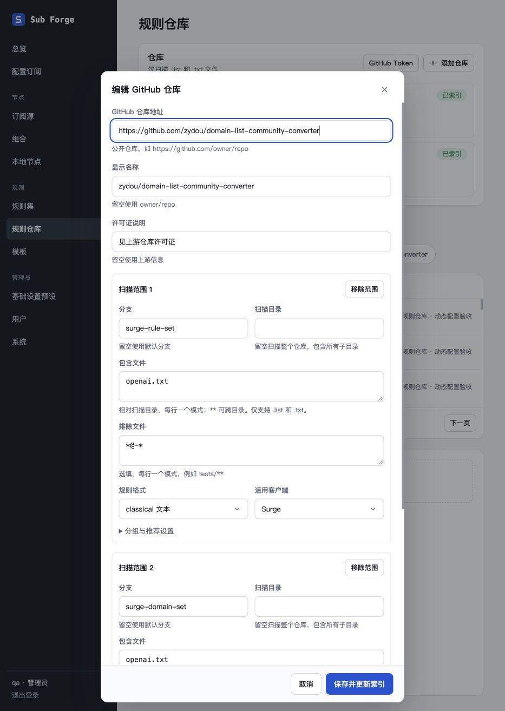
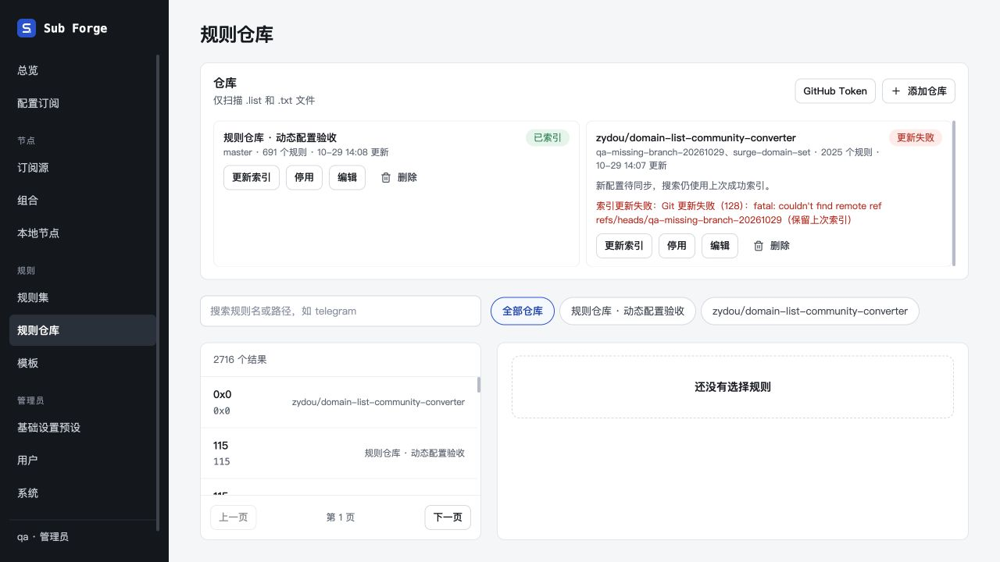
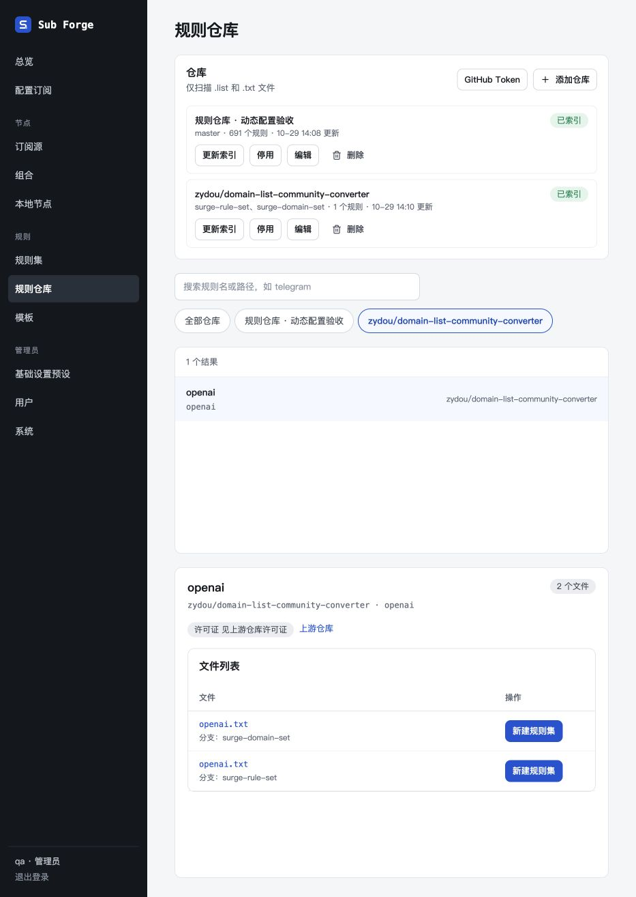
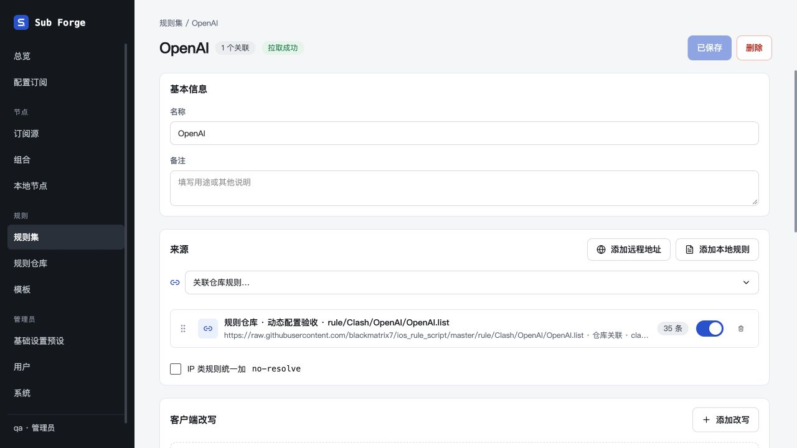

# Git 缓存与动态仓库验收（2026-10-29）

## 范围与环境

- 分支：`codex/git-repo-cache`；后端实现 `e4d3165`、补充边界修复 `c81dbae`、界面 `b67eea5`。
- 独立 worktree、独立 SQLite 数据库、专用 Git 缓存；未访问或修改用户实际部署数据。
- Node 22.17.0，使用已锁定依赖；没有安装或运行 Playwright、额外浏览器或浏览器测试运行时。
- 所有浏览器操作和截图均使用 Codex 内置浏览器。浏览器验收直接连接真实后端，Git 同步连接真实公开 GitHub 仓库，无接口拦截。

## 自动检查

| 检查 | 结果 |
| --- | --- |
| 工作区类型检查 | 通过；后端最终修改后再次通过 |
| 前端生产构建 | 通过；保留已有单个构建块超过 500 kB 的提示 |
| Core 测试 | 160 通过，23 条件跳过 |
| Web 测试 | 244 通过，2 条件跳过 |
| Server 最终测试 | 299 通过，5 条件跳过 |
| 总计 | 703 通过，30 跳过，无失败 |
| Git diff 空白检查 | 通过 |

跳过项为已有真实 Mihomo / GeoIP / 运行时集成环境条件，以及没有对应代理样本的字段测试；未将跳过项算为通过。未执行 Docker 镜像构建。

新增测试使用真实本地 Git 上游：覆盖深层中文/空格/引号文件名、多分支、符号链接过滤、固定旧提交正文、后续更新、分支历史改写、缺失分支失败与恢复、缓存删除重建，以及退出时回收忽略 SIGTERM 的后代进程。服务测试覆盖配置迁移、重启不恢复已删除默认仓库、管理员编辑与版本冲突、失败保留旧地址和索引、相同提交下配置变更重建、数据库事务回滚、已导入来源保留，以及 README 建议不跨分支或目录组合文件。

## 真实 GitHub 与浏览器验收

1. 无 GitHub Token 启动，两个默认仓库均成功同步：blackmatrix7 为 691 条；zydou 的两个分支归组为 2,025 条。提交 SHA 见 `snapshots.json`。
2. 打开默认仓库编辑表单，地址、名称、分支、目录、包含/排除、格式、客户端和高级设置均从配置回填。
3. 将 blackmatrix7 显示名称改为“规则仓库 · 动态配置验收”，保存后同步成功，刷新与服务重启后仍保留。
4. 搜索 OpenAI，文件链接包含索引 commit SHA；选取 `rule/Clash/OpenAI/OpenAI.list` 新建规则集成功，Git 按需获取正文，结果为 35 条规则。导入来源仍为跟踪 `master` 的远程 URL。
5. 编辑 zydou，把一个分支改为不存在的 `qa-missing-branch-20261029`，同时将两个范围的包含模式改为 `openai.txt`。Git 同步失败，界面显示新配置待同步与保留旧索引，旧 2,025 条记录仍可搜索。
6. 将分支修回 `surge-rule-set` 后成功同步，索引变为 1 个条目，文件列表同时保留两个分支的 `openai.txt`。
7. 再次点击更新索引：`built_at` 保持 `1793254240799`，`checked_at` 从 `1793254240834` 更新为 `1793254346497`，证明未变化时不重建。
8. 重启最终后端并刷新浏览器，修改后的仓库名称、扫描配置和索引保持不变。

初次使用 `127.0.0.1` 时出现一次会话失效，切换至 `localhost` 并重新登录后完成验收；原因未确定，不归因为本次代码修改。

## 清理

临时服务先后以 SIGTERM 正常退出，退出码为 0；最终检查端口 18817 无监听，未发现本次 worktree 的服务或 Git 子进程。临时浏览器页已关闭，临时数据库与缓存已清理。保留本目录证据与用户要求保留的 worktree，未合并、未推送。
