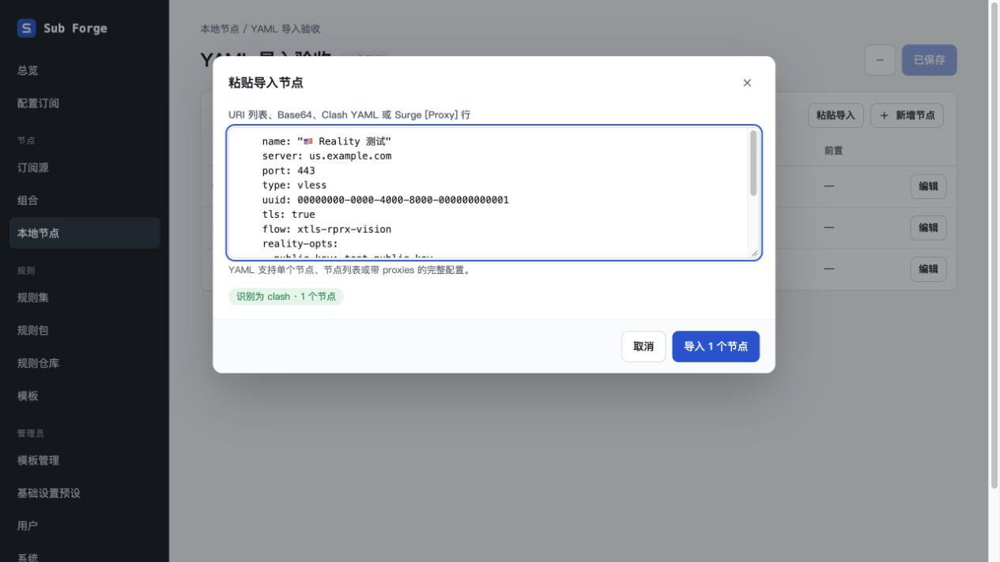
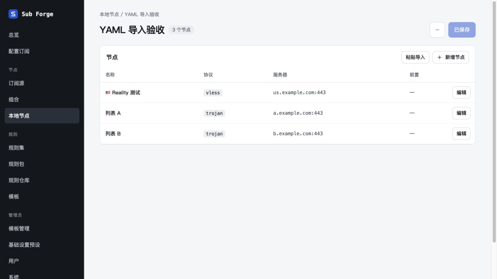

# 本地节点 YAML 粘贴导入修复验收（2026-10-29）

## 原因与修复

基线为 `main@80f5f91`。单节点「原始配置」直接解析 YAML 映射，而分组列表「粘贴导入」调用的订阅解析器只检测以 `proxies:` 包装的配置，单节点映射和裸列表因而被当作 URI 列表，得到零个节点。

- 共享内核按 YAML 结构识别单节点映射、裸节点列表、`proxies` 配置及相应行内写法。
- 保留整体缩进，避免只裁掉首行空白后破坏复制片段的层级；Reality、短 ID、未知扩展字段继续保留。
- 列表中的坏节点逐项报告，其余节点继续导入。YAML 文档语法损坏仍使内核解析失败，保持远程订阅的失败语义；前端入口捕获异常并显示诊断，禁止导入，不中断页面。
- 前端补充支持格式提示，需求、领域模型、路线图和包说明同步更新。数据模型、接口及种子格式不变。

新增回归在修复前复现了单节点、裸列表、行内配置无法识别及坏 YAML 抛出页面异常的问题。测试全部使用虚构凭据和示例域名，没有保存用户提供的真实节点凭据，也没有连接代理节点。

## 内置浏览器验收

仅使用 Codex 内置浏览器与原生辅助功能接口；临时服务监听 `127.0.0.1:18871`，使用独立内存数据库、临时测试账户及工作树生产构建。已有 `5173` / `8080` 服务及用户数据库保持原样。

| 场景 | 结果 |
| --- | --- |
| 整体缩进的 VLESS Reality 单节点直接粘贴 | 显示识别为 clash、1 个节点，导入按钮可用 |
| 导入 → 保存分组 → 刷新 | 节点仍在列表且显示已保存 |
| 再次打开节点原始配置 | UUID、flow、Reality 公钥、字符串短 ID、SNI、指纹、TCP、UDP 均保留 |
| 裸列表含 2 个有效节点和 1 个缺字段节点 | 显示 2 个节点、1 项错误，只导入有效节点；保存刷新后分组共 3 个节点 |
| 粘贴未闭合的 YAML 列表 | 显示具体语法错误，导入按钮禁用，页面可继续操作 |
| 最终构建将错误诊断处理移到前端后复验 | 损坏 YAML 仍正确提示；替换为有效单节点后恢复识别为 1 个节点 |

辅助功能记录：[保存后的节点](saved-node.txt)、[保存后的分组](saved-group.txt)、[无效 YAML](invalid-yaml.txt)。

## 自动检查与边界

- `pnpm test`：470 项通过、28 项原有条件跳过。core 84 通过 / 23 跳过，server 193 通过 / 3 跳过，web 193 通过 / 2 跳过。未启用 mihomo 外部内核及运行时验收；前端保留 2 项原有协议样例覆盖跳过。
- `pnpm typecheck`、前端生产构建、`git diff --check` 通过。构建仍有已有的单个产物超过 500 kB 提示。
- 安装前检查依赖声明与锁文件；使用 `pnpm install --offline --frozen-lockfile`，锁文件未变。Playwright 仅存在于 Vitest 的可选 peer 声明，未安装、下载或调用。
- 外部 Claude Design 画布要求登录，新增提示文案尚未同步到画板，已登记于 `docs/11-design-coverage.md`。
- 临时服务与验收标签在完成后关闭；工作树保留，未合并到主分支。
