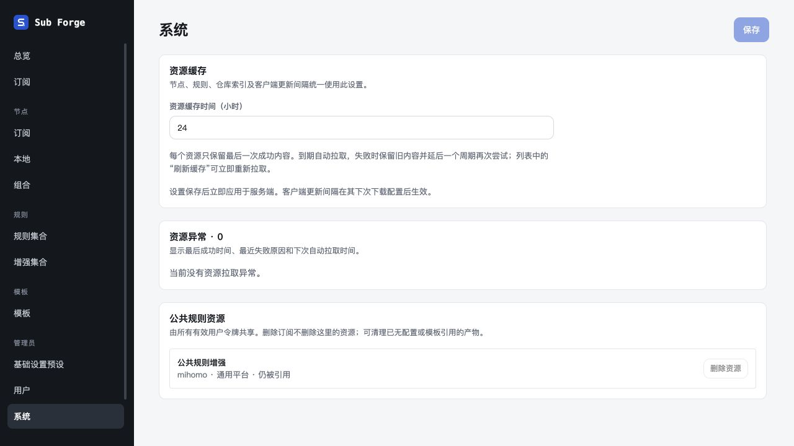
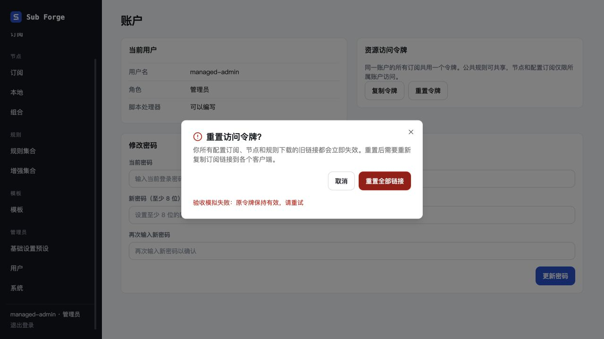
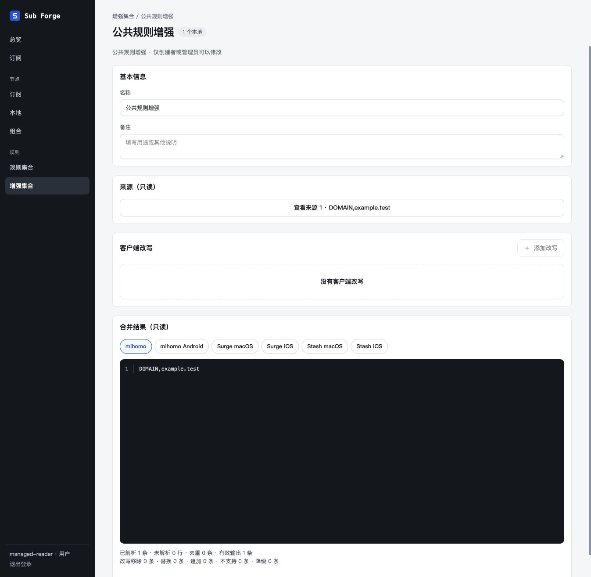

# 用户令牌与全局托管验收

日期：2026-10-30。分支：`codex/user-token-managed-resources`。

## 环境

使用独立工作树、内存数据库、虚构节点和固定规则正文；未读取或修改正式数据库。浏览器操作只使用 Codex 内置浏览器。验收入口为 `packages/server/test/manual-managed-resources-server.ts`，监听 `127.0.0.1:5196`，所有上游均为内存模拟，不访问真实订阅。

复现：先构建 web，再从 server 包执行 `pnpm exec tsx test/manual-managed-resources-server.ts`。账号 `managed-admin` / `managed-reader`，演示密码 `managed-test-2026`。第一次令牌重置固定返回 503，重试延迟 1.5 秒，用于检查失败和提交中状态。退出后数据与演示令牌销毁。

## 自动验证

| 命令 | 结果 |
| --- | --- |
| `pnpm -r test` | core 289、server 474、web 353 项通过，共 1116 项；46 项条件测试跳过 |
| `pnpm -r typecheck` | 三个包通过 |
| `pnpm --filter @sub-forge/web build` | 通过；保留原有大于 500 kB 的构建分块提示 |
| 核心名称及托管边界复测 | 25 项通过，覆盖重名、保留后缀、`__proto__`、`constructor` 和统一托管 |

核心覆盖托管规则、可读名称、服务端节点前置、MRS 与客户端转换。服务端覆盖用户 token 稳定性、轮换、跨用户权限、v22 升级、跨订阅公共产物复用、最后绑定清理、订阅删除后公共资源可读、在途删除不复活、历史节点归属变化、失败回退与恢复。前端包含统一弹窗架构及生命周期回归。

46 项跳过中，核心 39 项和服务端 5 项需要显式配置真实 Mihomo 内核及运行时环境；前端 2 项因没有相应协议样本跳过。真实内核端到端测试的种子与下载路径已更新为用户令牌模型，但本轮未执行真实内核运行时测试，不能据此声称真实客户端流量验收通过。

## 内置浏览器验证

| 场景 | 观察结果 |
| --- | --- |
| 公共资源列表 | 显示可读名称和客户端；被配置引用的产物禁止删除，无引用产物允许清理 |
| 清理取消与确认 | Escape 取消后资源仍在；重开确认后 Apple 产物消失，共享增强产物保留 |
| 用户令牌重置失败 | 503 错误留在原弹窗；标题、正文和重试入口完整 |
| 重置重试 | 提交中按钮禁用，成功后关闭；重新打开没有旧错误，关闭按钮正常取消 |
| 退场状态 | 关闭期间仍保留弹窗标题、正文与内容，未出现空壳闪烁 |
| 主订阅预览 | 浏览器直接显示 YAML；公共规则使用可读名和 `/r/:token/:key`，节点使用含配置 ID 和结构版本的托管地址，无 provider 级 `override.dialer-proxy` |
| 普通用户公共读取 | 看不到管理员私有配置；可以查看公共增强，列表只有“查看”，详情没有保存/删除，字段只读 |
| 公共来源预览 | 普通用户可以打开来源正文并查看合并结果；关闭时正文保留至退场结束 |

节点 provider YAML 直接导航被内置浏览器以 `ERR_BLOCKED_BY_CLIENT` 阻止，本项浏览器验收未完成，没有切换其他浏览器或绕过限制。节点下载、权限和链注入由 HTTP 集成测试及核心测试验证。

本轮没有在浏览器中逐项重跑全部遮罩、路由离开、StrictMode、无动画和嵌套关闭组合；对应现有统一运行时单测通过，本次没有修改弹窗运行时。

## 截图

## 清理

本轮验收进程已收到 SIGTERM 并正常退出，`5196` 无监听；验收标签页已关闭。未停止用户原有服务。工作树与提交保留供审阅，不合并、不删除工作树。
