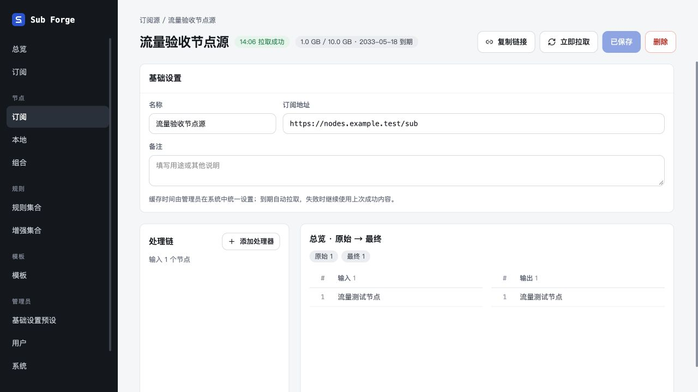
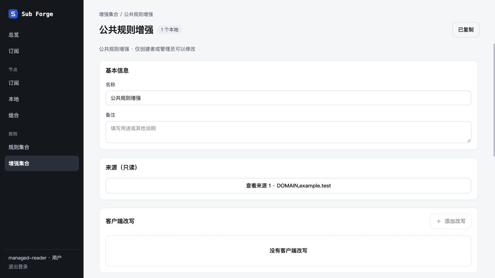

# 托管资源复核、复制链接与流量验收

日期：2026-10-30。分支：`codex/user-token-managed-resources`。在原独立 worktree 继续完成，未合并；未使用真实业务数据库或上游凭据。

## 复核修复

| 问题 | 修复与验证 |
| --- | --- |
| 旧组合的处理链预览可按每个成员自己的归属读取，未约束当前用户 | 显式传递当前用户检查整棵节点依赖；跨用户预览与复制链接返回 404，未发起上游请求 |
| 删除期间继续拉取后续来源、重建孤立绑定 | 串行拉取后检查配置/文档；后台队列执行前只查现有绑定，不以状态查询重建绑定 |
| 删除源、组合或增强后刷新任务被 finally 保存回来 | 删除关联任务；在途任务监听删除，结束前复核，删除并重建同 ID 也不能复活旧任务；显式临时任务继续正常保留状态 |
| 公共规则首次生成时删除并重建同 ID | 撤销旧请求，避免创建空产物或覆盖新定义；短期监听器完成后释放 |
| 规则改成 MRS 后，旧文本地址收到二进制 | 资源键包含输出格式和 behavior；旧 URL 保留原格式成功产物并告警。缺少格式契约的历史 MRS 也保留旧字节，刷新主配置后切换新 URL |
| 私有 provider 路径为 `__proto__` 时触发 500 | 检查 provider 的实际类型，未知或原型属性路径返回 404 |
| 前端账户切换时残留敏感查询 | 登录、退出、会话失效统一清除查询缓存；验证旧在途请求不能覆盖新账户链接 |

前六项原始边界用例在修复前均可失败复现。后续追加首次生成、删除重建、令牌撤销、预览越权、历史二进制格式及账户缓存回归。

## 功能与 HTTP 验证

- 五类复制接口返回当前登录用户 token；普通用户能复制公共增强，不能复制他人的私有节点和配置。生成地址不拉取上游，也不创建公共产物。
- `/rules/:token/:id` 可独立生成增强的 Mihomo / Stash 变体，与主订阅引用共享同一份公共产物和原文；创建者禁用不影响其他有效用户使用公共资源。
- `/nodes` 和 `/p` 返回 `Subscription-Userinfo`；验证 Mihomo / Stash UA、GET / HEAD、缺失字段、零值、同 URL 去重、最早到期、失败快照回退、成功缺失后清除。纯本地节点无虚假流量头。
- 独立节点订阅中的前置引用仍指向同一文件的节点，不引用未输出的隐藏策略组。
- 主配置、节点 provider、独立节点、独立规则与规则变体五种下载，在请求期间重置 token 或禁用用户均返回 404，不泄露流量头。

## 内置浏览器验收

运行 `packages/server/test/manual-managed-resources-server.ts`，仅监听 `127.0.0.1:5196`，内存数据库、两个虚构账户、虚构节点与流量。使用 Codex 内置浏览器，未安装或运行独立 Playwright / Chromium。

| 场景 | 结果 |
| --- | --- |
| 节点源、组合、本地组、配置、规则增强列表复制按钮 | 均可操作，页面显示“已复制”，读取浏览器剪贴板核对路径 |
| 节点源、组合、本地组、公共增强详情入口 | 正确显示；节点源改动未保存时复制禁用，恢复原值后恢复 |
| 节点源详情流量 | 显示模拟上游的 1 GB / 10 GB 及到期时间 |
| 同一管理员复制节点与公共增强 | token 一致，对象路径不同 |
| 退出并切换普通用户 | 只显示该用户的私有节点；公共增强仍可见，编辑/删除入口不开放 |
| 普通用户复制公共增强 | 使用自己的 token，与管理员不同；详情复制成功；与自己的私有节点使用同一 token |

截图：

临时浏览器标签已关闭，临时服务已收到 SIGTERM 并正常退出，确认 5196 无监听。没有修改原有 8080 / 5173 服务。

## 自动验证与限制

- `pnpm test` 全套通过；最后补充历史 MRS 格式回归后重新运行服务端全套。
- core：289 通过 / 39 条件跳过；server：501 通过 / 5 条件跳过；web：354 通过 / 2 条件跳过；合计 **1144 通过、46 跳过**。本轮新增 28 条回归。
- `pnpm typecheck` 三包通过；最后服务端修改后再次检查通过。
- `pnpm --filter @sub-forge/web build` 通过；存在原有的大分块体积提示。
- `git diff --check` 通过。原始命令输出保存在本目录的文本记录中。
- 未执行真实 Mihomo 二进制配置校验、代理链联网和服务端真实代理集成；缺少相应运行条件的 44 条测试明确跳过。前端另有 2 个缺少协议样本的条件跳过。
- 未使用真实 Stash / Mihomo 客户端导入或实测套餐流量。客户端 HTTP 契约由模拟上游集成测试覆盖；本轮没有新增/调整弹窗，沿用现有弹窗架构和生命周期回归。

现行权限、格式契约及流量规则见 [全局托管文档](../../../docs/19-managed-resources.md)。
