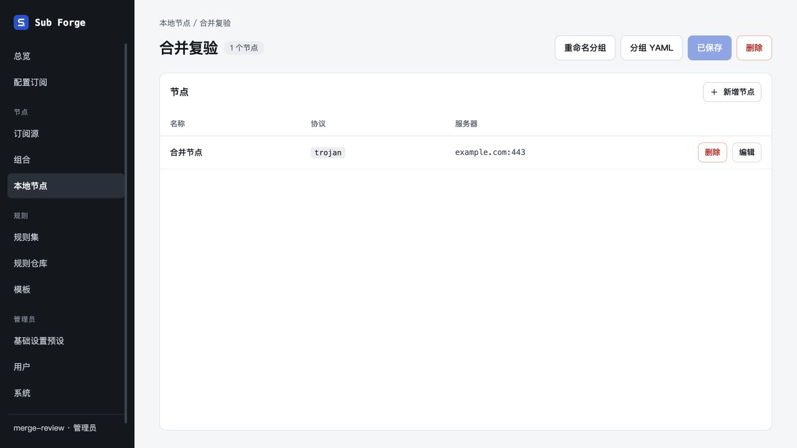

# 未合并分支整合验收

日期：2026-10-29。

## 合并策略

- `54d1ee2658b36c59a261b8befed31acda6a5c845`：旧独立粘贴弹窗的立即保存逻辑已被 main 的单节点原始配置导入取代。合并历史时保留新版入口、手动保存与多节点拒绝行为，不恢复旧弹窗；在路线图中注明替代关系，服务端说明与现行保存流程一致。
- `89505ed3f312a256ab9efc422f1e7cfaaafaaefe`：保留全部顶部操作平铺改动；解决导入引用及 README 冲突，同时保留 main 的原始配置导入和全局空状态说明。

## 验证结果

- `pnpm test`：594 项通过、28 项原有条件跳过。
- `pnpm typecheck` 与前端生产构建通过；构建仍提示单个产物超过 500 kB。
- 内置浏览器在隔离内存数据库验证：本地分组直接显示重命名、分组 YAML、已保存、删除；分组 YAML 按钮可打开弹窗；无旧粘贴导入入口。
- 新增节点的原始配置粘贴虚构 Trojan 分享链接后转换为 Mihomo YAML；点击添加到分组后显示已保存，刷新后节点名称、服务器与端口保持正确。
- 本轮浏览器复验聚焦冲突涉及的本地节点流程；其他平铺操作页面的原分支验收记录保留在相邻 `inline-list-actions-20261029` 目录。
- 临时服务与浏览器页面已关闭；未进行生产部署或真实上游拉取。

