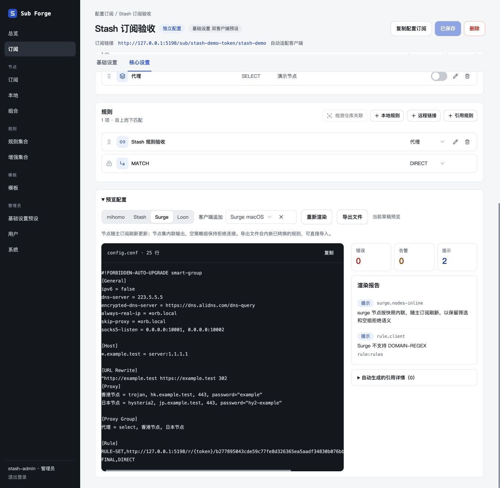
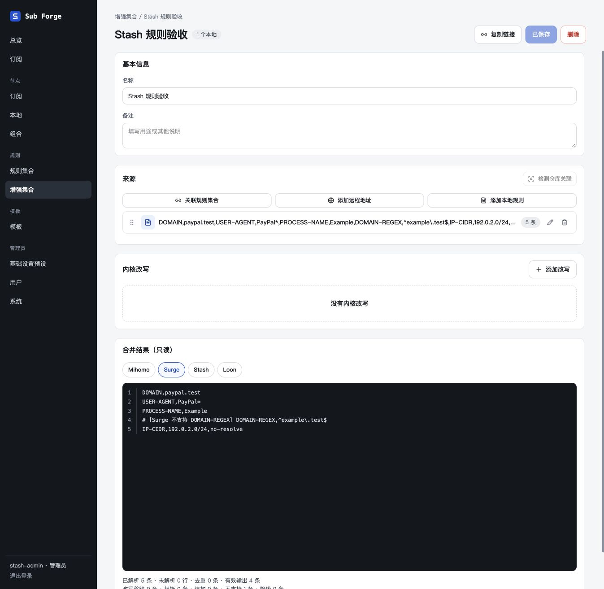

# 原文追加与内核规则验收

日期：2026-10-30。工作分支：`codex/native-client-append`。

## 自动检查

- `pnpm -r --no-bail test`：Core 693、Server 539、Web 343，共 1,575 项通过；47 项依赖环境或原有条件跳过，没有失败。
- `pnpm -r --no-bail typecheck`：三个包通过。
- `pnpm --filter @sub-forge/web build`：通过；保留既有的大包体积提示。
- 统一弹窗 architecture 与生命周期单测包含在 Web 全量回归中。

关键断言覆盖：原文逐字保存、未完成 YAML 可保存且只在生成时报错、其他内核不受影响、四片段优先级、数组/null/false/0、DNS policy 特殊键、加密 DNS、Host 通配条目、INI 原生段与条件指令、受管理段拒绝生成、listeners 作用范围、应用识别与缓存/节点链接一致、独立导出、停用后原文仍在、同内核规则资源共享、PROCESS 与嵌套逻辑完整保留、旧平台条件拒绝新保存、v24 加密备份与幂等迁移。

## 内置浏览器

使用 `test/manual-stash-server.ts`、内存数据库、固定虚构账号和节点，端口 5198；不访问用户真实节点或上游。没有启动或安装 Playwright/Chromium。首次使用 127.0.0.1 时出现本地会话失效，改用 localhost 后完成以下验收；未把会话失效记为产品通过项。

1. 预设只有内核、可选客户端和原文输入框，没有公共字段表单、提取按钮或 YAML/表单切换。
2. 粘贴用户提供的 Mihomo 基础配置，保留注释、空行、`hosts:` 空值、TUN、DNS、FakeIP。填写 FlClash 分流文本，切到 Surge 再切回，发布 v2 并重新加载；原文仍完整显示。FlClash 客户端原文独立保留。
3. Surge 公共原文包含 DNS、加密 DNS、skip-proxy、Hosts 和 URL Rewrite；macOS 层另填双 SOCKS 监听端口。
4. 订阅引用预设并追加 listeners；选择不输出、保存、重新加载、恢复引用预设，订阅原文仍在。
5. 预览只选 Mihomo，端口使用订阅内核的 7895；再选 FlClash，端口使用预设客户端层的 7899，DNS policy、加密 DNS、false 和 listeners 同时保留。
6. Surge 公共预览不含 Mihomo DNS/TUN 字段；选 macOS 后只增加对应监听项，Hosts、URL Rewrite 不丢。Mihomo/FlClash 共享规则 URL，Surge 公共/macOS 共享另一个规则 URL。
7. 规则弹窗展开内核改写，只包含内核选择；输入临时规则与改写后 Escape 取消，关闭动画阶段标题、原文、展开内容和校验提示仍保留，外部规则仍为 1 项且已保存。重新打开内容为空，取消按钮正常关闭。
8. 规则集预览只有 Mihomo、Surge、Stash、Loon 四项；Surge 输出保留 PROCESS-NAME，DOMAIN-REGEX 仍显示内核不支持诊断，无客户端平台选择器。

截图：

临时页面已关闭，服务已发送 SIGTERM 并正常退出，确认 5198 无监听进程。

## 验证边界

本轮没有运行四端真实代理转发或官方配置校验器。原文保留和结构合并不表示任意原生参数对当前客户端版本都有效，例如用户输入的 TUN stack 不做语义修正。

保存失败重试、嵌套弹窗、路由离开、StrictMode、无动画等生命周期由已有单测覆盖，本轮浏览器未逐一重跑这些组合；也未逐一人工预览所有可选应用。没有将这些项目算作浏览器通过。完整基础配置约定见 [20](../../../docs/20-native-client-append.md)。
