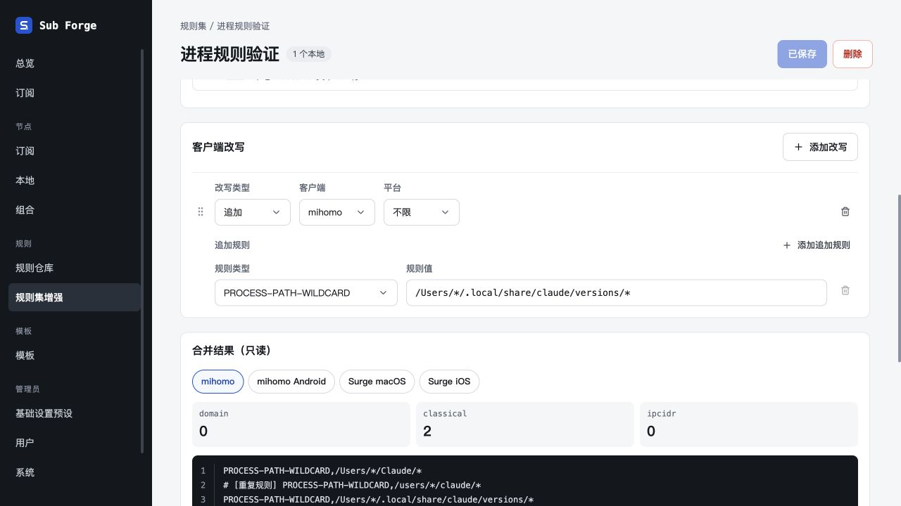
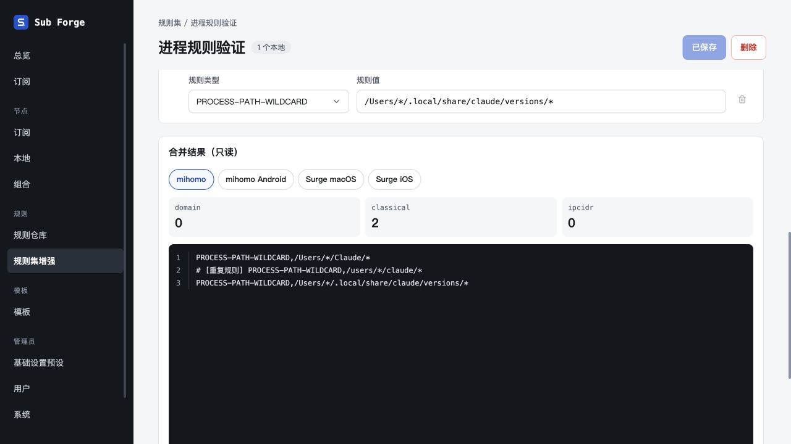
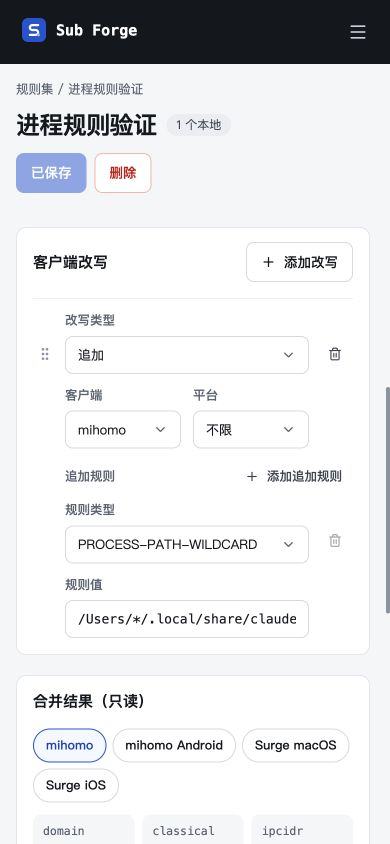

# 具体进程类型与 wildcard 大小写去重

日期：2026-10-29。

## 变更

- 进程类型 Select 直接显示 PROCESS-NAME、PROCESS-PATH 及各自的 -WILDCARD / -REGEX，不再提供二次分类。旧 PROCESS(kind,mode) 正常回显；在进程类型之间切换保留原值。类型列加宽至 260 px。
- mihomo 合并转换及规则集展开按小写键去重 PROCESS-NAME-WILDCARD、PROCESS-PATH-WILDCARD、DOMAIN-WILDCARD，保留首条原始写法；重复行保留为注释，维持来源定位。名称与路径、精确与正则不混淆；Surge 维持原语义。
- 远程文本或 YAML 含重复 wildcard 时强制托管 LIST，避免原文件透传绕过去重；单来源原文预览继续保留全部行。
- 保存结构、既有 IR 与示例种子不变，无数据迁移。

## 验证

- 全仓类型检查通过；全仓测试通过（core 199 通过 / 39 跳过，server 337 通过 / 5 跳过，web 269 通过 / 2 跳过）；随后追加的两项服务端贯通测试与该文件原有三项测试一并通过。
- 回归覆盖跨来源 / 替换 / 追加、小写键、首条原文保留、来源行位、单来源预览、Surge 保留差异、名称 / 路径与精确 / 正则边界、远程文本 / YAML 转托管、合并预览与实际下载相同。
- 前端生产构建通过，保留原有大于 500 kB 的产物提示。
- 内置浏览器在隔离内存数据库验证：旧 PROCESS-PATH-REGEX 正确回显，无二次分类；切换 PROCESS-PATH-WILDCARD 不清空原值，保存重载保持；预览两条大小写不同的 wildcard 仅输出一条有效规则，去重计数 1。
- 390 × 844 窄屏完整类型名称可见，表单正常换行。
- 临时服务与页面已关闭，验收脚本已移除，5186 端口无监听；未访问生产数据。
- 外部设计画布沿用待登录事项，已登记本轮待同步内容。

实现依据：[mihomo 进程规则](https://github.com/MetaCubeX/mihomo/blob/Meta/rules/common/process.go)、[DOMAIN-WILDCARD](https://github.com/MetaCubeX/mihomo/blob/Meta/rules/common/domain_wildcard.go)。

