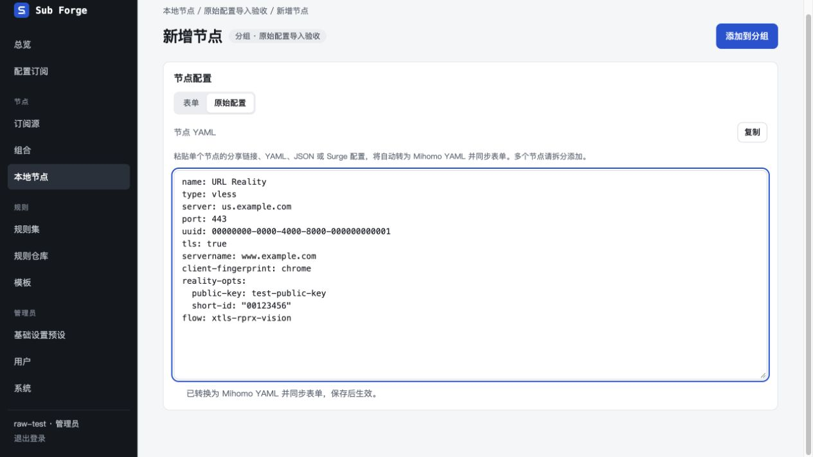
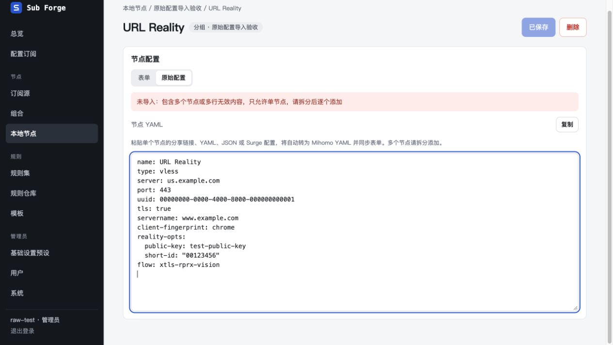
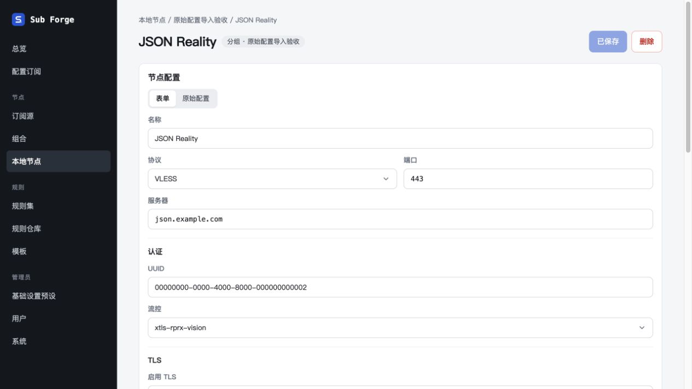

# 原始配置单节点导入验收（2026-10-29）

基线 `main@bb54c1c`。复用已有独立工作树，先快进到最新主分支，再按用户要求将导入统一到单节点「原始配置」输入框。用户明确选择仅允许单节点，多节点时提示拆分。

## 行为与范围

- 分组详情移除独立「粘贴导入」入口及弹窗，新增 / 编辑节点均可在原始配置中粘贴。
- 完整节点自动替换当前编辑草稿、显示标准 Mihomo YAML 并同步表单，仍通过原保存按钮写入。片段粘贴尊重光标 / 选区，支持日常修改字段；ALPN 等普通数组片段也不会误判为节点列表。
- 多个节点、混合有效 / 无效节点、损坏配置和不支持的参数不导入、不覆盖草稿，明确显示原因。节点自带前置按现有规则忽略并提示在配置订阅代理链中设置。
- 支持已有分享 URI、Base64、Clash / Mihomo YAML 与 JSON、Surge `[Proxy]` 段和节点行；YAML / JSON 单项列表或 `proxies` 外层同样支持。
- 支持 VMess 分享 JSON、sing-box 单出站和单项 `outbounds`，以及 Xray / V2Ray 单出站和单项 `outbounds`。sing-box 覆盖 Shadowsocks、VMess、VLESS、Trojan、Hysteria2、TUIC、AnyTLS、SOCKS5、HTTP；Xray / V2Ray 覆盖 Shadowsocks、VMess、VLESS、Trojan、SOCKS5、HTTP。覆盖常用认证、TLS / Reality、WS / HTTPUpgrade / gRPC。不支持的传输和未知连接字段明确拒绝，不宣称兼容所有客户端、全部协议或所有选项。
- 普通网页 / 订阅 URL 提示到订阅源添加，不联网取订阅。完整客户端配置仅提取单个出站，不转换路由、DNS、策略组等全局配置。
- 数据模型、服务端保存接口、种子格式不变；订阅解析失败策略不变。

客户端字段核对使用官方文档：[sing-box VLESS](https://sing-box.sagernet.org/configuration/outbound/vless/)、[sing-box TLS](https://sing-box.sagernet.org/configuration/shared/tls/)、[sing-box 传输](https://sing-box.sagernet.org/configuration/shared/v2ray-transport/)、[Xray VLESS](https://xtls.github.io/config/outbounds/vless.html)、[Xray 传输](https://xtls.github.io/config/transport.html)。

## 浏览器验收

使用 Codex 内置浏览器与原生辅助功能接口，实际触发剪贴板粘贴事件。独立服务监听 `127.0.0.1:18871`，内存数据库、临时账户、虚构节点凭据和示例域名；没有连接实际代理节点。后半段用 `localhost:18871` 隔离浏览器 Cookie，避免同机其他本地服务会话覆盖；重新登录后复验保存成功。

| 场景 | 结果 |
| --- | --- |
| 分组列表没有独立导入按钮，新增节点仍可进入编辑器 | 通过 |
| 默认草稿中直接粘贴 VLESS Reality URL，不必全选旧内容 | 自动替换为 YAML，保留 UUID、TLS、SNI、指纹、flow 和字符串短 ID |
| 切回表单 → 添加到分组 → 刷新 | 字段保留，显示已保存 |
| 已有节点中粘贴两个 URI | 显示拆分提示，原 YAML 保留 |
| 粘贴 sing-box VLESS Reality JSON | 转成 Mihomo 字段，同步节点标题与表单 |
| 选中服务器域名，粘贴普通域名片段 | 只替换选区，其他字段保留 |
| 粘贴未闭合 YAML | 显示未导入原因，原草稿保留，仍可返回原表单 |
| JSON 转换结果保存并刷新 | 确认已保存，服务器、UDP、UUID 与前导零短 ID 均保留 |

辅助功能记录：[多节点拒绝](multiple-rejected.txt)、[保存后的表单](saved-form.txt)。

## 自动检查与交付边界

- `pnpm test`：583 项通过、28 项原有条件跳过，分别为 core 156 / 23、server 209 / 3、web 218 / 2。未运行依赖外部 mihomo 的配置 / 运行时验收，不将跳过记为通过。
- 类型检查、前端生产构建通过；构建保留已有大于 500 kB 的产物提示。
- 没有安装或调用 Playwright，没有更改依赖或锁文件。
- 设计画布需要登录，未同步外部画板；对应交互和文案已登记到 `docs/13-design-canvas-sync.md`。
- 临时服务在验收完成后停止，工作树保留，未合入主分支。
