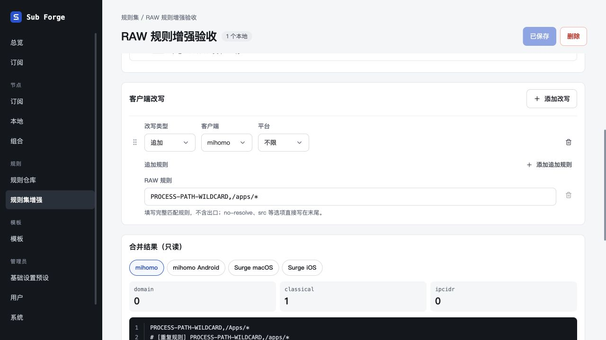
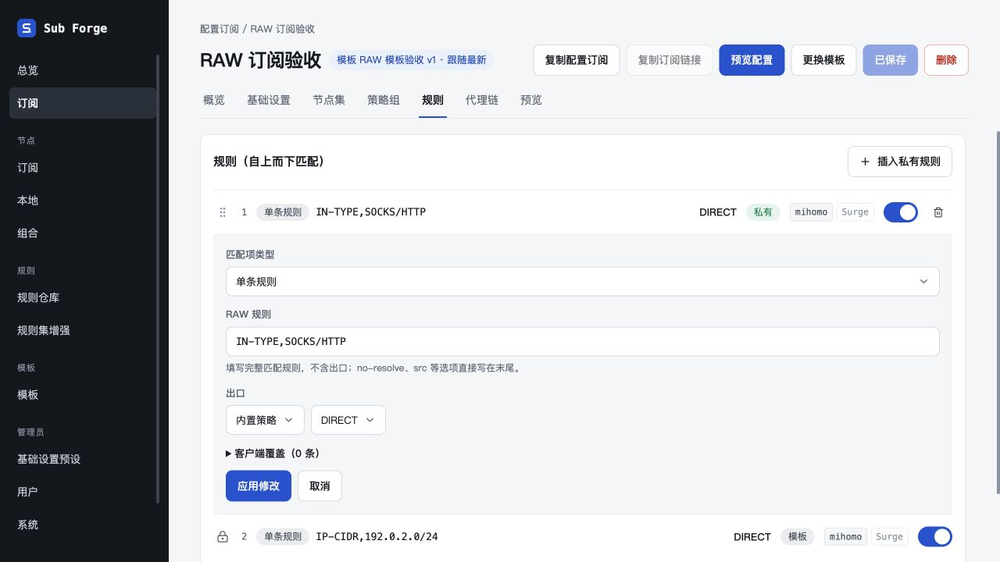
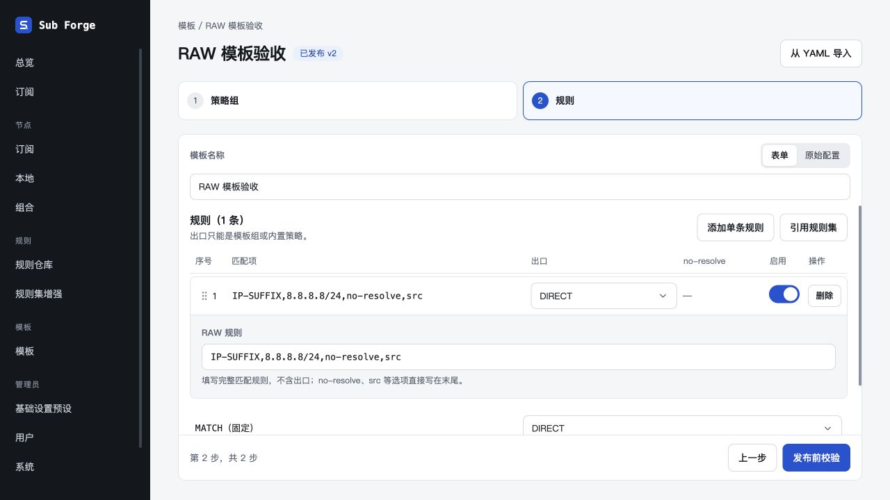
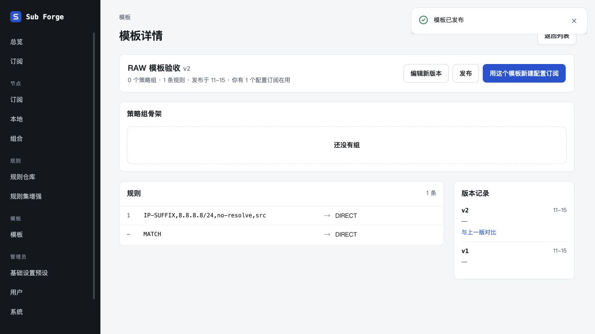
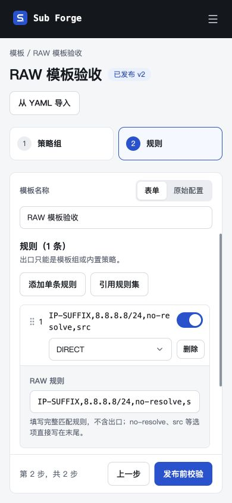

# 三入口单条规则统一 RAW

日期：2026-10-29。

## 行为

- 订阅私有规则及覆盖、规则集增强改写、模板单条规则共用 RAW 文本输入，无类型 / 值或进程组合控件、解析按钮及单条选项开关。
- 旧结构化 IR 直接回显匹配原文，仅编辑后保存 RAW；新建默认 RAW。未指定 client 时原样输出到目标客户端，保留旧 client 限定。
- 出口独立配置，末尾 no-resolve / src 放在出口之后；旧 options 合并到回显并在编辑后清除，防止删掉后被补回。
- 未纳入枚举的规则类型与逻辑表达式可保存为 RAW；模板表单与 YAML 往返保留原文、身份及选项，RAW wildcard 沿用 mihomo lowercase 去重。
- 不批量迁移已有规则；保留规则集引用、客户端条件及整条排序。示例种子已同步。

## 验证

- 全仓类型检查通过；821 项测试通过（core 203 / server 343 / web 275），46 项原有条件跳过。
- 新增回归覆盖通用 / 客户端专用 RAW、逻辑和未来规则类型、出口与选项顺序、旧选项合并、空白 / 换行拒绝、RAW 与结构化 wildcard 去重、三个入口保存发布与重读、模板 YAML 往返。
- 后续收紧 RAW 边界处理后，core 测试、服务端 RAW 集成测试及前端生产构建再次通过；产物仍有原有大于 500 kB 的提示。
- 内置浏览器使用隔离内存数据库验收规则集：旧进程规则回显，编辑保存重载成功，RAW wildcard 与来源去重，统计 1。
- 订阅：旧进程规则回显 RAW；修改为 IN-TYPE,SOCKS/HTTP，应用、保存、重载保留，编辑器无类型和值组合控件。
- 模板：旧 IP 规则的 options 合并进 RAW；改成 IP-SUFFIX 后切换 YAML，出口位于 no-resolve / src 前；切回表单文本不丢；发布 v2 成功，重新编辑仍为 RAW。
- 390 × 844 窄屏模板编辑布局正常，控件无横向溢出。
- 临时页面、服务及验收脚本已清理；未操作生产数据。设计画布沿用待登录同步事项，已更新待同步清单。

