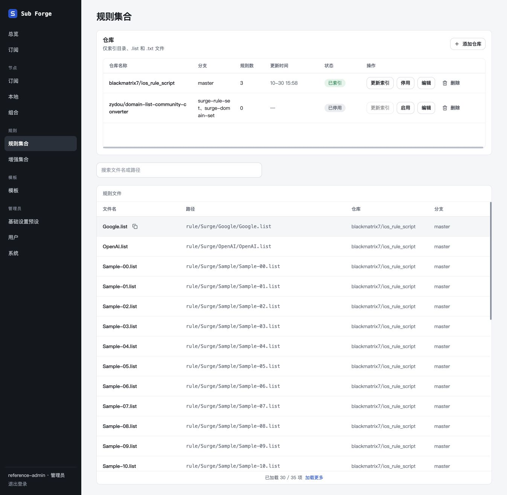
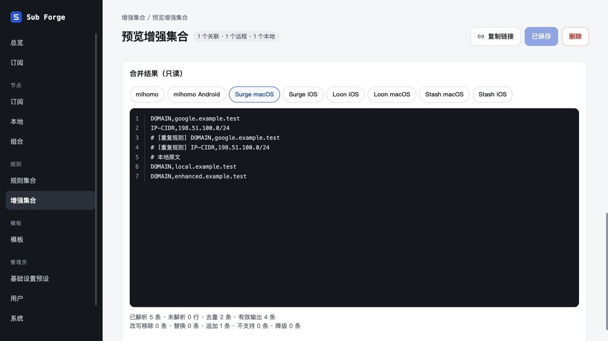
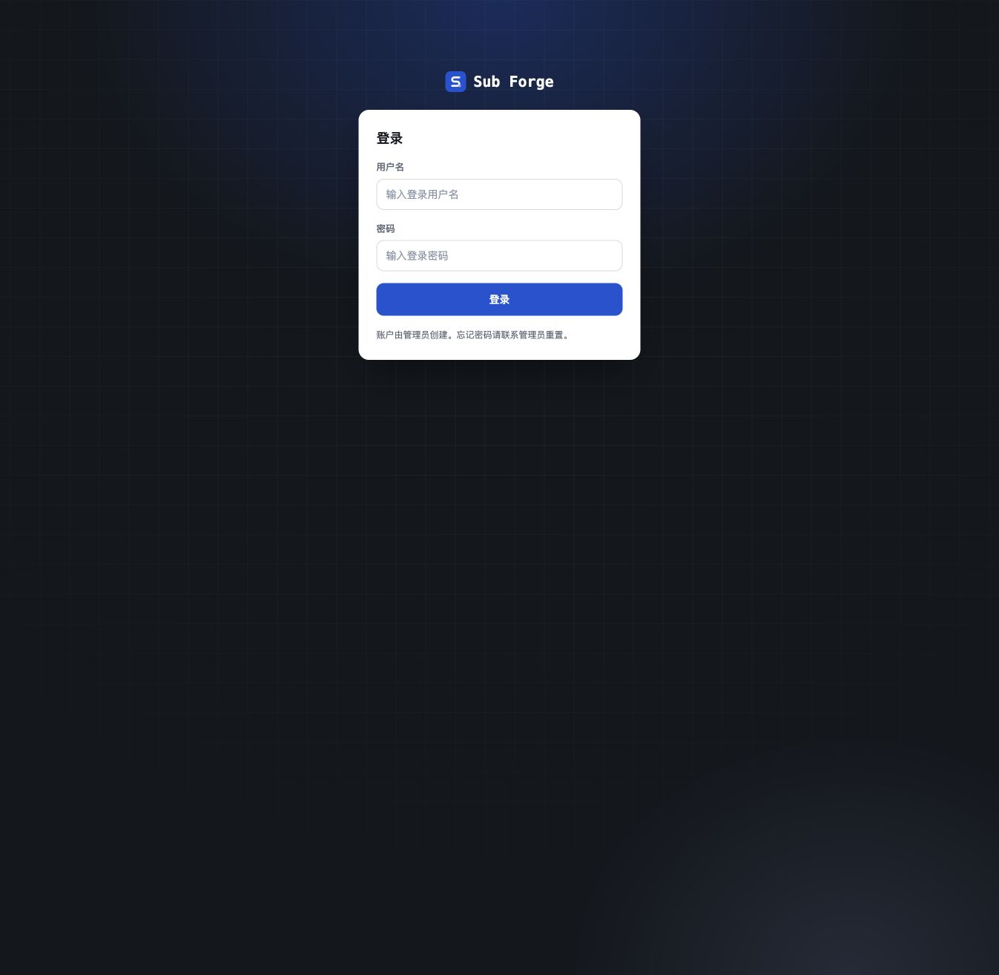

# 源文件预览验收

日期：2026-10-30。工作树：`codex/raw-source-preview`。

使用内置浏览器，服务为 `packages/server/test/manual-raw-source-preview-server.ts`，仅监听 `127.0.0.1:5248`，内存数据库与确定性索引、转换正文，无生产数据写入。仓库行跳转另实际打开了公开的 Google.list raw 文件，确认呈现上游原文与注释。

## 已验证

- 四列表头与列宽，文件列表不再有操作列；名称悬停时复制图标的可见度为 1，未悬停时隐藏。
- 复制按钮反馈“已复制”；在搜索栏实际粘贴得到与文件链接一致的 GitHub raw 地址，且没有新开标签页。
- 点击路径单元格在新标签打开 raw 文件，原管理页保留。
- 模板、独立订阅、跟随模板只读规则的仓库和远程链接都指向原地址，无账户令牌或托管路径。
- 独立订阅新增远程规则到未保存草稿后可直接预览，保留查询参数；验收后放弃草稿。
- 增强引用新开详情并定位合并结果；Mihomo 下 3 条输出，切到 Surge macOS 后显示 4 条输出、追加 1 条，符合样本改写。
- 增强详情的关联仓库和远程来源直达 raw；本地来源与本地规则继续展示包含注释的正文。
- 本轮没有修改弹窗实现；前端全量测试覆盖统一弹窗架构与生命周期。

## 自动验证

初次功能验证：类型检查通过，前端 367 项通过、2 项原有跳过；后端 542 项通过、5 项原有跳过；生产构建通过。后续新 API 合并的验证结果追加在下方。

## 新 API 整合

已将 `codex/query-resource-routes` 的 `e97c7fb`（接口与鉴权）和 `bd4002c`（契约文档）合入本工作树，未合并主分支。冲突处理保留新 query 管理接口，移除已无调用方的文件 token 预览工具；原文直达链接与订阅资源鉴权相互独立。

整合基线：core 700、server 562、web 367 项通过，共 1629 项；47 项按原有条件跳过。类型检查、生产构建通过。新增跨客户端回归验证源文件 URL 与实际订阅资源地址分离，公共仓库／增强引用仍走 `/resources`，订阅专属远程规则走 `/subs/ruleset`。该基线的 Loon 仍沿用旧内联规则，用户随后明确要求取消，后续修正在下方单独记录。

## Loon 全规则托管修正

用户确认手写规则也必须托管，因此全部分流项按列表顺序写入 `[Remote Rule]`，主配置 `[Rule]` 只保留 `FINAL`。不通过内联、跨段排序或 URL 去重改变列表语义。Loon 自身的域名/IP 阶段匹配仍适用，报告明确说明这一边界。

- 核心测试验证手写块、规则集交错顺序，同一引用的不同出口，停用/不适配项不生成资源，no-resolve 与客户端改写保留，以及缺失托管地址时明确失败。
- 后端验证手写规则使用订阅私有 `/subs/ruleset`；公共仓库和增强仍使用 `/resources`。验证客户端、用户、令牌隔离，改写/删除手写规则后的历史链接撤销，模板删除引用撤销，以及旧内联 last-good 不得下发。
- 全量 core 702、server 564、web 367 项通过，共 1633 项；47 项按原有条件跳过。随后新增模板引用撤销用例，Loon 后端专项 7 项全部通过，累计有效用例 1634 项。类型检查、生产构建通过。
- 内置浏览器在合并新 API 后复查规则文件四列及源链接；独立订阅仓库和远程入口直达 raw，增强引用定位合并结果。
- 浏览器的 Loon 预览显示四条托管链接、零错误，手写正文没有出现在主配置中。含托管规则的草稿导出禁用并提示保存后使用订阅链接，不输出带占位令牌的可用文件。
- 浏览器打开实际 `/subs/profile?...target=loon&platform=ios`：四条引用按原顺序输出，令牌和版本已填充；继续打开第四条手写规则 `/subs/ruleset` 返回 `DOMAIN,local.example.test`，正文不含出口。
- 验收服务已停止，无本轮残留监听。未执行 Loon 真机导入和实际代理转发。

