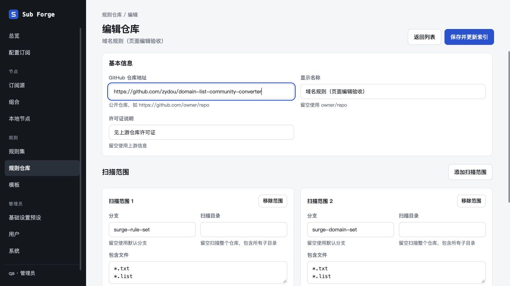
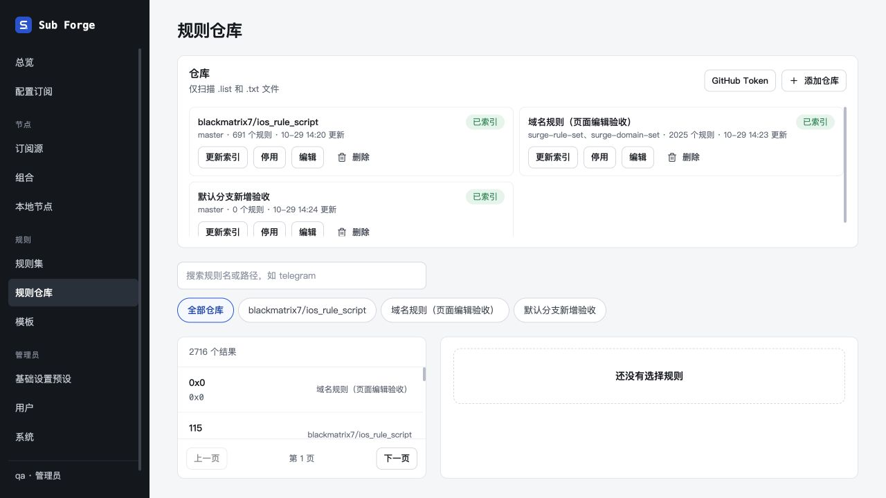

# 仓库子页面与 Docker 验收

日期：2026-10-29。分支：`codex/git-repo-cache`。隔离数据卷和本地测试账户；未操作生产实例。

## Docker

- 使用 `docker build -f docker/Dockerfile -t sub-forge:git-cache-pages-qa .` 构建成功。
- 最终镜像：`sha256:ee0ecc856290d41562e51eb0710a9518543833a1bc8ebd95d0bb2b421ba7f054`，本次只验证 `linux/arm64`。
- 最终运行阶段预装 Git 和 CA 证书，容器实测 `git version 2.39.5`；证书文件非空，`node` 用户（uid/gid 1000）可写 `/data`。
- 没有配置 GitHub Token，两个初始仓库通过真实 Git 同步分别得到 691、2025 个规则。
- 同一 `/data` 数据卷重建容器后，编辑名称、新增仓库及 2716 个搜索结果均保持，Git 缓存仍位于 `/data/rule-repo-cache`（本次约 1004 KiB）。

## 内置浏览器验收

使用 Codex 内置浏览器，访问 Docker 实例 `http://localhost:18818`。

| 场景 | 结果 |
| --- | --- |
| 列表点击添加仓库 | 进入 `/rule-repo/new` 独立页面，无弹窗 |
| 新增草稿返回列表 | 显示页内未保存提示；继续编辑保留草稿，放弃修改回到列表 |
| 编辑初始 zydou 仓库 | 进入 `/rule-repo/zydou/edit`，正确回填两个扫描分支及各自格式 |
| 修改名称保存 | 回到列表，显示新名称；异步同步完成，规则数量保持 2025 |
| 编辑页面刷新 | 配置重新读取，名称和两个扫描范围保持 |
| 新增仓库并留空分支 | 添加 zydou 的默认分支，自动解析为 master；成功回到列表；该分支无匹配规则，正常显示已索引 0 条 |
| 列表点击删除 | 显示对应卡片内确认；取消后提示消失，未实际删除 |
| GitHub Token 入口 | 进入 `/rule-repo/settings` 独立页面，显示未配置状态；未输入凭据 |
| 容器重建 | 会话和仓库配置保留，编辑页及列表正常显示 |

应用内离开确认使用页内提示。浏览器刷新或关闭的未保存保护仍采用既有原生行为，本次未触发浏览器关闭确认。

## 自动检查与清理

- Web 构建通过，保留原有大于 500 kB 的 chunk 提示。
- Web 单元测试：23 个文件通过，244 项通过、2 项既有跳过。
- `git diff --check` 通过。
- 已停止并删除测试容器，删除本次专用数据卷，关闭测试浏览器页。测试镜像保留；worktree 保留，未合并。

## 截图

