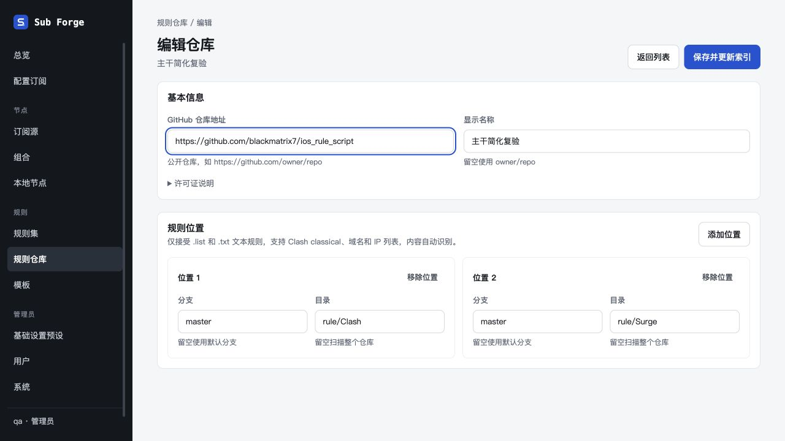
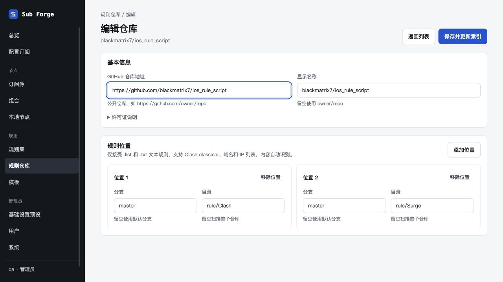

# 仓库编辑简化验收

## 两次简化合并 main 后复验

2026-10-29 将 `aa92bf1` 与 `03036cb` 一起快进合并至 main，无冲突。在主仓库 `main@03036cb` 上执行 Web 生产构建（含类型检查）、Web 全部测试和仓库后端测试：252 + 29 项通过，2 项前端既有跳过；构建仅有原有 chunk 体积提示。

直接从 main 启动隔离测试服务，Codex 内置浏览器确认：六组扫描配置展示为两个位置，高级筛选入口已移除，格式说明准确显示；修改名称、保存返回列表、刷新编辑页回填均正常。只读 SQLite 比较六组内部配置与简化前快照完全一致，索引仍为 691 条且无错误。测试服务及浏览器页已关闭，worktree 保留，未推送远端。

## 后续调整：筛选完全内置

按用户追加要求，移除文件筛选和兼容设置的全部入口，默认位置只显示分支和目录；提示“仅接受 .list 和 .txt 文本规则，支持 Clash classical、域名和 IP 列表，内容自动识别”。原有筛选配置在表单数据中原样保留，新位置使用系统默认值。格式扩展名限制继续由后端执行。

复验：生产构建、252 项前端测试（2 项既有跳过）和 29 项仓库后端测试通过；内置浏览器确认入口完全移除，保存成功。SQLite 深度比较确认六组原始配置不变，691 条索引无错误。测试页已关闭，服务已停止。下方早期截图和记录保留过程证据，以本段最终页面为准。

日期：2026-10-29。基于 `main@dbed319`，分支 `codex/simplify-repo-editor`，复用既有工作树。

## 改动

默认展示仓库地址、名称和规则位置；每个位置仅分支与目录。相邻且分支、目录相同的底层扫描配置合并展示，blackmatrix7 从六组扫描表单缩成两个位置。文件筛选、许可证折叠显示；格式标记、客户端分类、分组与 README 推荐设置继续按需展开。新增只填 URL 时沿用默认分支、全目录递归、list/txt 筛选与内容自动识别。

后端接口与数据库未修改。保存还原原有扫描顺序和所有字段，不合并非相邻配置，避免重叠匹配优先级变化。

## 验证

- 前端生产构建成功，保留既有 chunk 体积提示。
- 前端测试 252 项通过、2 项既有跳过。新增三个场景覆盖：六组变两位置并完整往返、统一修改位置、不合并非相邻配置或不同分支、新位置默认值。
- Codex 内置浏览器访问隔离实例 `http://localhost:18820`：blackmatrix7 默认只显示 rule/Clash 和 rule/Surge 两个位置；许可证与文件筛选默认折叠，常用字段一屏可见。
- 浏览器修改名称后保存回列表；只读 SQLite 对照保存前扫描数组，六组配置深度比较完全相等，索引 691 条、无同步错误。
- 新增页面仅一个默认位置，添加、移除位置正常；展开高级设置后可编辑包含和排除模式。
- `git diff --check` 通过。测试浏览器页已关闭，本次测试服务已停止。

