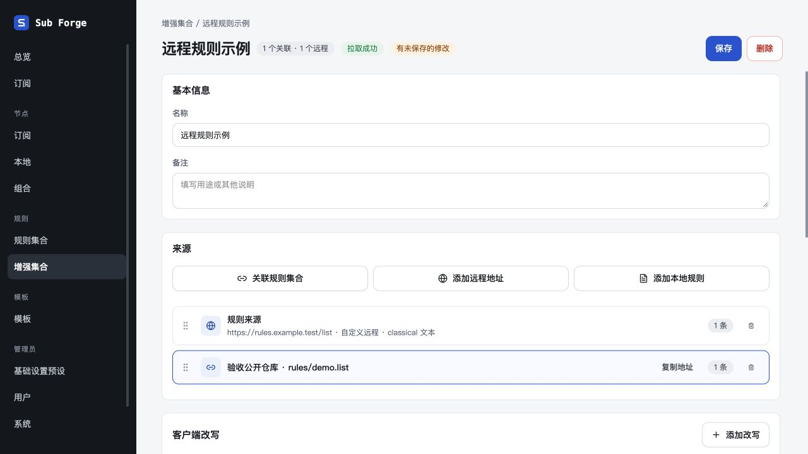
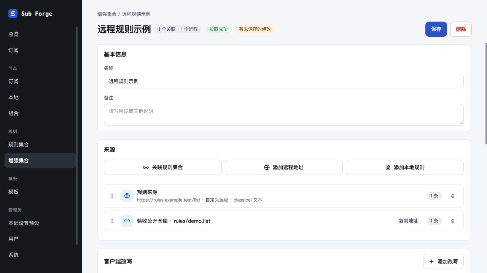
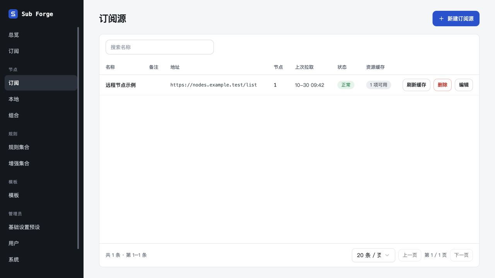

# 规则卡片交互与操作间距验收（2026-10-30）

工作树 `.Codex/worktrees/rule-card-interactions`，分支 `codex/rule-card-interactions`，基于 main `9520599`。未合并、未推送。

## 调整

- 仓库关联来源只显示名称，名称在卡片内垂直居中；不显示地址、关联类型与格式说明的第二行，复制地址操作保留。
- 选中关联卡片不再创建空编辑区，高度与未选中一致。
- 在当前来源卡片外按下鼠标/触摸时取消选择，预览恢复合并结果；点击另一来源时转为选择该来源。当前卡片内的输入和操作不会因外部取消逻辑失去选择。
- 文档列表操作用 flex gap-2 统一 8px 间距，刷新、删除、编辑之间不再贴连。

## 验证

- `pnpm --filter @sub-forge/web test`：34 个测试文件通过，302 项通过、2 项按原条件跳过。
- `pnpm --filter @sub-forge/web build`：TypeScript 检查及构建通过，保留已有大包体提示。
- `git diff --check`：通过。纯界面修复不增加重复实现的单元测试，交互使用内置浏览器验证。
- 使用已有 `manual-resource-cache-server.ts` 内存环境与虚构上游，未读取生产数据。通过界面关联 demo.list，确认仅显示一行名称；选中与未选中截图中关联卡片上下边界保持一致。
- 点击基本信息区域，关联来源 aria-pressed 从 true 变 false，预览标题切换为“合并结果（只读）”。
- 选择普通远程来源，地址输入仍正常展开；点击输入框后仍保持选中。
- 节点列表刷新、删除、编辑按钮呈现一致间距。
- 浏览器标签及本次测试服务均已清理。

本次无服务端接口、领域字段和种子数据变更。外部设计画布沿用此前登录限制，未同步；本地规范已记录，不能将其记为画布同步完成。未进行生产验收。
