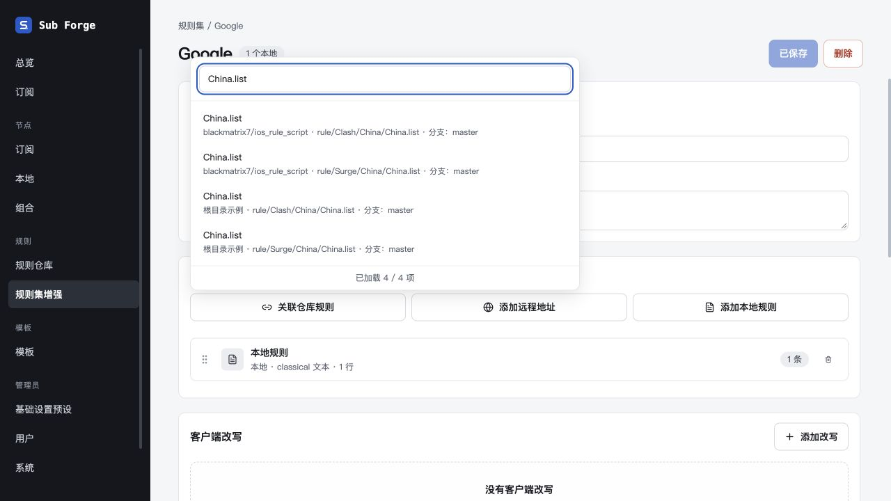
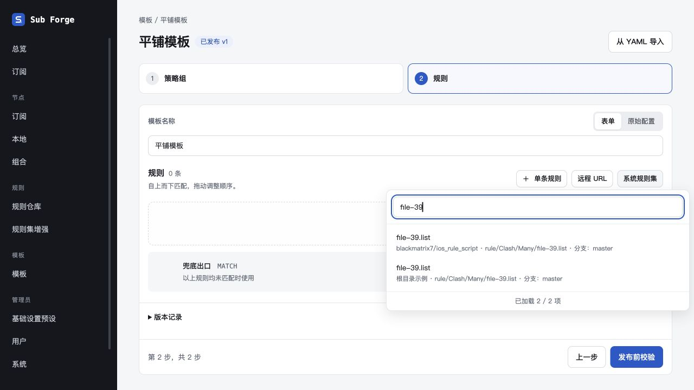
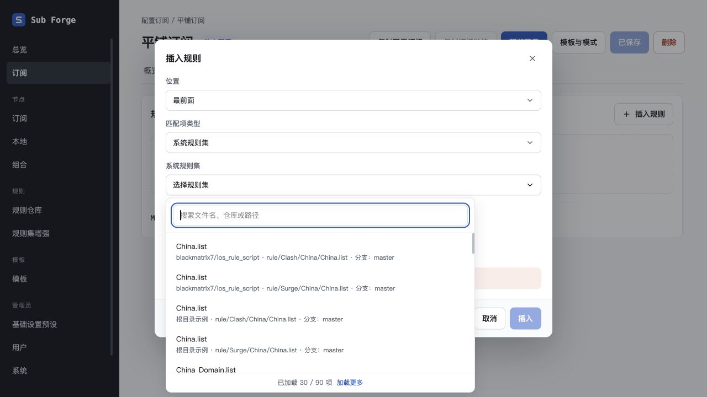
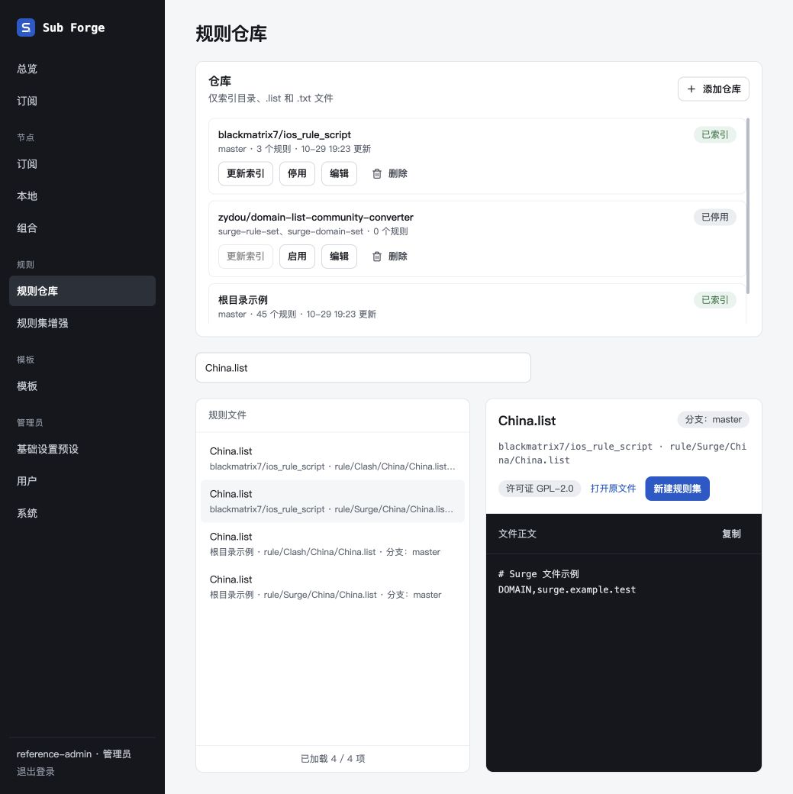

# 规则来源两行平铺分页验收（2026-10-29）

本轮替代文件树与逐层目录加载。代码在 `codex/rule-catalog-pagination` worktree 中完成，未合并主分支。

## 行为与清理

- 模板、订阅、规则集增强三处来源选择器和规则仓库页统一平铺。每项第一行文件名，第二行仓库名、完整原始路径及分支；同名文件不合并，无目录节点。
- 每次默认 30 项，点击加载更多才追加一页。搜索在完整索引筛选后分页；SQL 的 LIMIT/OFFSET 限制应用层接收的文件数量，缓存缺失时也通过 SQL 回退分页。
- 已删除递归文件树、目录加载器、逐层目录接口与目录缓存生成逻辑；沿用表结构，旧目录节点读取时忽略，下次刷新自然替换。
- 单文件预览、引用校验和草稿保存流程保留。领域 IR、种子及历史引用无改动。

## 自动验证

- 服务端：`pnpm --filter @sub-forge/server exec vitest run --testTimeout=15000`，401 通过、5 跳过。15 秒超时用于既有 Git 缓存测试，未修改仓库配置。
- 前端：`pnpm --filter @sub-forge/web test`，294 通过、2 跳过。
- 服务端类型检查、前端类型检查及生产构建通过。构建仍有既有的大包提示（约 882 KB）。
- 覆盖完整路径与分支身份、30/30/10 分页不重不漏、搜索未加载文件、Unicode 和字面通配字符、私有权限隔离、停用仓库、旧缓存降级、原子更新失败保留缓存，以及单文件引用保存渲染。

## 浏览器验收

使用 `packages/server/test/manual-rule-options-server.ts`，内存数据库、模拟 Git 和虚构规则正文；本机 localhost:18837，未接触生产数据。

1. 规则集增强：打开显示 30 / 89；点击加载更多显示 60 / 89，搜索 China.list 得到四个独立路径／仓库候选。
2. 键盘 Down → Down → Enter 选择 Surge 文件，新增来源精确指向 `rule/Surge/China/China.list`，测试草稿保存成功。
3. 模板：初始 30 / 90；搜索第一页尚未加载的 file-39 得到两个独立仓库文件。
4. 订阅：插入规则 → 系统规则集，复用同一两行弹层，初始 30 / 90。
5. 仓库页：初始 30 / 89；搜索 China.list，选择 Surge 文件，右侧展示对应原始注释与正文。
6. 修正仓库元数据就绪前重复挂载导致的第一页重复请求；重新加载后服务端仅记录一次 offset=0&limit=30 搜索。

代表性请求：

```text
/api/rule-options/search?scope=repository&q=&offset=0&limit=30
/api/rule-options/search?scope=repository&q=&offset=30&limit=30
/api/rule-options/search?scope=repository&q=China.list&offset=0&limit=30
/api/rule-options/search?scope=all&q=&offset=0&limit=30
/api/rule-options/search?scope=all&q=file-39&offset=0&limit=30
```









外部 Claude Design 画布受本会话已核实的登录限制，未编辑，替代方案已登记 docs/13。测试服务已通过 SIGTERM 正常关闭，端口已释放。
