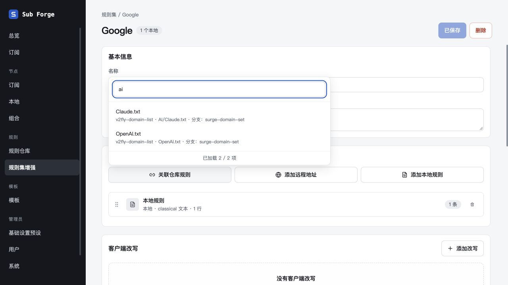

# 规则文件搜索范围修复（2026-10-29）

用户搜索 `ai` 时出现 36kr.txt 等无关文件。原因是 `/api/rule-options/search` 将仓库名称和分支拼入 searchable；`v2fly-domain-list` 中的 `domain` 包含 `ai`，导致该仓库所有文件通过包含匹配。

修复将仓库文件 searchable 限定为完整 path（包含文件名）。仓库名称和分支仍在第二行显示，文件身份、分页与权限不变。三处来源选择器及仓库页的提示统一为「搜索文件名或路径」。本地规则集沿用原名称和备注搜索。

## 验证

- 先添加回归测试复现：包含 39 个文件的 domain 仓库搜索 ai，旧实现错误返回 39 个，预期为 37 个实际路径命中。
- 修复后回归测试验证 30 + 7 项分页不重不漏、精确文件名优先、大小写及全半角等价；仓库名或分支单独命中不返回文件，空搜索仍返回全部 39 个候选的当前页。
- `pnpm --filter @sub-forge/server exec vitest run test/rule-options.test.ts test/rule-references.test.ts test/rule-file-preview.test.ts`：19 项通过。
- 服务端类型检查、前端类型检查与生产构建通过；构建保留既有大包提示。
- 隔离内存浏览器验收：模拟仓库 v2fly-domain-list、分支 surge-domain-set，含 36kr.txt、4399.txt、OpenAI.txt、AI/Claude.txt。空搜索显示 4 / 4，输入 ai 后仅显示 OpenAI.txt 与 AI/Claude.txt，计数为 2 / 2。
- 测试服务使用 localhost:18838，已正常停止；临时启动脚本已删除，未接触生产数据库。

前后端及相关文档已同步。核心领域模型和种子不受影响。外部设计画布受本会话已核实的登录限制，文案待同步项记录在 docs/13。
