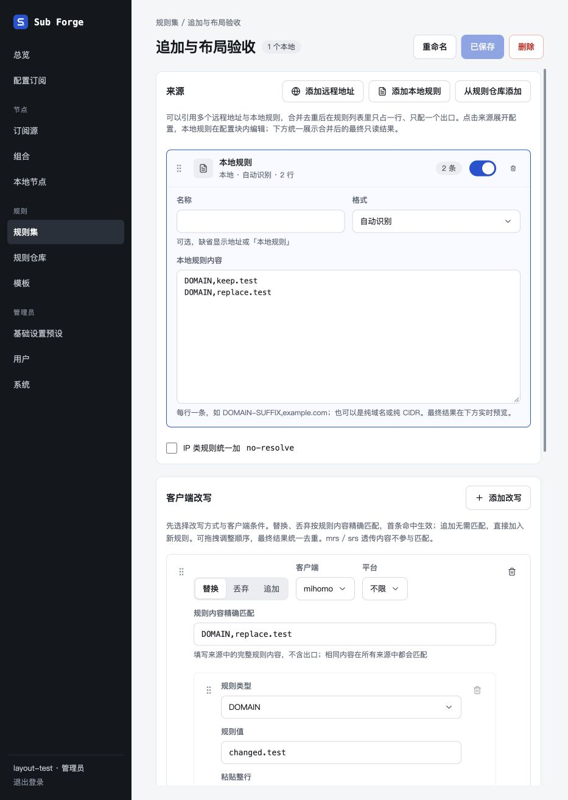
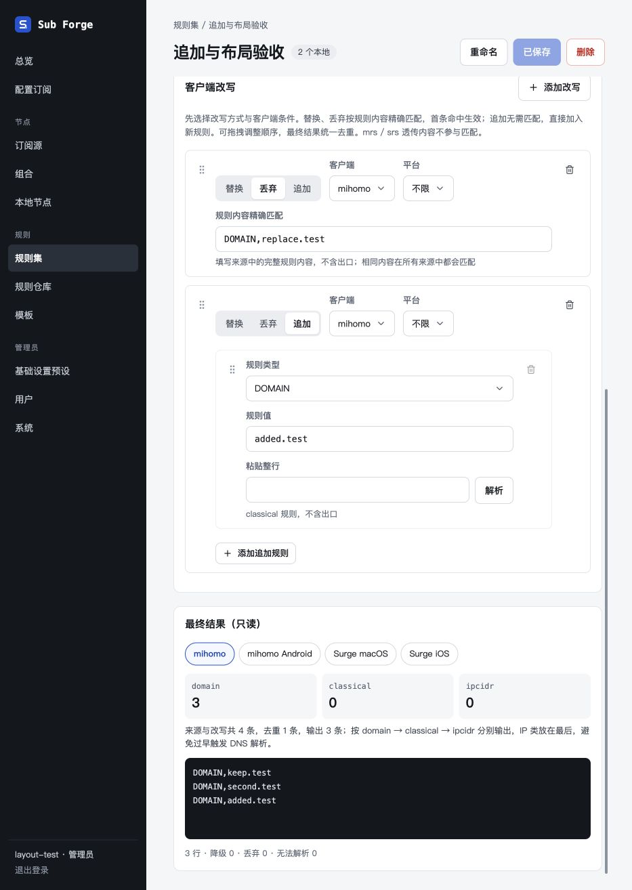

# 规则集追加与布局验收

日期：2026-10-29。

## 行为

- 客户端改写先选择替换、丢弃或追加，再选择客户端与平台。
- 替换、丢弃在操作方式下方显示规则内容精确匹配框；追加无需匹配，所有符合客户端与平台条件的追加项按顺序执行一次。
- 追加在来源展开后加入，不参与再次匹配改写，沿用最终分桶、去重与 no-resolve 处理。
- 本地内容输入框放在对应来源展开的配置块内；底部始终只读展示整组合并结果，来源选择只影响配置展开。

## 验证

- 全量测试：596 项通过，28 项原有条件跳过。
- 全仓类型检查、前端生产构建通过；构建仍有单个产物超过 500 kB 的提示。
- 新增内核与接口回归覆盖多来源仅追加一次、客户端／平台条件、追加间顺序、去重、no-resolve、无启用来源、无匹配内容的追加保存重读、预览与实际订阅渲染一致、无效追加和混合动作拒绝。
- 使用 Codex 内置浏览器与隔离内存数据库验收：本地内容就地编辑；操作方式位于匹配输入之前；追加不显示匹配框；替换和追加保存后重载得到预期结果；丢弃保留匹配框且移除输出；切换 Surge 显示原始规则；新增第二来源后合并去重，重新选中第一来源仍展示整组最终结果。
- 未访问真实上游或生产数据库。临时页面与服务已关闭，18091 端口确认不再监听。

