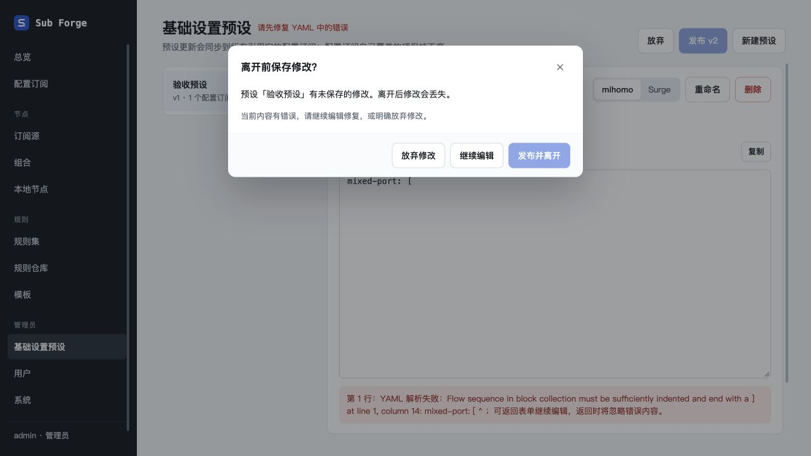
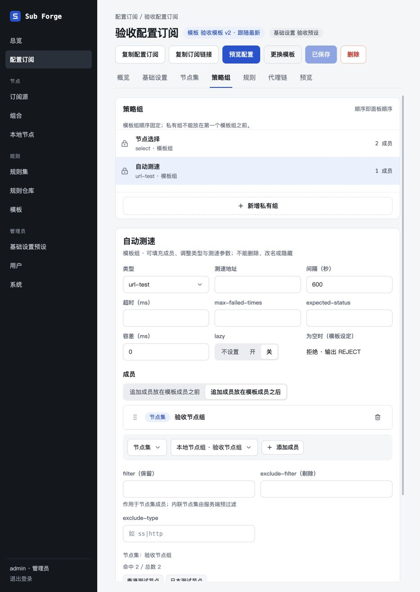
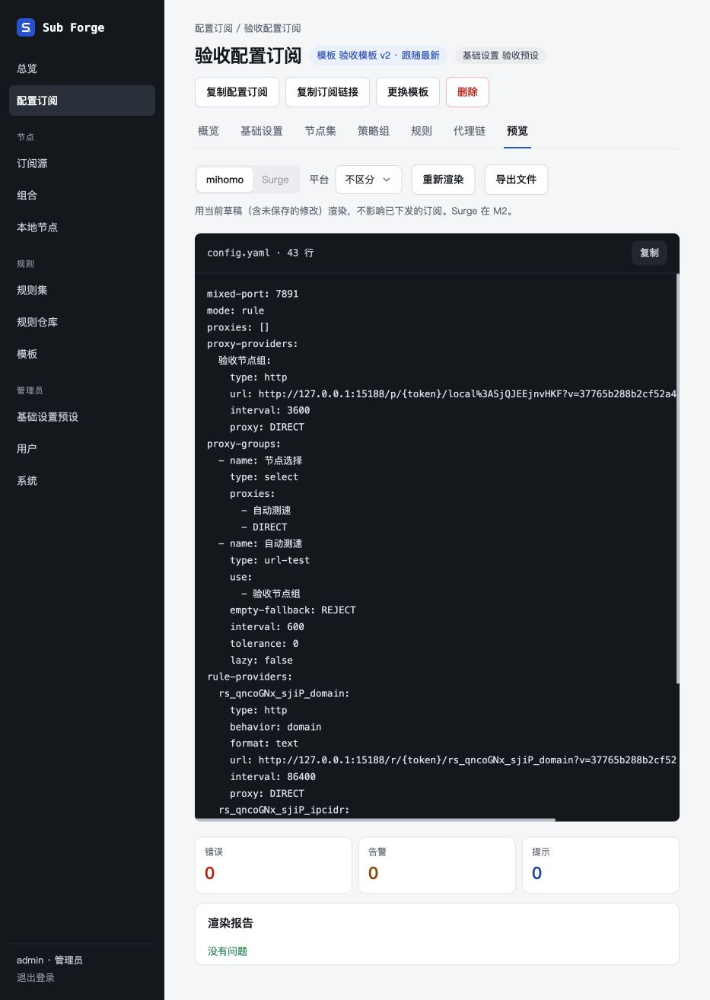

# 公共组件抽取验收（2026-10-29）

分支：`codex/shared-components`；实施基线：`96312a8`。代码分三步提交：公共展示与复制反馈、业务表单与拉取状态、公共查询与编辑离开保护。

保留现有平铺操作按钮。基线已经移除旧更多菜单，因此没有继续抽取菜单关闭逻辑。未改变服务端接口、数据库结构及模板与配置订阅之间的覆盖关系。

## 自动检查

| 检查 | 结果 |
| --- | --- |
| `pnpm typecheck` | core、server、web 均通过 |
| `pnpm test` | core 158 通过 / 23 跳过；server 218 通过 / 3 跳过；web 223 通过 / 2 跳过，总计 599 通过、28 跳过 |
| `pnpm --filter @sub-forge/web build` | 通过；仍提示单个 JS 产物超过 500 kB，未在本次重构中拆包 |
| `git diff --check` | 通过 |

新增单元测试覆盖规则匹配类型切换、拉取失败与恢复状态、扩展字段新增及重命名的保留字段校验。未安装或运行 Playwright。

## 内置浏览器验收

使用 Codex 内置浏览器访问隔离实例：前端 `127.0.0.1:15188`，后端 `127.0.0.1:19088`。数据库与运行文件位于本工作树忽略目录 `.Codex/runtime/verification/`。全部使用虚构节点和本地规则，没有拉取用户真实订阅。

验收结束后已关闭临时标签页并执行 `scripts/stop`；确认两个端口均关闭，未发现此工作树遗留的开发服务进程。隔离数据库留在忽略目录，不纳入提交。

| 场景 | 结果 |
| --- | --- |
| 模板版本列表及与上一版对比 | v1、v2 与说明可见，对比弹框正常 |
| 模板测速参数与三态布尔值 | interval 改为 450 后原始 YAML 同步；tolerance=0 保留；lazy 从 false 改为未设置后 YAML 不再输出该字段 |
| 模板规则匹配类型切换 | 规则集切到单条规则后显示新字段、原出口保持；空规则即时显示校验错误 |
| 预设无效 YAML 离开保护 | 路由跳转被拦截，发布并离开禁用；继续编辑保留错误文本；页面放弃按钮恢复原配置 |
| 预设合法内容发布并离开 | 修改端口后发布、导航均成功；接口回读确认为 v2、mixed-port=7891 |
| 公共新建框 | 空名称创建禁用，填写名称按回车创建成功并跳到详情；列表由 1 个分组变为 2 个 |
| 配置订阅节点集 | 公共计数显示 2 个节点，与测试数据一致 |
| 配置订阅策略组 | 测速间隔覆盖为 600 后保存成功，预览含 interval=600、tolerance=0、lazy=false；接口回读确认模板间隔仍为 300 |
| 最终配置预览与报告 | 预设新端口与组覆盖均生效，渲染报告为 0 错误 / 0 告警 / 0 提示 |
| 复制反馈 | 模板原始配置和最终预览点击复制后显示“已复制”，未出现写入错误 |
| 本地节点无效 YAML 离开保护 | 即使有效草稿未改变，损坏原文仍拦截跳转，保存并离开禁用；明确放弃后进入目标页 |
| 组合处理链公共预览 | 原始和最终均为 2 个节点；添加快捷设置后逐步预览正常 |
| 快捷设置保留字段 | 其他字段输入 name 后拒绝添加并显示“快捷设置不能修改字段：name” |
| 浏览器运行日志 | 验收期间读取到的 error / warn 日志为空 |

## 验证边界

- 本次没有对所有页面做完整端到端回归；未执行真实远程订阅拉取、网络失败注入、移动端及刷新原生确认框验收。
- 浏览器剪贴板读取工具返回空文本，因此仅确认页面写入成功反馈，未确认操作系统剪贴板内容；复制失败提示与异步失效保护经过源码检查，未做浏览器权限拒绝注入。
- 报告定位按钮存在且错误条目正确，自动交互过程中登录状态变化中断了定位点击，不把定位滚动记为已通过。
- 自动测试中的 28 项跳过项不计为通过。

## 截图

