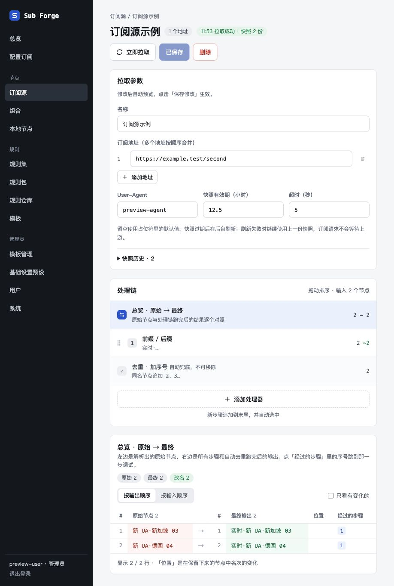
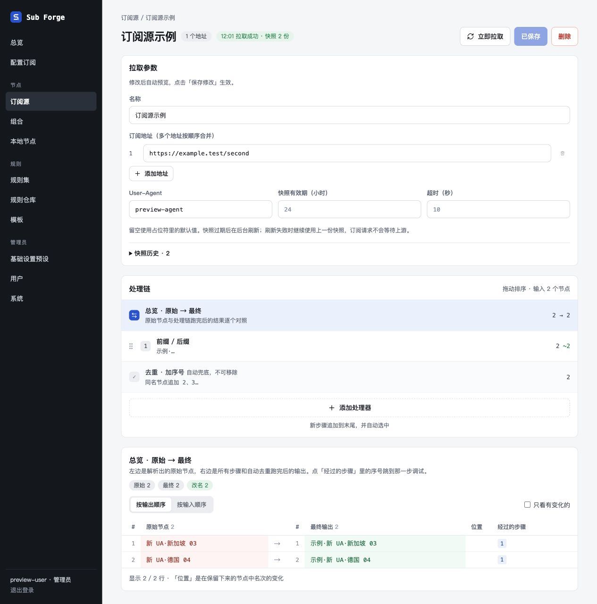

# 订阅源页内拉取参数与上下布局验收

基线：`main@f589e97`。分支：`codex/source-inline-fetch`。

详情页从上到下为拉取参数、处理链步骤、编辑与实时预览。原拉取参数弹窗已移除，快照历史在参数区内展开。参数与处理链共享草稿，通过「保存修改」统一提交；有未保存修改时，手动拉取按钮为「保存并拉取」。

订阅源预览支持地址、User-Agent、超时与有效期草稿。参数不同于已保存配置时，只拉取临时内容，不写文档或正式快照；同一组参数的预览内容短期缓存，处理链修改可以复用。切换拉取参数时隐藏旧结果，失败显示原因。

## 内置浏览器验收

使用真实应用 API、内存数据库、虚构账户和虚构上游响应，生产构建由独立服务托管。监听 `127.0.0.1:18877`，验收访问 `localhost:18877`；未访问真实订阅或修改日常服务的数据。全部浏览器交互、截图均通过 Codex 内置浏览器完成。

| 场景 | 结果 |
| --- | --- |
| 详情页默认直接显示拉取参数，三块内容上下排列 | 通过 |
| 修改名称即时更新标题，保存按钮变为「保存修改」 | 通过 |
| 更改地址和 User-Agent，未保存时预览更新为对应节点 | 通过 |
| 添加第二个地址，按地址顺序合并为 4 个节点 | 通过 |
| 删除第二个地址；只剩一个地址时禁用删除按钮 | 通过 |
| 快照历史在页内展开，草稿预览没有新增正式快照 | 通过 |
| 无效上游返回错误，预览清空旧参数节点 | 通过 |
| 编辑处理链前缀，与拉取参数一起「保存并拉取」 | 通过 |
| 刷新页面，名称、地址、UA、12.5 小时有效期、5 秒超时与处理链保留 | 通过 |
| 最终预览使用新地址、UA 及新处理链前缀 | 通过 |
| 单独点击「保存修改」，成功回到「已保存」 | 通过 |

[最终已保存页面状态](saved-state.txt)

## 自动检查与范围

- 服务端测试：203 项通过、3 项原有条件跳过；包括新增的 7 项草稿预览回归测试，覆盖地址顺序、参数传递、清空默认值、缓存复用与过期、快照隔离、部分与全部失败、输入校验及用户隔离。
- 前端测试：188 项通过、2 项原有条件跳过。
- 工作区类型检查通过；后续服务端类型检查、最终前端生产构建通过。
- `git diff --check` 通过。构建保留已有的单个产物超过 500 kB 提示。
- 使用 `pnpm install --offline --frozen-lockfile`，依赖与锁文件未修改。锁文件中的 Playwright 名称为 Vitest 的可选 peer 声明，本次没有安装或调用 Playwright 或其他浏览器。
- 本次只验证虚构上游和当前桌面视口；未执行真实上游、移动设备、mihomo 客户端或全站业务验收。
- 临时浏览器标签已关闭；验收服务收到 SIGTERM 后正常退出，进程及 18877 监听均已消失。worktree 保留，尚未合并。

## 与最新主分支整合后的复验

用户授权合并后，在本 worktree 整合 `main@137c3a8`。解决两个文件的冲突：快照服务同时保留订阅源临时预览与规则集来源格式校验；订阅源页同时保留页内参数、上下布局，以及主分支统一的空状态组件。其余自动合并保留最新地区旗帜、规则集多来源、模板入口等改动。

- 全量测试：535 项通过、28 项原有条件跳过（内核 132 / 23、服务端 209 / 3、前端 194 / 2，分别为通过 / 跳过）。
- 工作区类型检查、前端生产构建、差异空白检查通过；构建仍有既存的 500 kB 体积提示。
- 内置浏览器加载整合后的生产构建，复验上下布局、修改地址与 UA 后的未保存预览、页内快照历史、保存并拉取、刷新后的参数与预览，全部通过。
- 继续使用独立内存数据库和虚构上游，未改真实订阅。临时标签已关闭，服务正常退出，进程与端口监听均已清除。

[合并复验页面状态](merge-state.txt)

