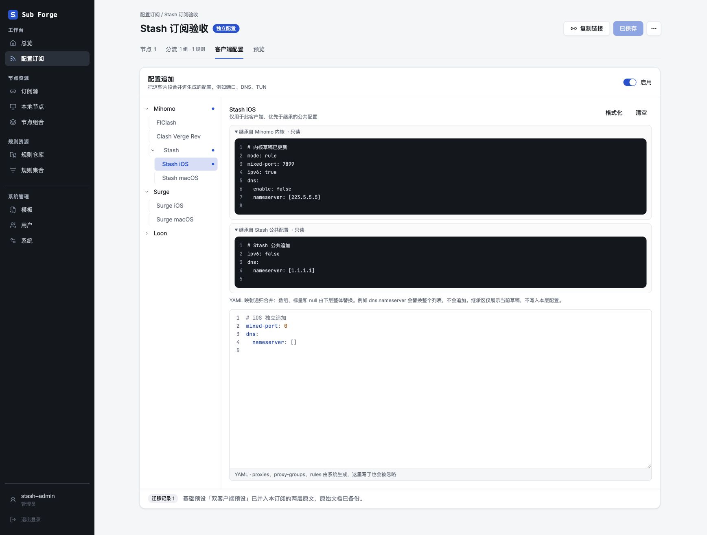
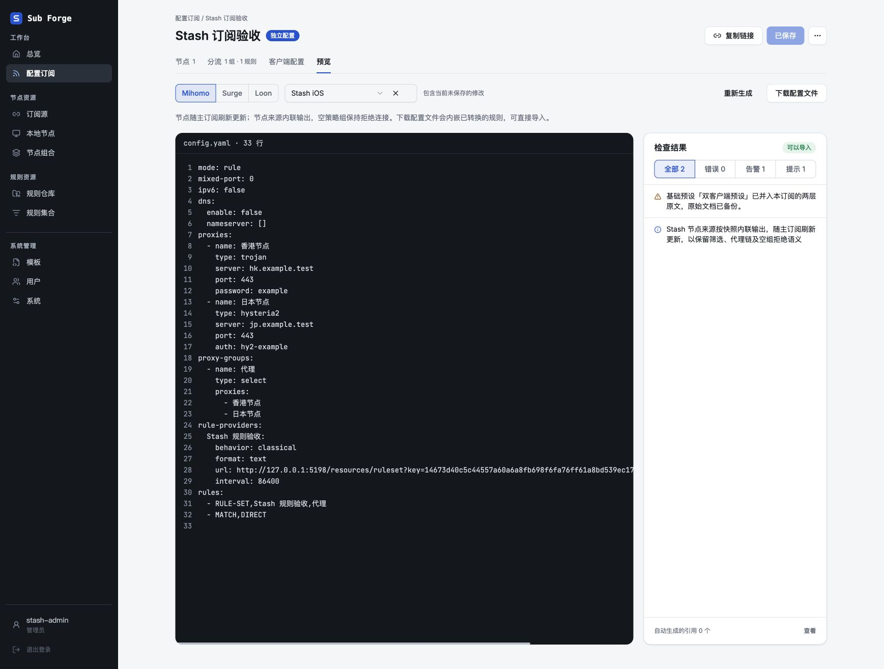
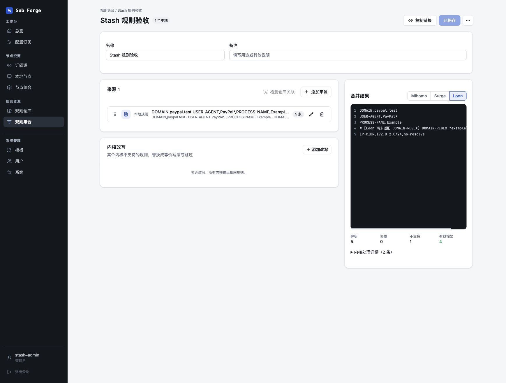
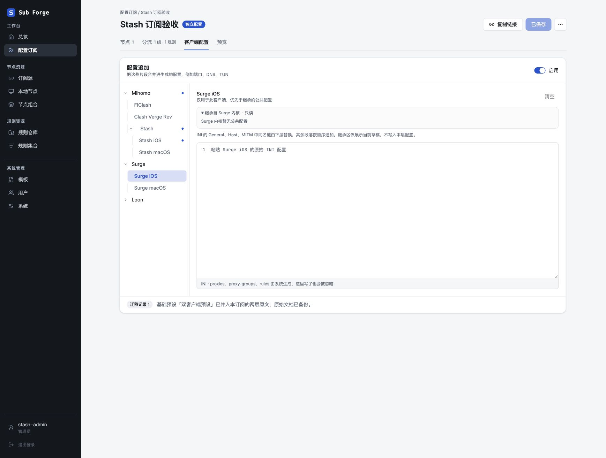
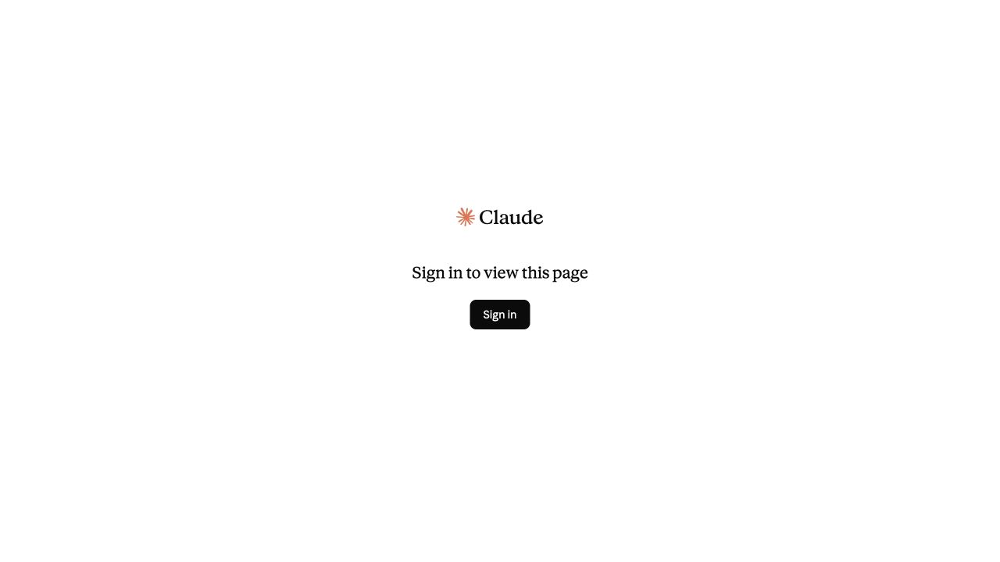
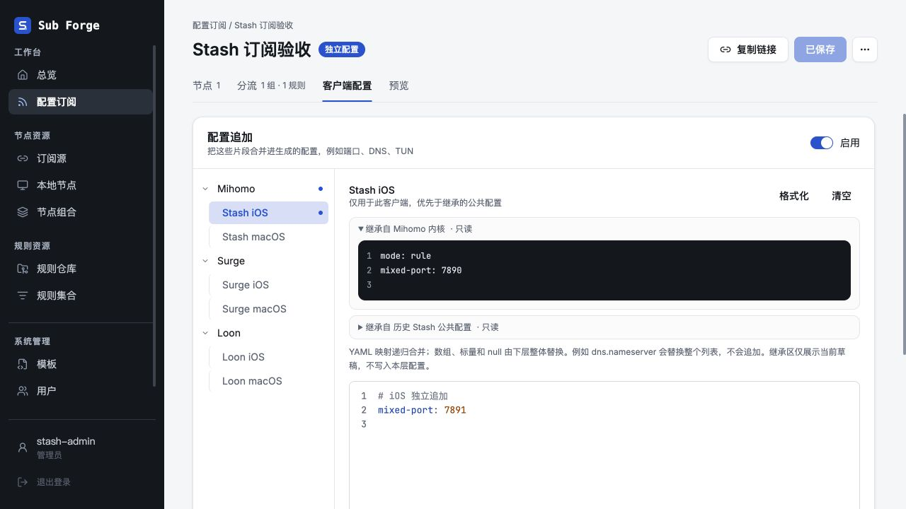
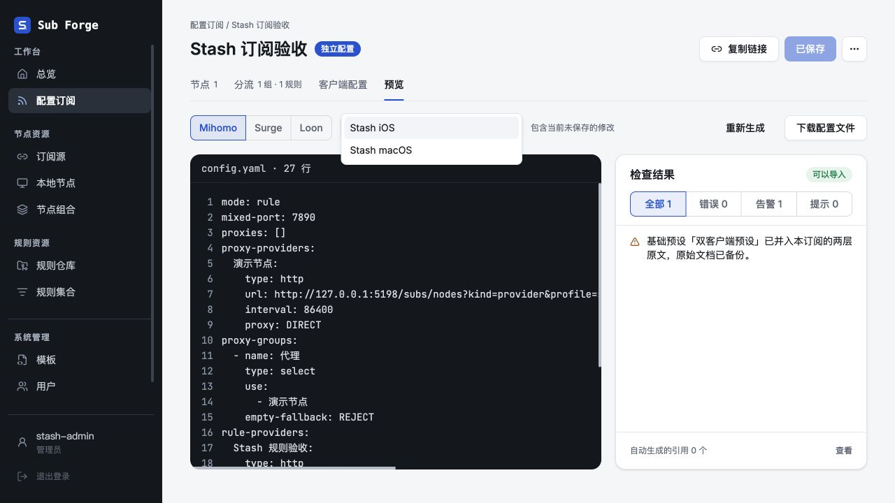

# Stash 配置继承与只读原文

日期：2026-11-02。分支：`codex/stash-under-mihomo`。

## 设计

保留现有树形目标导航、白色编辑器、行号和工具栏。只读继承区位于工具栏与编辑器之间，使用默认折叠的原生 details，复用 CodePreview，展开内容最高 192px 后内部滚动。每层单独展示原文，不生成合并文本，不把原文复制进应用槽位。未保存的上层修改即时显示。空内容在展开后显示中文提示。

```text
Mihomo                     Stash iOS                 格式化  清空
  FlClash                  ▸ 继承自 Mihomo 内核 · 只读
  Clash Verge Rev          ▸ 继承自 Stash 公共配置 · 只读
  Stash                    YAML 映射递归合并；数组整体替换……
    Stash iOS              ┌ iOS 独立追加原文 ─────────────┐
    Stash macOS            │                              │
Surge                      └──────────────────────────────┘
  Surge iOS
  Surge macOS
Loon
  Loon iOS
  Loon macOS
```

Stash 属于产品配置分组中的 Mihomo，不改变其实际内核事实。生成按 Mihomo 公共 → Stash 公共 → 所选应用追加合并，保留原有 DTO、API、输出适配和客户端存储槽位。YAML 映射递归合并、列表/标量/null 整体替换；INI General/Host/MITM 同名键由下层替换，其他段落按顺序追加。false、0 和空列表保留。

规则集合预览与配置分组共用 BASE_KERNELS，只显示 Mihomo、Surge、Loon，不提供应用或平台选项。完整订阅预览也使用这三个顶层，Mihomo 下可选择 Stash iOS/macOS，以检查实际应用追加。

合并结果视图、逐字段覆盖标识暂不实现。外部 [Claude Design 画布](https://claude.ai/artifact/XceERK5VmwqhEPai8xevKd) 本次通过内置浏览器打开后要求登录，未能编辑，不能视为画布已同步；以上设计说明与截图用于后续同步 V2ProfileClient、V2ProfilePreview、V2RuleSet。

## 自动验证

- Core：715 通过、40 项既有环境跳过；覆盖三层优先级、空下层、false/0/空数组/null、原文不回写、上层改动继续继承、语法错误传播及其他内核隔离。
- Server：643 通过、5 项既有环境跳过；包含正式订阅 UA、草稿/独立导出及原文保存。原有断言中 Stash 不继承 Mihomo 的两处预期已随需求更新。
- Web：351 通过、2 项既有跳过；包含统一弹窗架构与生命周期回归。本轮未新增或修改弹窗。
- Core、Server 类型检查通过，Web 最终构建包含类型检查并通过；构建仅保留既有大包体积提示。`git diff --check` 通过。

## 内置浏览器

使用现有 manual-stash-server.ts、内存数据库、虚构账号与节点，不读写用户真实订阅。尚无 Stash 真机导入或代理转发验收。

已验证：三层树形导航、折叠 Mihomo 时将子项选择归回父级、只读原文与应用追加分离、父级草稿即时更新、保存、Stash iOS 预览的 mixed-port=0、ipv6=false、dns.enable=false、nameserver=[]；规则集合的 Mihomo/Surge/Loon 切换与各自输出。







刷新后，Mihomo、Stash 公共、Stash iOS 原文分别保留，未将继承内容写入 iOS。Surge iOS 的空继承区显示“Surge 内核暂无公共配置”和 INI 覆盖说明；浏览器错误日志为空。

窄屏未执行成功：调用内置浏览器视口 API 设置 390×844 后，实际窗口与 DOM 仍为 1737×1314；未把桌面截图当作窄屏通过。已重置临时视口设置。



验收结束后，临时标签页已关闭；服务收到 SIGTERM 后正常退出，5198 端口已无监听。工作树保留，未合并、未部署。



## 菜单层级更正

用户最终确认的结构取代本文件前面的三层树：

```text
Mihomo
  Stash iOS
  Stash macOS
Surge
  Surge iOS
  Surge macOS
Loon
  Loon iOS
  Loon macOS
```

编辑器与完整预览共用六个应用的可见集合，删除中间 Stash 和标准 Mihomo 客户端的菜单入口。继承计算和存储槽位不变；历史 Stash 公共原文仅在有内容时显示只读区块，不迁移、不删除旧内容。规则集合预览继续只有 Mihomo、Surge、Loon。

本次更正后重新运行 Web 回归：351 通过、2 项既有跳过；Core 原文继承回归 7 项通过。Core 类型检查和 Web 构建（含类型检查）通过。上文 Core/Server 全量结果属于首次继承实现验收，本次菜单更正未重复运行 Server 全量。

内置浏览器使用相同的内存测试服务及虚构数据，确认三组各两个直接子项；折叠 Mihomo 后选择回到父级。Stash iOS 保存 `mixed-port: 7891` 后，macOS 追加仍为空；完整预览中 iOS 输出 7891，macOS 继承公共值 7890。Mihomo 应用候选只有 Stash iOS、Stash macOS，浏览器错误日志为空。只读原文保持独立，历史 Stash 公共内容按非空展示。





本轮临时标签页已关闭，测试服务收到 SIGTERM 后正常退出，5198 端口无监听。外部设计画布仍未编辑，窄屏和真实客户端验收仍按上文限制记录。工作树保留，未合并、未部署。
