# Stash 配置继承与只读原文

日期：2026-11-02。分支：`codex/stash-under-mihomo`。

## 设计

保留现有树形目标导航、白色编辑器、行号和工具栏。只读继承区位于工具栏与编辑器之间，使用默认折叠的原生 details，复用 CodePreview，展开内容最高 192px 后内部滚动。每层单独展示原文，不生成合并文本，不把原文复制进应用槽位。未保存的上层修改即时显示。空内容在展开后显示中文提示。

```text
Mihomo                     Stash iOS                 格式化  清空
  FlClash                  ▸ 继承自 Mihomo 内核 · 只读
  Clash Verge Rev          ▸ 继承自 Stash 公共配置 · 只读
  Stash                    YAML 映射递归合并；数组整体替换……
    Stash iOS              ┌ iOS 独立追加原文 ─────────────┐
    Stash macOS            │                              │
Surge                      └──────────────────────────────┘
  Surge iOS
  Surge macOS
Loon
  Loon iOS
  Loon macOS
```

Stash 属于产品配置分组中的 Mihomo，不改变其实际内核事实。生成按 Mihomo 公共 → Stash 公共 → 所选应用追加合并，保留原有 DTO、API、输出适配和客户端存储槽位。YAML 映射递归合并、列表/标量/null 整体替换；INI General/Host/MITM 同名键由下层替换，其他段落按顺序追加。false、0 和空列表保留。

规则集合预览与配置分组共用 BASE_KERNELS，只显示 Mihomo、Surge、Loon，不提供应用或平台选项。完整订阅预览也使用这三个顶层，Mihomo 下可选择 Stash iOS/macOS，以检查实际应用追加。

合并结果视图、逐字段覆盖标识暂不实现。外部 [Claude Design 画布](https://claude.ai/artifact/XceERK5VmwqhEPai8xevKd) 本次通过内置浏览器打开后要求登录，未能编辑，不能视为画布已同步；以上设计说明与截图用于后续同步 V2ProfileClient、V2ProfilePreview、V2RuleSet。

## 自动验证

- Core：715 通过、40 项既有环境跳过；覆盖三层优先级、空下层、false/0/空数组/null、原文不回写、上层改动继续继承、语法错误传播及其他内核隔离。
- Server：643 通过、5 项既有环境跳过；包含正式订阅 UA、草稿/独立导出及原文保存。原有断言中 Stash 不继承 Mihomo 的两处预期已随需求更新。
- Web：351 通过、2 项既有跳过；包含统一弹窗架构与生命周期回归。本轮未新增或修改弹窗。
- Core、Server 类型检查通过，Web 最终构建包含类型检查并通过；构建仅保留既有大包体积提示。`git diff --check` 通过。

## 内置浏览器

使用现有 manual-stash-server.ts、内存数据库、虚构账号与节点，不读写用户真实订阅。尚无 Stash 真机导入或代理转发验收。

已验证：三层树形导航、折叠 Mihomo 时将子项选择归回父级、只读原文与应用追加分离、父级草稿即时更新、保存、Stash iOS 预览的 mixed-port=0、ipv6=false、dns.enable=false、nameserver=[]；规则集合的 Mihomo/Surge/Loon 切换与各自输出。


刷新后，Mihomo、Stash 公共、Stash iOS 原文分别保留，未将继承内容写入 iOS。Surge iOS 的空继承区显示“Surge 内核暂无公共配置”和 INI 覆盖说明；浏览器错误日志为空。

窄屏未执行成功：调用内置浏览器视口 API 设置 390×844 后，实际窗口与 DOM 仍为 1737×1314；未把桌面截图当作窄屏通过。已重置临时视口设置。


验收结束后，临时标签页已关闭；服务收到 SIGTERM 后正常退出，5198 端口已无监听。工作树保留，未合并、未部署。


## 菜单层级更正

用户最终确认的结构取代本文件前面的三层树：

```text
Mihomo
  Stash iOS
  Stash macOS
Surge
  Surge iOS
  Surge macOS
Loon
  Loon iOS
  Loon macOS
```

编辑器与完整预览共用六个应用的可见集合，删除中间 Stash 和标准 Mihomo 客户端的菜单入口。继承计算和存储槽位不变；历史 Stash 公共原文仅在有内容时显示只读区块，不迁移、不删除旧内容。规则集合预览继续只有 Mihomo、Surge、Loon。

本次更正后重新运行 Web 回归：351 通过、2 项既有跳过；Core 原文继承回归 7 项通过。Core 类型检查和 Web 构建（含类型检查）通过。上文 Core/Server 全量结果属于首次继承实现验收，本次菜单更正未重复运行 Server 全量。

内置浏览器使用相同的内存测试服务及虚构数据，确认三组各两个直接子项；折叠 Mihomo 后选择回到父级。Stash iOS 保存 `mixed-port: 7891` 后，macOS 追加仍为空；完整预览中 iOS 输出 7891，macOS 继承公共值 7890。Mihomo 应用候选只有 Stash iOS、Stash macOS，浏览器错误日志为空。只读原文保持独立，历史 Stash 公共内容按非空展示。


本轮临时标签页已关闭，测试服务收到 SIGTERM 后正常退出，5198 端口无监听。外部设计画布仍未编辑，窄屏和真实客户端验收仍按上文限制记录。工作树保留，未合并、未部署。

## 菜单样式更正

移除选中项整行背景，选中与悬停仅作用于文字按钮，箭头保持独立；移除展开子项左侧边框，保留原有缩进和展开交互。

Web 构建（含类型检查）通过。内置浏览器分别验证选中、选中并悬停两种状态，箭头与外层行背景均透明，子项左边框为 0px；展开 Loon 后两端应用正常显示。浏览器错误日志为空。此次仅调整 CSS，不新增或重复运行单元测试。

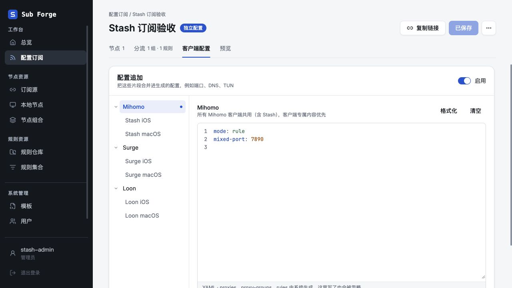

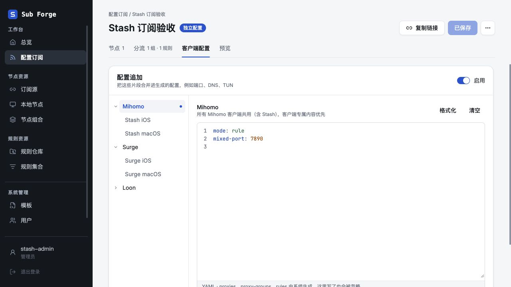

临时标签页已关闭；验收服务正常退出，5198 端口无监听。

## 选中字重与编辑焦点

配置目标选中时不再额外增加字重；仅在本页面的原文编辑区移除聚焦阴影，避免外层裁切后底部出现蓝色高亮线。

Web 构建（含类型检查）通过。内置浏览器确认选中及未选中目标的字重均为 400；文本框实际聚焦时外层阴影为 none，截图可见编辑框底部无蓝线，浏览器错误日志为空。此次仅调整 CSS，未重复运行单元测试。临时标签页及测试服务已关闭，5198 端口无监听。

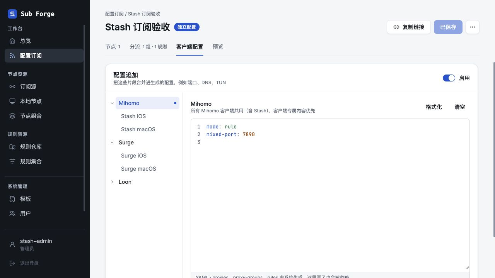

## 父子菜单背景对齐

去掉子项独立的 14px 行内缩进，改为与箭头占位共享 18px 宽度，让父级文字按钮和子项按钮的选中、悬停背景左右边缘一致；保留子项文字缩进。

Web 构建（含类型检查）通过。内置浏览器展开三组后实测九个目标按钮左边缘均为 299px、右边缘均为 464px；Stash iOS 可正常选择，浏览器错误日志为空。本次无业务逻辑改动，未重复运行单元测试。

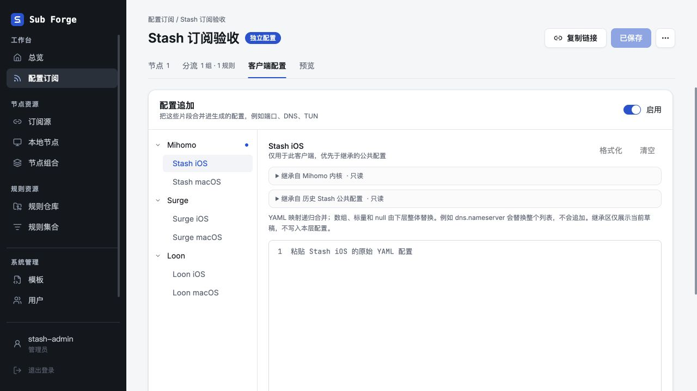

## 继承区直接展示

本节取代早期折叠卡片及空态提示设计。继承区移除外层卡片和折叠标题；公共原文非空时直接展示 CodePreview，空值和纯空白不渲染继承区。来源、只读状态与合并规则位于代码区内部底部的独立 footer，不混入原文，不写入客户端配置。多层历史公共原文仍按继承顺序独立展示。

Web 构建（含类型检查）通过；Web 回归 351 项通过、2 项既有跳过。内置浏览器使用内存测试数据确认：修改 Mihomo 公共草稿后，Stash iOS 立即显示最新原文，追加文本框仍为空；继承区无 details/summary、无可编辑字段和外层边框，提示位于代码区内部。Surge iOS 在公共配置为空时不出现继承区；为 Surge 输入 INI 草稿后立即显示原文与 INI 合并说明。浏览器错误日志为空。

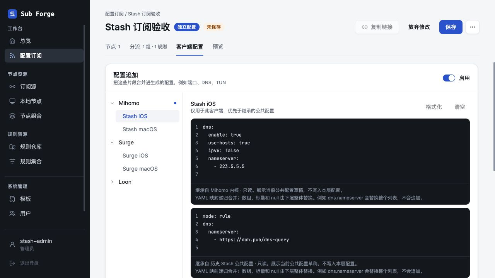

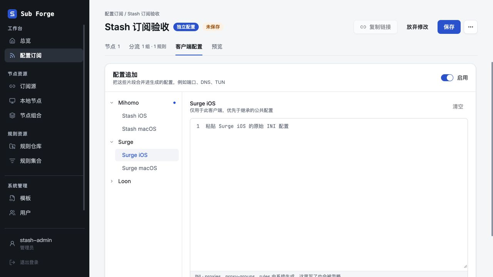

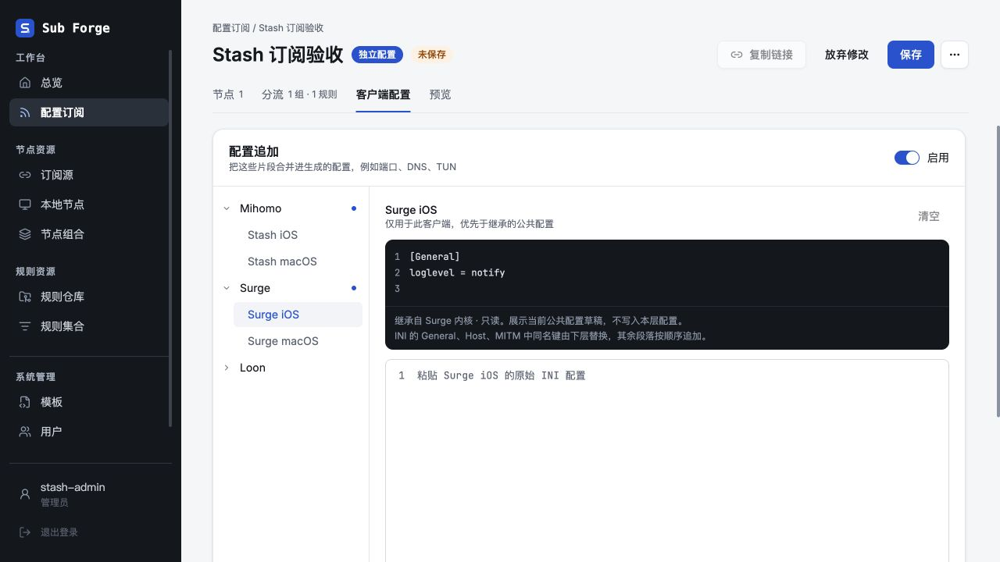

## 精简编辑工作区设计

用户要求删除截图中的重复标题、优先级说明和长篇合并解释。本轮按 frontend-design 技能先收敛布局，再实现与验收。

- 配色沿用当前产品：编辑底色 #ffffff，正文 #15181d，次要文字 #5b6270，选择色 #2952cc，分隔线 #e3e6eb，只读代码底色 #14171c。
- 字体沿用 Inter / 苹方界面文字与 JetBrains Mono 代码文字，不改变选中项字重。
- 左侧导航只负责当前目标；右侧从代码开始，不再重复客户端名称。非空继承原文下面仅保留一行来源与只读状态。
- 编辑器底栏左侧显示 YAML / INI，右侧放格式化、清空；不再有悬在继承区上方的工具栏和外部说明段落。
- 合并语义与保留字段约定继续写在文档中，界面不重复解释；原文、草稿与实际合并行为不变。

```text
配置目标             继承原文（有内容才展示）
  Stash iOS          继承自 Mihomo 内核 · 只读
                     ┌ 当前目标追加原文 ──────────────┐
                     │                                │
                     ├────────────────────────────────┤
                     │ YAML              格式化  清空 │
                     └────────────────────────────────┘
```

实施前复核：保留本产品已有的深色只读、白色编辑语义，不添加新卡片、装饰标题、颜色或说明。去掉最初考虑的编辑器顶栏，将操作并入底栏，进一步减少重复结构。

实现后复核：客户端不再在右侧重复显示标题，继承区只留一行来源，白色编辑器底栏承载格式与操作。实际截图中两个代码区左边缘一致，无嵌套卡片和外部解释段落，空公共配置时只显示编辑器。

Web 构建（含类型检查）通过；Web 回归 351 项通过、2 项既有跳过。内置浏览器通过界面在内存测试环境新建无历史数据的示例，填入 Mihomo 公共 DNS 与 Stash iOS 追加；公共草稿实时展示，格式化只改变追加的排版，清空追加不改变公共原文，重新填写后保存成功。DOM 检查确认右侧重复标题及长说明已移除。Surge iOS 空公共配置不显示继承区，底栏只有 INI 与清空，没有 YAML 格式化按钮。浏览器错误日志为空。

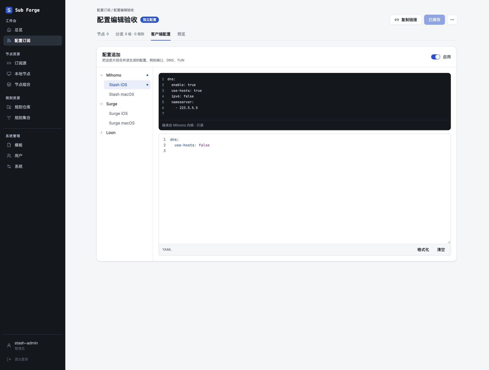

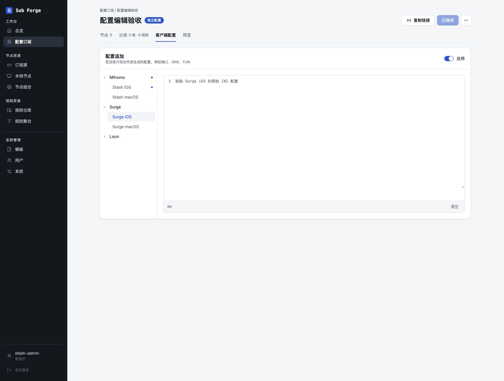

## 必要说明修正

用户纠正：上一轮删掉了必要说明，本轮以本节取代「界面不解释合并语义与保留字段」的设计。沿用已有颜色、字体及上下两个代码区，只调整编辑器内部底栏的信息层次。

- 继承区保留来源与只读标识，不再解释其草稿实现。
- 编辑器底栏第一行根据上下文说明用途：内核页说明共用范围；有公共配置的客户端页说明合并与覆盖规则；没有公共配置时仅说明当前客户端专用。
- 底栏第二行只说明一次「节点、策略组和规则由系统生成，请勿在此填写。」格式化与清空保留在右侧，窄区允许操作换行。
- YAML 文案为「合并字段，客户端优先；列表整体替换。」INI 文案为「General、Host、MITM 同名键覆盖，其他段落追加。」不恢复重复客户端标题和大段示例说明。

实施前复核：保留会影响填写决策的用途、覆盖规则与系统管理边界；删除的是重复描述，不能再把全部说明移出界面。

Web 构建（含类型检查）通过；Web 回归 351 项通过、2 项既有跳过。内置浏览器在内存环境中验证公共页、无公共内容客户端页、有继承的 YAML/INI 客户端页：提示随上下文切换，空继承区继续隐藏，未保存公共原文实时更新。YAML 追加保存成功；DOM 确认系统管理字段说明只出现一次、提示位于编辑器内部、右侧没有重复标题。浏览器错误日志为空。

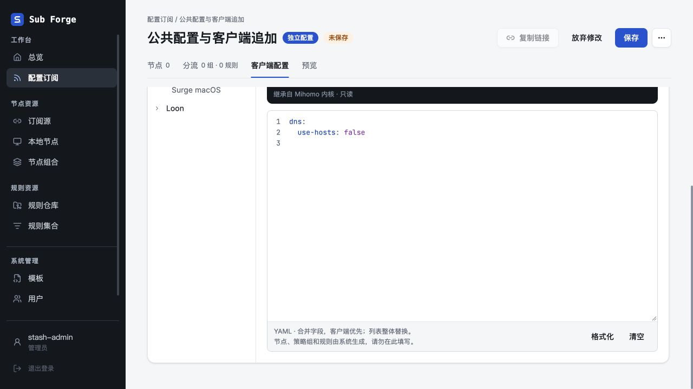

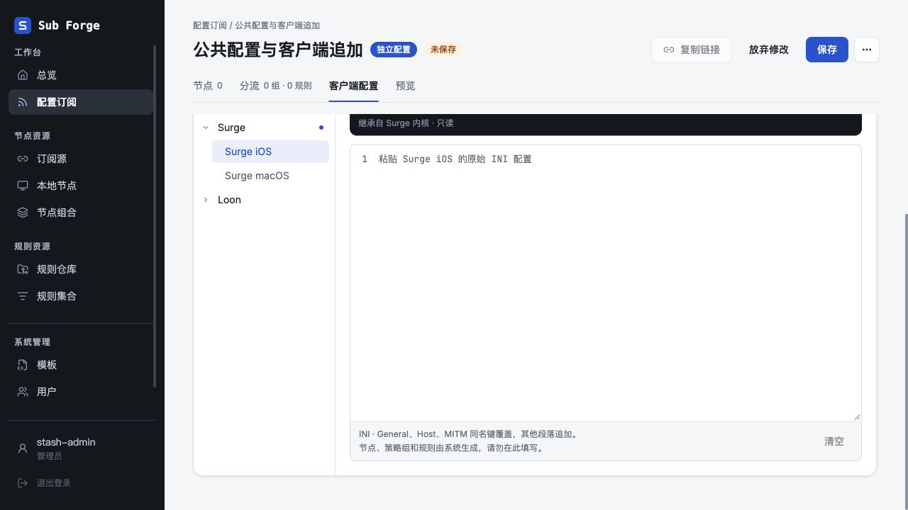
