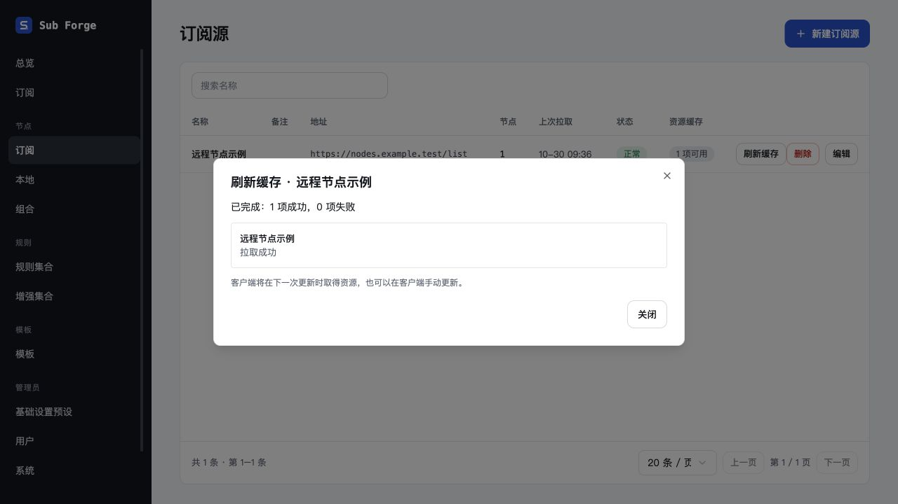

# 统一缓存与主分支整合验收（2026-10-30）

用户已授权合并。合并前 main 为 `99e6c95`，缓存分支为 `08c32d7`。先在缓存 worktree 整合 main 的官方组件、规则草稿与订阅编辑器改动，验证后合入 main；不推送、不删除工作树。

## 冲突处理

- 保留缓存统一设置、SSE、无时间缓存、刷新操作与失败告警。
- 保留 main 的官方 Dialog 及主题命名；新缓存任务弹窗改用官方组件，不恢复旧 Modal。阻止弹窗事件冒泡到表格行，避免查看结果时误跳详情。
- 保留主分支规则编辑草稿与订阅编辑器更新；合并双方文档记录。
- 依赖锁文件沿用主分支，检查无 Playwright 安装声明后使用 frozen-lockfile 安装工作树依赖；锁文件中的相关条目仅为 Vitest 的可选 peer 声明。

## 验证

- `pnpm test`：core 260 通过/39 跳过，server 443 通过/5 跳过，web 302 通过/2 跳过，共 **1005 通过、46 跳过**。跳过条件与此前一致。
- `pnpm typecheck`、前端生产构建、`git diff --check` 均通过。构建仍有既有大包体提示。
- Codex 内置浏览器使用内存数据库和模拟上游：节点列表刷新出现官方弹窗，完成显示 1 项成功/0 项失败；点击任务名称仍停留弹窗，关闭后仍停留列表。
- 本次未重新执行所有上一轮场景，之前记录保留；未执行真实客户端或生产验收。外部设计画布仍未同步。
- 自建浏览器标签已关闭，本次 18769 验收服务已终止。

