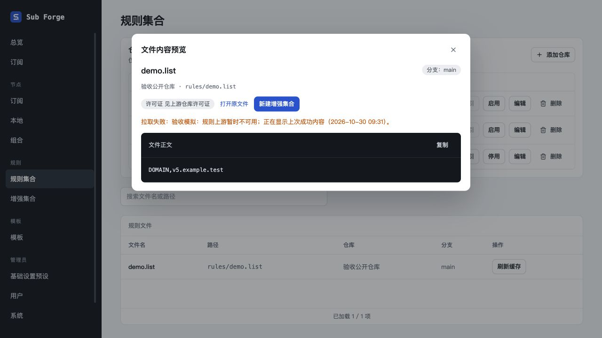
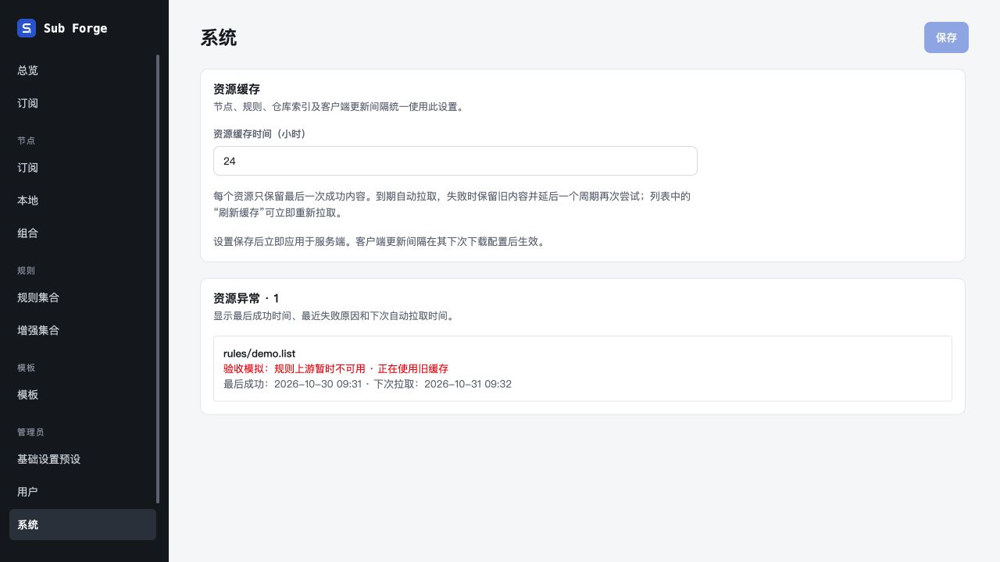

# 统一资源缓存补充审查（2026-10-30）

分支 `codex/unified-resource-cache`，独立工作树 `.Codex/worktrees/unified-resource-cache`。本轮审查缓存刷新、失败回退、并发及权限隔离，直接修复并补测试；不合并、不推送、不部署。此前验收记录保持原样。

## 发现与修复

| 范围 | 问题与修复 |
| --- | --- |
| 缓存身份 | 新建订阅草稿的直接远程规则缺少用户作用域，可能跨用户复用；补齐作用域。旧快照首次绑定须匹配当前参数和权限，避免不同 UA 草稿复用旧快照。 |
| 权限隔离 | 递归节点和本地规则引用增加运行时归属检查；公共管理员规则失去公共资格后禁止通过 last_good 或历史版本继续下发。订阅、provider 和转换入口在等待渲染后重新检查 token。 |
| 并发写入 | 校验晚完成可能覆盖新配置或新快照；记录配置与成功/尝试快照修订，变化后重新渲染。删除订阅后不得重新写成功配置；校验期间新发生的失败告警也不能丢失。 |
| 刷新任务 | 重复任务合并；任一 worker 抛错后等待其余 worker 结束，避免任务提前完成。执行前、刷新后和渲染后复核根文档及依赖。停止后禁止新增调度。 |
| 二进制校验 | 推断的 MRS 参数用于实际拉取；必须为真实二进制且内容类型符合声明，文本伪造解码标记不能通过。模板自检不再跳过 MRS 读取失败，SRS 明确拒绝。 |
| 调度与回退提示 | 已浏览但未引用的仓库正文参与后台到期检查与系统异常汇总。文件预览回退时显示失败原因和真实成功时间；任务完成主动重读查询。 |
| 生命周期 | 修复 SSE 写出期间变更丢失与关闭等待；仓库详情仅合并在途任务，退出等待全部任务。来源换地址/删除后回收失去引用的旧绑定和原文，迟到响应不复活已删除来源缓存，保留其他来源共享内容。 |

首批 5 项新增测试先复现为失败，再修复为通过。新增 `packages/server/test/cache-review.test.ts` 共 19 项回归测试；模板二进制自检测试同步调整为实际拉取后的新预期。没有增加数据库 schema 或产品配置字段；进程内配置修订只用于保护异步回写。示例种子无需变更。

## 自动验证

| 检查 | 结果 |
| --- | --- |
| `pnpm test` | core 260 通过、39 跳过；server 443 通过、5 跳过；web 292 通过、2 跳过；合计 **995 通过、46 跳过** |
| `pnpm typecheck` | 三个包全部通过；后续后端修改再次执行 server 类型检查通过 |
| `pnpm --filter @sub-forge/web build` | 通过，保留已有大包体提示 |
| 最终定向测试 | cache-review、store、source-url 共 43 项通过 |
| `git diff --check` | 通过 |

46 项跳过沿用项目既有条件，包含缺少环境开关/二进制的真实 Mihomo 集成与两个缺少协议 fixture 的前端测试，没有记作通过。

## 内置浏览器验收

使用 Codex 内置浏览器和已有 `manual-resource-cache-server.ts`，127.0.0.1:18769，内存数据库与虚构上游。本轮未安装或调用 Playwright 工具，也未使用其他浏览器。

| 步骤 | 观察结果 |
| --- | --- |
| 管理员打开尚未引用的 `rules/demo.list` | 首次成功显示 `DOMAIN,v5.example.test` |
| 将模拟上游切换为失败，点击文件刷新缓存 | 任务完成显示 0 项成功、1 项失败，提示继续使用上次成功内容 |
| 再打开正文预览 | 显示失败原因和最后成功时间，正文仍为 v5，没有伪造 v6 成功内容 |
| 打开系统页 | 异常数为 1，包含该尚未引用的文件；显示旧缓存、10 月 30 日 09:31 最后成功、10 月 31 日 09:32 下次拉取 |

验收结束关闭自建标签页、终止本次测试服务，并检查端口及进程退出。

## 验证边界

- 浏览器使用模拟上游，没有访问生产数据、等待真实 24 小时或执行真实 Mihomo/Stash 客户端更新；时间边界、权限撤销和并发由服务端回归测试验证。
- 外部 Claude Design 画布此前实查要求登录，仍未完成画布同步；本轮只同步本地文档及实现，已登记 `docs/11-design-coverage.md`，不将画布同步记为完成。
